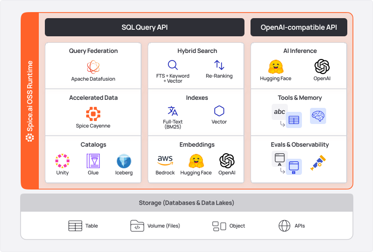

<p align="center">
  <a href="https://spice.ai">
    
  </a>
</p>

<h3 align="center">The portable data lakehouse for every agent.</h3>

<p align="center">Serve enterprise data to agents securely and at scale on object storage.</p>

<p align="center">
  <a href="https://opensource.org/licenses/Apache-2.0"></a>
  <a href="https://github.com/spiceai/spiceai/stargazers"></a>
  <a href="https://spice.ai/slack"></a>
  <a href="https://x.com/intent/follow?screen_name=spice_ai"></a>
</p>

<p align="center">
  <a href="https://spiceai.org/docs"><b>Docs</b></a> ·
  <a href="#quickstart"><b>Quickstart</b></a> ·
  <a href="https://github.com/spiceai/cookbook"><b>Cookbook</b></a> ·
  <a href="https://github.com/spiceai/skills"><b>AI Skills</b></a> ·
  <a href="https://spice.ai/blog"><b>Blog</b></a>
</p>

**Spice** gives each app and agent fast, sandboxed access to only the data it needs, through a single SQL endpoint for retrieving, accelerating, searching, and reasoning over operational and analytical data. It's incrementally adoptable, deploys anywhere from a laptop to a cluster, and stays simple to operate from one deployment to thousands.

This repository contains Spice.ai Open Source: the Apache-2.0 runtime (`spiced`) and CLI (`spice`), a single Rust binary built on [Apache DataFusion](https://datafusion.apache.org), [Apache Arrow](https://arrow.apache.org), [Apache Ballista](https://datafusion.apache.org/ballista/), [Apache Iceberg](https://iceberg.apache.org), and [Vortex](https://github.com/vortex-data/vortex). [Spice.ai Cloud](https://spice.ai) and [Spice.ai Enterprise](https://docs.spice.ai/docs/enterprise) are managed and enterprise distributions built on it.

<p align="center">
  
</p>

## Quickstart

Install the CLI on macOS, Linux, or WSL:

```bash
curl https://install.spiceai.org | /bin/bash   # or: brew install spiceai/spiceai/spice
```

Or let your coding agent set it up. Install [Spice Skills](https://github.com/spiceai/skills), and your agent can write and run the Spicepod for you:

| Agent        | Install                                                                                   |
| ------------ | ----------------------------------------------------------------------------------------- |
| Claude Code  | `/plugin marketplace add spiceai/skills`, then `/plugin install spiceai@spiceai`          |
| Codex        | `codex plugin marketplace add spiceai/skills`, then `codex plugin add spiceai@spiceai`    |
| Other agents | `npx skills add spiceai/skills -a <agent>`                                                |

<details>
<summary>Or paste this prompt into any coding agent</summary>

```text
Install the Spice.ai skills from github.com/spiceai/skills, using one method:
- Claude Code: `claude plugin marketplace add spiceai/skills`, then `claude plugin install spiceai@spiceai`
- Codex: `codex plugin marketplace add spiceai/skills`, then `codex plugin add spiceai@spiceai`
- Other agents: `npx skills add spiceai/skills -a <agent-id>`
Then follow the setup skill (skills/setup/SKILL.md) to run Spice in this project and show me a SQL query result.
```

</details>

To run it yourself, create an app, add the sample Spicepod, and start the runtime:

```bash
spice init spice_qs && cd spice_qs
spice add spiceai/quickstart
spice run
```

The `spiceai/quickstart` Spicepod declares one dataset, Parquet files in S3 accelerated locally with Spice Cayenne:

```yaml
datasets:
  - from: s3://spiceai-demo-datasets/taxi_trips/2024/
    name: taxi_trips
    params:
      s3_auth: public
      file_format: parquet
    acceleration:
      enabled: true
```

In a second terminal, open the SQL REPL with `spice sql` and query the ~3M accelerated rows:

```sql
SELECT trip_distance, total_amount FROM taxi_trips ORDER BY trip_distance DESC LIMIT 10;
```

Next, connect your own sources with the [data connector docs](https://spiceai.org/docs/components/data-connectors) or browse end-to-end recipes in the [Cookbook](https://github.com/spiceai/cookbook). On Windows, run the runtime under WSL or Docker; see the [installation docs](https://spiceai.org/docs/installation).

## The data primitives agents need in one runtime

- **SQL federation and acceleration.** Connect to and query operational databases, data lakes, and warehouses through a single SQL endpoint. Materialize and accelerate working sets in memory or on disk with Spice Cayenne for sub-second access, with secondary indexes for point lookups.
- **Analytics replica.** Run large analytical queries against an analytics replica of your operational database, kept current through high-throughput CDC.
- **Hybrid search.** Combine structured filters, vector similarity, and keyword matches in one SQL query with `vector_search`, `text_search`, `rrf`, and `rerank`, then rank the merged results by relevance.
- **AI gateway and SQL functions.** An OpenAI-compatible gateway to local and hosted models, with AI SQL functions, MCP tools, memory, evals, and observability built into the runtime.

## Use cases

- **Agent data serving.** Serve each agent federated SQL across its sources, with hot datasets accelerated locally for sub-second queries and search and tools built in. Each agent sees only the datasets it declares, and Spice holds the source credentials. [MCP recipe](https://github.com/spiceai/cookbook/blob/trunk/mcp/README.md)
- **Fast queries without ETL delays.** Run federated SQL across operational databases, warehouses, and APIs, and accelerate the hot path with fewer pipelines to maintain. [Federation recipe](https://github.com/spiceai/cookbook/tree/trunk/federation)
- **Real-time analytics on operational data.** Give dashboards, BI tools, and agents near real-time analytical queries over operational data, served from the replica instead of the production database. [CDC docs](https://spiceai.org/docs/features/cdc)
- **One standard lakehouse for every tenant.** Define the lakehouse once in a Spicepod and deploy it for each customer, team, or agent, each with its own sources and settings. [Multi-tenancy patterns](https://spice.ai/blog/multi-tenancy-for-ai-agents-without-pipelines)

## Interfaces

| Interface            | Protocols and APIs                                                        |
| -------------------- | ------------------------------------------------------------------------- |
| SQL query and search | HTTP, Arrow Flight, Arrow Flight SQL, ODBC, JDBC, ADBC                    |
| AI inference         | OpenAI-compatible chat, responses, and embeddings; local GPU inference    |
| Agents and tools     | MCP server and gateway (Streamable HTTP), NSQL text-to-SQL                |
| Open table formats   | Iceberg REST Catalog API for query and write                              |
| SDKs                 | [Python, Go, Rust, Java, JavaScript, .NET](https://spiceai.org/docs/sdks) |

## Integrations

40+ integrations with databases, warehouses, data lakes, HTTP APIs, and AI providers. See them all at [spice.ai/integrations](https://spice.ai/integrations).

| Component                                                                  | Highlights                                                                                      |
| -------------------------------------------------------------------------- | ----------------------------------------------------------------------------------------------- |
| [Data connectors](https://spiceai.org/docs/components/data-connectors)     | PostgreSQL, MySQL, MongoDB, Snowflake, Databricks, BigQuery, Iceberg, Delta Lake, S3, Kafka     |
| [Data accelerators](https://spiceai.org/docs/components/data-accelerators) | Spice Cayenne (Vortex), in memory or on disk                                                    |
| [Catalogs](https://spiceai.org/docs/components/catalogs)                   | Unity Catalog, AWS Glue, Databricks, Iceberg, DuckLake, PostgreSQL, Spice.ai                    |
| [Models](https://spiceai.org/docs/components/models)                       | OpenAI, Anthropic, xAI, Amazon Bedrock, Google Vertex AI, Databricks, Hugging Face, local files |
| [Embeddings](https://spiceai.org/docs/components/embeddings)               | OpenAI, Amazon Bedrock, Google Vertex AI, Azure OpenAI, Hugging Face, Model2Vec                 |
| [Vector search](https://spiceai.org/docs/features/search/vector-search)    | Spice Cayenne vector indexes, Amazon S3 Vectors, Elasticsearch                                  |
| [Secret stores](https://spiceai.org/docs/components/secret-stores)         | Environment, Kubernetes, OS keyring, AWS Secrets Manager, HashiCorp Vault, Azure Key Vault      |

Each component page lists every supported option and its release status. Spice Cayenne is the default accelerator; the Arrow, DuckDB, SQLite, and PostgreSQL accelerators are deprecated in v2.4 and removed in v2.5. See the [migration guide](https://spiceai.org/docs/components/data-accelerators/cayenne/migration).

## Deploy anywhere

Run Spice.ai Open Source locally, at the edge, or on the fully managed [Spice.ai Cloud Platform](https://spice.ai). Spice runs as a single node, as a sidecar next to each app or agent, or as a multi-node cluster.

```bash
docker pull spiceai/spiceai                                                             # Docker
helm repo add spiceai https://helm.spiceai.org && helm install spiceai spiceai/spiceai  # Kubernetes
```

Spice is also available on the [AWS Marketplace](https://aws.amazon.com/marketplace/pp/prodview-jmf6jskjvnq7i). For multi-node deployments, see the [distributed query docs](https://spiceai.org/docs/features/distributed-query), the [cluster-sidecar architecture](https://spice.ai/blog/cluster-sidecar-architecture), and the [Apache Ballista deep dive](https://spice.ai/blog/apache-ballista-at-spice-ai).

## Learn more

- [Documentation](https://spiceai.org/docs) and [FAQ](https://spiceai.org/docs/faq)
- [Cookbook](https://github.com/spiceai/cookbook): recipes for federation, acceleration, search, RAG, CDC, and agents
- [Blog](https://spice.ai/blog): engineering deep dives, including [Spice 2.0](https://spice.ai/blog/spice-2-0-is-now-available), [the analytics replica pattern](https://spice.ai/blog/the-analytics-replica-pattern-shortening-the-path-to-data-based-ai), [Cayenne and Vortex](https://spice.ai/blog/vortex-at-spice-ai-the-columnar-format-for-data-intensive-workloads), and [Apache Iceberg](https://spice.ai/blog/apache-iceberg-at-spice-ai)
- [YouTube](https://www.youtube.com/playlist?list=PLesJrUXEx3U9anekJvbjyyTm7r9A26ugK): talks and demos, including [Spice at the CMU Database Group](https://www.youtube.com/watch?v=tyM-ec1lKfU)
- [Releases](https://github.com/spiceai/spiceai/releases) and [Roadmap](docs/ROADMAP.md)
- [Extensibility](docs/EXTENSIBILITY.md): build custom connectors, accelerators, catalogs, secret stores, and models

## Contributing

Contributions are welcome. Read [CONTRIBUTING.md](CONTRIBUTING.md) to get started, browse [open issues](https://github.com/spiceai/spiceai/issues), or [file a new one](https://github.com/spiceai/spiceai/issues/new).

## Community

Join us on [Slack](https://spice.ai/slack), follow [@spice_ai](https://x.com/spice_ai) on X, connect on [LinkedIn](https://www.linkedin.com/company/74148478), or email [hey@spice.ai](mailto:hey@spice.ai). We're [hiring](https://spice.ai/careers).

⭐️ Star this repo to follow new releases.
