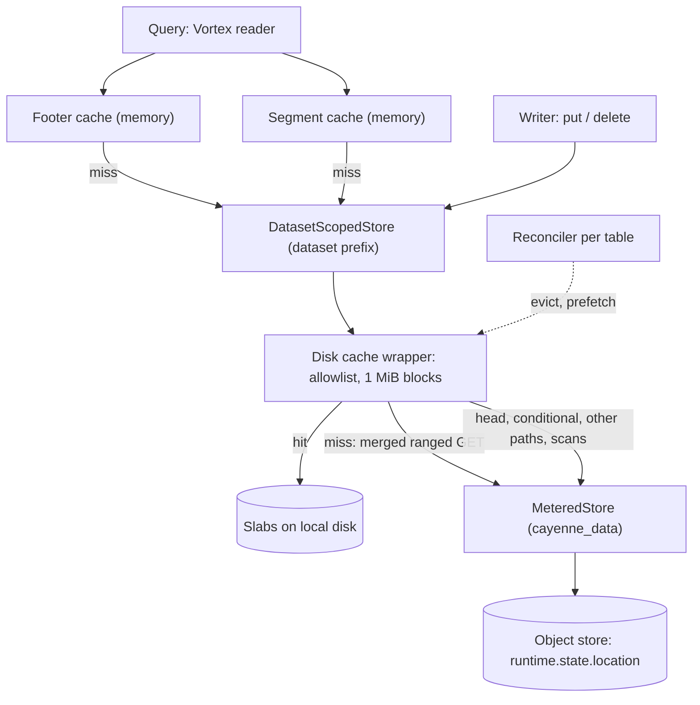

# Cayenne object-native disk cache: technical design

Status: **draft for discussion.** This document describes a node-local disk
cache for Cayenne data files kept in an object-store `runtime.state.location`
(`runtime.params.cayenne_vnext: enabled`). It covers the components, the rules
each follows, the on-disk format and the evidence behind each choice. The
user-facing surface is Enhancement
[#15971](https://github.com/spiceai/spiceai/issues/15971), which has not been
signed off. Every name a user would see here (the parameter, the directory,
metrics and log lines) is marked **for review** until it is.

The cache is built in two parts. The `object-store-cache` crate holds the cache
itself: the slab store, the read path, prefetch and eviction. The wiring into
Cayenne and the runtime installs the cache, chooses what it may hold, and
reconciles it with each table's committed state
(`crates/cayenne/src/disk_cache.rs`, the object-native catalog, the table
provider, the Cayenne accelerator and `crates/runtime/src/builder.rs`). Each
section says which part it describes, and
[Implementation status](#implementation-status) lists both.

**How to read it.** The [Summary](#summary) gives the whole design. The
mechanism follows: [placement](#placement-memory-disk-object-store),
[identity](#cache-identity-and-keys), the [read path](#the-read-path), the
[write path](#the-write-path-and-deletes) and
[reconciliation](#reconciliation). The [on-disk format](#on-disk-format),
[recovery](#recovery), [budget and eviction](#budget-and-eviction) and
[concurrency](#concurrency) sections are reference material. The
[failure semantics](#failure-semantics), the
[configuration](#configuration), [observability](#observability) and
[performance](#performance-characteristics) come next. Then the
[alternatives](#alternatives-considered), [limitations](#limitations),
[open decisions](#open-decisions-and-follow-ups) and the
[invariants](#appendix-invariants).

**Where the numbers come from.** Two rigs produced them.

- *The harness* ran the Vortex reader under DataFusion, not `spiced`, on TPC-H
  SF10 `lineitem` as the 11 files Cayenne's writer produced (1.87 GB). Store
  latency was modeled on S3 Standard: first byte median 25 ms, P99 100 ms. The
  host was one Apple laptop with an external SSD, one client, three
  interleaved repetitions, and an A/A pair to give the noise floor. P99 is
  nearest-rank over 1,000 queries. Every arm returned the same rows. The
  harness measured a prototype of this design, before the slab store and the
  current eviction rule, so its numbers rank designs. They are not a promise
  for `spiced`.
- *Through `spiced`* means a release build of `spiced` against a RustFS bucket
  behind a proxy that adds 20 ms to every request, driven by a spicescript
  scenario. The [baseline](#measured-through-spiced) without the cache is in;
  the comparison with the cache on is under [Results](#results).

Neither rig is real S3. Real S3 in-region is the gate for turning
`cayenne_vnext` on by default, not for this cache.

**Terms.** The *location* is `runtime.state.location`. A *data file* is a
`.vortex` file a snapshot's manifest names; a *deletion vector* is an `.arrow`
file under a table's `deletions/` directory. A *block* is a 1 MiB aligned byte
range of one object. A *slab* is one append-only file of packed blocks. The
*writer* is the instance that ingests into a dataset; a *reader* serves the
dataset from the location without writing it. A Spicepod cannot make an
instance a reader today, because the writer lease cannot be configured.
*Retired* files have left the live set but stay readable for
`DATA_FILE_RETENTION` (one hour).

## Summary

A Cayenne dataset in an object-store location reads its data files over the
network. Its memory caches (the footer cache and the segment cache) are small
and empty after every restart. Each Spice instance with
`cayenne_vnext: enabled` and an `s3://` location registers a disk cache of the
location's immutable data objects and opens it when its first object-native
catalog is created, unless
`runtime.params.cayenne_disk_cache_mb` is `0`. Reads fill it in 1 MiB blocks. Each table's committed
state decides what it keeps: files a table no longer references, or retired
longer than the retention, are evicted. After a restart, or on a node that did
not write a file, the footer ranges of every live file are prefetched first,
then whole files only into free space.

| Component | Why it is needed |
|---|---|
| **1 MiB byte blocks of immutable objects**, keyed by backend namespace, path, object size, block size and index | Format-independent and below the Vortex reader, so adjacent misses merge into one GET. 1 MiB had the best first-lookup P99 of the sizes measured. Objects in the allowlist are written once under unique names, so a block never needs revalidation. |
| **An allowlist**: `.vortex` data files outside staging, and deletion vectors | Only kinds that are created once and never rewritten in place. Heads, manifests, logs and lookup-index runs never enter the cache. |
| **Single flight per block, with a bounded wait** | Two queries reading one block cost one GET. A waiter gives up after 1 s and reads the store itself. |
| **Entry writes after the read returns** | A slow disk write never delays or fails a query. On the harness, one slow entry write was inside 52 of 54 slow first queries. |
| **Packed slabs with a per-slab index** | Opening a cache of 1,000,000 entries took 0.10–0.16 s across the index formats measured, against 2.7–2.8 s with one file per block. |
| **CRC32C per 64 KiB chunk, verified on every read** | A hit reads and verifies only the chunks it needs, so a small read costs a small read. A same-length corruption in a chunk that is read reads as a miss and is refetched, never served. |
| **Durable tombstones that fail closed** | A removed block never returns after a restart. An unreadable tombstone file discards its whole slab. |
| **A budget that follows free space**, reclaimed by whole slab weighed by a read-frequency sketch | The cache yields when another writer fills the volume, and keeps the slabs whose blocks are read most per byte. |
| **Reconciliation with committed state** | Retired and dropped files leave the cache; footers of new files arrive before the first query that needs them. |
| **Evict before delete** | A crash between the two can only cost a refetch. A deleted object is never served after a restart. |

## Goals and non-goals

Goals:

- Warm point lookups at local-disk latency when the working set fits the
  budget, with about zero store GETs per query.
- Restarts that keep the cache: the first queries after a restart are served
  from disk, not from the store.
- Queries keep answering from resident blocks while the store fails, on the
  writer (see [Limitations](#limitations) for readers).
- Identical rows with the cache on or off. A cache error never fails a read
  the store can serve.
- Bounded resources: disk within the budget and below the volume's free
  space, a bounded share of memory, and work off the query path.

Non-goals for v1:

- **Sizing from the container's disk entitlement.** v1 sizes the cache from
  memory unless a size is set
  ([Kubernetes and sizing](#kubernetes-and-sizing)).
- **Write-through.** The writer does not keep the files it uploads. It already
  holds their footers and new segments in memory; through `spiced`, the
  writer made 0.00012 data reads per query after a full refresh.
- **Keeping a dataset fully local** ("keep-local"). This needs its own
  Enhancement.
- **A shared cache between instances**, peer fetch, or a faster second bucket.
- **Local-directory locations.** A `file://` location is already local disk;
  no cache is installed.
- **Cluster mode.** A cluster scheduler or executor keeps the SQLite metastore
  and local data path under the flag, so there is nothing to cache.

## What it builds on

- **Object-native data in the location.** Under `cayenne_vnext`, a dataset's
  data files live in the location under
  `<location>/cayenne/v1/datasets/<folder>/data/`. The layout is flat:
  `<table_id>/<write_id>_<n>.vortex` for data files and
  `<table_id>/deletions/delete_<uuidv7>.arrow` for deletion vectors. A
  snapshot is the set of files its manifest names
  ([Cayenne: data in the location](../cayenne/cayenne.md#data-in-runtimestatelocation-cayenne_vnext)).
- **Immutable object names.** Writes put each file once, at its final key,
  and a retry writes new keys. The sink mints a fresh UUIDv7 write id per
  write; deletion vectors take UUIDv7 names; a recreated dataset takes a new
  folder. The cache relies on this and never checks a resident block against
  the store again.
- **Committed state as the only record of files.** A scan reads its file set
  from manifests and never lists. The same state gives reconciliation the
  live set, the retired set and each file's size, with no HEAD.
- **`DatasetStorage` and `DatasetScopedStore`.** Every data read, put and
  delete of a dataset goes through its scoped store, which refuses paths
  outside the dataset's prefix. `DataFileKind::of` classifies a path as a
  data file or a deletion vector; applied to the part of a path under a
  dataset's data path, it is the cache's allowlist.
- **`MeteredStore`.** The location's data store is wrapped by
  `metered(store, CayenneData)`, which counts requests in
  `state_store_request_duration_ms{feature="cayenne_data"}`. The cache goes
  above the meter, so that series counts only misses and prefetch: real store
  traffic.
- **The Vortex footer and segment caches.** `cayenne_footer_cache_mb` sizes a
  process-wide footer cache and `cayenne_segment_cache_mb` a process-wide
  segment cache (1/64 of memory, clamped to 256 MiB–2 GiB). On trunk, a
  footer-cache miss stores the footer only when the initial tail read did not
  also supply a complete row-data segment. On a node that did not write the
  file, or after a restart, a file whose tail read also covers row data then
  re-reads its tail on every open: through `spiced`, a point lookup made
  3.99–4.0 data reads after every restart measured. A separate change makes an open that read the footer from storage
  store it, with the complete segments its tail read covered. It lands before
  the cache and is in both arms of every cache measurement.

## Placement: memory, disk, object store

The cache is an `ObjectStore` wrapper between the dataset's scoped store and
the metered location store. It sees only byte-range reads of objects. The
Vortex reader above it, and its memory caches, are unchanged.



*Diagram 1: the three layers. Memory caches hold decoded footers and segments;
the disk cache holds raw blocks; the store holds everything. The metastore's
own store (heads, batches, checkpoints) is a separate store and never passes
through the cache.*

| Layer | Holds | Survives restart | Size |
|---|---|---|---|
| Footer cache | Decoded Vortex footers | No | `cayenne_footer_cache_mb` |
| Segment cache | Decoded column segments | No | `cayenne_segment_cache_mb` |
| Disk cache | Raw 1 MiB blocks of data files and deletion vectors | Yes, while the volume does | `cayenne_disk_cache_mb` (for review) |
| Object store | Every object | Yes | Unbounded |

One cache serves the whole process: one directory, one budget and one
frequency sketch, shared by every dataset. The runtime opens it before any
dataset loads, beside the segment cache, and installs it as a process-wide
handle (`cayenne::disk_cache::install`). The object-native catalog wraps its
data store with the cache when the catalog is first created
(`ObjectNativeCatalog::with_disk_cache`), and every dataset in the location
reads through that store.

## Cache identity and keys

**Namespace.** A block key starts with a namespace that names the backend. The
caller derives it from everything that decides which bytes a path names: the
scheme, the endpoint, the bucket and the prefix, never credentials, since it is
written into every entry. `StoreIdentity::namespace`
(`crates/runtime-state-location/src/lib.rs`) is the hex BLAKE3 hash of those
four, each prefixed with its length, with the endpoint taken from the
effective S3 settings (`s3_endpoint`, or `AWS_ENDPOINT_URL` / `AWS_ENDPOINT`
from the environment), lowercased and with a trailing `/` trimmed. A changed
endpoint is a new namespace, so a bucket of the same name on another backend
never reuses old blocks. Only `s3://` locations get a namespace in v1; others
get no cache.

**Key.** A block's key is `(namespace, path, object size, block size, block
index)`. Its canonical encoding is length-prefixed strings followed by three
little-endian `u64`s. The index in memory and the reclaim sketch use a 128-bit
digest of that encoding (the first 16 bytes of its BLAKE3 hash). The full
encoding is stored in the entry's header and compared on every read, so a
digest collision is a miss, never another block's bytes.

**What the size protects, and what it does not.** A rewrite of a path at
another size never matches old blocks. A rewrite at the same size would. The
cache does not store or compare the e-tag as part of the key; it keeps the
e-tag and modification time as metadata to answer `get_opts` after a restart
without a HEAD. Safety therefore rests on the allowlist admitting only kinds
written once under unique names (see below).

## What is cached

Cached: reads of paths under a dataset folder's data path,
`<location>/cayenne/v1/datasets/<folder>/data/`, that `DataFileKind::of`
accepts: `.vortex` files outside a `_staging*` directory and `.arrow` files
under `deletions/`. Only the part of the path under the data path is
classified (`under_dataset_data` in the object-native registry), so the
location's own prefix never makes an object cacheable
(`DiskCacheBinding::cacheable` in `crates/cayenne/src/disk_cache.rs`).

Never cached, passed to the store unchanged:

| Request | Why |
|---|---|
| HEAD (`get_opts` with `head`) | Metadata is the store's answer. |
| Any read with `If-Match`, `If-None-Match`, modified-since, unmodified-since or a version | A conditional read asks the store a question. |
| Paths outside the allowlist: heads, manifests, batches, checkpoints, staging files | They are rewritten or conditionally replaced. |
| Lookup-index runs (`_lookup_index/**/*.run`) | They are written with an unconditional `put` under a name that is not derived from their bytes, so the same path can hold other bytes later. |
| Puts, multipart uploads, lists, copies, renames, deletes | Writes go to the store. The wrapper only updates its own state (see [The write path](#the-write-path-and-deletes)). |
| Empty ranges, invalid ranges, `get_ranges` with no ranges | The store returns its own result or error. |
| Scans: one read of more than `min(budget / 8, 64 MiB)` | Streamed from the store, never held in memory, never admitted. |
| Any location that is not `s3://` | No cache is opened: a local directory is already local disk. |

## The read path

The wrapper's `get_opts` and `get_ranges` serve allowlisted reads through the
cache. Everything below is in the crate.

### Sizing the object

A block key needs the object's size before any lookup. The wrapper takes it,
in order, from: a size it remembers, from reconciliation (`note_size`, with
the size the manifest records), a prefetch, a put, a listing or an earlier
HEAD (at most 65,536 objects per namespace, shared by every wrapper of it,
least recently used dropped first); the resident blocks' keys, which survive
a restart; and a HEAD on the first read in this process. A
failed HEAD sends the read to the store, which returns its own error.
`get_opts` also needs a modification time; one stored with the blocks is used,
and an entry whose metadata did not fit beside its key falls back to a HEAD
while the bytes still come from the cache. A modification time is never made
up.

Because reconciliation notes the size of every live file from the manifest,
a restarted node serves a live file without a HEAD even before any block is
resident.

### Block math

A read of bytes `[start, end)` touches blocks `start / 1 MiB` through
`(end − 1) / 1 MiB`. Block `i` covers `[i × 1 MiB, min((i + 1) × 1 MiB,
size))`; the last block of an object is short. Products saturate before they
are capped at the size, so the math is exact for any `u64` size. The read
returns one slice per block, cut to the requested range, without copies.

### Claim, look up, fetch

1. **Ticket.** The read takes a ticket on the object's gate, recording the
   object's eviction generation. Its entry writes carry the ticket.
2. **Claim.** Every block is claimed in the process's in-flight map before
   any lookup. A block another read or a prefetch already holds is awaited.
   Query reads count each block in the frequency sketch here.
3. **Look up.** Claimed blocks are read from the slab store in one batch.
   Entries of the object that sit next to each other in a slab are read with
   one `pread` of only the 64 KiB chunks that cover the requested range, into
   a reused 2 MiB buffer from a bounded pool; independent runs go to up to 16
   blocking threads. Each entry is checked on its own: its header, key and
   length, and the CRC32C of every chunk read. A corrupt entry is tombstoned
   alone, and a failed run sends only its own blocks to the store. A hit is
   handed to readers waiting on the block.
4. **Fetch.** Missing blocks are grouped into runs of consecutive blocks.
   Each run goes out as one ranged GET of at most 8 MiB, with 16 GETs in
   flight per read. Each GET runs as its own task, so a cancelled query does
   not cancel a fetch other reads wait on. A GET whose query was dropped
   releases its claims one wait period later.
5. **Check.** The store must report the size the blocks are keyed by and
   return exactly the bytes asked for. Otherwise the size is forgotten and the
   whole read goes to the store.
6. **Shared waits.** Blocks claimed by others are awaited until one shared
   deadline, 1 s after the wait starts. A block whose fetch failed, or did
   not finish in time, is read from the store directly by this read, without
   writing an entry.

On the harness, merging adjacent misses into one GET took the first TPC-H Q6
scan from 1,671 GETs to 466.

A store error on a fetch is returned to the query as the store's own error,
exactly as without the cache.

### Entry writes off the query path

A fetched block is handed to waiters and queued for writing; the read returns
without waiting. Writes have two queues of 64, demand ahead of prefetch, and
four run at once. A full demand queue drops the fill and counts it; a prefetch
fill waits for room. Hashing, encoding and CRC computation run on blocking
threads with the file I/O. A block stays in the in-flight map, with its bytes,
until its write finishes, so a read in between gets the bytes from memory
without a second fetch.

### Scans and compaction reads

A read larger than `min(budget / 8, 64 MiB)` is a scan: the wrapper passes it
to the store as is (`Pass::Scan` in `crates/object-store-cache/src/store.rs`).
Its bytes stream through, nothing is held or admitted, and the sketch does not
count it. On the harness, a full scan at a 512 MiB budget raised the next hot
phase's P99 by 11.9 ms over an idle control when admitted, and by 2.75 ms when
bypassed (noise floor 4.52 ms). The 64 MiB cap bounds a single read's memory
for any budget. Every read through the wrapper, a scan or a bypassed read
included, holds prefetch back until it returns (a streamed response: until its
stream ends, fails or is dropped).

The wrapper has one read class. Compaction reads data files through the same
wrapped store as queries, so on the writer it is served the same way: a read
over the scan threshold streams from the store and admits nothing, and a
smaller read is served from resident blocks, fills the cache and counts in the
sketch like a query's read.

## The write path and deletes

The writer's puts and deletes go through the same scoped store, so the wrapper
sees them (`crates/object-store-cache/src/store.rs`). Each change also drops
the wrapper's remembered size for the paths it changes.

- **Evict before delete.** For each batch of a `delete_stream` (at most 1,024
  paths), the cacheable paths are evicted durably (removed from the index,
  fenced, tombstoned) before the batch is forwarded to the store, and no fill
  of them is written until the store reports them deleted. Every data delete
  reaches `delete_stream`: the retirement sweep, the orphan sweep, dropped
  folders and `file_create` reloads. A crash between eviction and the remote
  delete leaves an object that is still in the store and no longer resident:
  one refetch, never a deleted object served.
- **Eviction failure does not block reclamation.** If durable eviction fails,
  the cache turns itself off for that namespace (stops serving and filling it)
  and forwards the delete.
- **Written here.** A successful put or completed multipart upload of a
  cacheable path records it in the namespace's written set (the 1,048,576 most
  recent per namespace). Reconciliation never prefetches a file this process
  wrote: the writer already holds its footer and segments in memory, and
  refetching each refresh's output would only cost egress. A delete, rename or
  overwrite through the wrapper removes the path from the set.
- **Put, upload or copy onto a resident path.** The target is evicted durably
  first, and no fill of it is written until the store's call returns (an
  upload: until it completes, is aborted or is dropped). Allowlisted paths are
  never rewritten, so this is defence, not a path the engine takes.
- **Rename** evicts the source and the target durably.

The cache never deletes anything from the store. Replicas never delete data
files at all.

## Reconciliation

Each table reconciles the cache with its committed state
(`CayenneTableProvider::reconcile_disk_cache` in
`crates/cayenne/src/provider/table.rs`, with `plan_prefetch`, `kept_keys` and
`reconcile_rounds` in `crates/cayenne/src/disk_cache.rs`). The crate provides
`evict_unreferenced`, `note_size`, `written_here` and `prefetch`. The table
reads its files from the object-native catalog (`cacheable_files`): the live
data files and deletion vectors with the sizes and sequences their commits
recorded, and the retired keys.

### When it runs

| Round | Typical node | Prefetch |
|---|---|---|
| Full round when the table opens (a background task the provider starts) | Writer after a restart (nothing written here yet), or a reader | Every live file not written here |
| After every reload of the table's state from the catalog (`confirm_head` → `reload_from_catalog`) | Reader | Only keys the last round did not see |
| Full round every 5 minutes, whether or not reloads came | Both | Writer: files from before its restart, into free space; reader: a full pass |

Rounds start at most one a second, hold only a weak reference to the table
between rounds, and stop when the table is dropped or its maintenance is
closed. A round does nothing while the table's committed state is not settled:
a change applied but not committed, a commit whose outcome is unknown, or a
transaction that reserves the table. A failed round is logged at WARN at most
once a minute per dataset, and at DEBUG otherwise.

Since a Spicepod cannot configure a reader, the path that prefetches whole
files this node did not write is reached through `spiced` by starting on an
empty data directory over the same location (step 6 of
`test/spicescript/object-native-read-cache.yaml`). The reader rows of the table
are exercised in process by `replica_prefetches_writer_files` in
`crates/cayenne/tests/disk_cache_test.rs`.

### What it evicts

The keep set is the table's live files plus its retired files whose retention
timer (the table's own, the one the retirement sweep uses, both through
`metastore_layout::retention_left`) has run less than `DATA_FILE_RETENTION`.
A round starts the timer of a retired file it sees for the first time, so a
retired file is kept for the full retention from then. Everything else in the
cache under the table's dataset prefix is evicted durably; objects of other
datasets are left alone. The crate's `evict_unreferenced` takes the
namespace, the dataset prefix and that keep predicate, walks only the objects
under the prefix (resident ones and those with reads in progress), and evicts
at once whatever the predicate rejects. The cache keeps no retention clock of
its own, so it never disagrees with the table's.

Retirement timers are in memory. After a restart they restart from the
retired set, so retired files can hold budget for up to an hour after a
restart.

### What it prefetches, and in what order

Candidates are the live files not written here, newest first by the highest
sequence number each holds, then by name (Cayenne names files with a
time-ordered id). Blocks already resident are not fetched again.

1. **Tails first.** For each data file: the range the Vortex reader's initial
   tail read covers (just under 64 KiB, the largest postscript plus the
   end-of-file marker), rounded out to whole blocks, so one or two blocks per
   file. Tails take at most 10 % of the cache's capacity per round; the files
   past that get no tail in that round.
2. **Then deletion vectors** whole.
3. **Then whole data files**, newest first, only into free room. Once one
   whole file is declined for lack of room, the round queues no older one.

The tail rule follows the measurements. On the harness, 17 of a cold point
lookup's roughly 30 GETs were footer or zone-map reads. Prefetching those
blocks at open (6.81 MiB, 0.093 s for 11 files) took the first point lookup's
median from 318 ms to 237 ms on a hot key set and from 298 to 218 ms on a
uniform one, with no warm or restart row worse beyond its noise floor. After a
restart whose first queries open every file of a 1 TB table, footer and
zone-map reads cost 30–91 s from the store and 0.20–0.55 s from the block
cache. Whole-file prefetch is what makes uniform lookups converge: blocks
filled only on demand left warm P99 at 71–77 ms, against 2.5 ms with the files
resident.

### The prefetch engine

`NodeCache::prefetch(namespace, path, size, ranges)` queues a job and returns.
In the crate:

- **Free room only.** A block is fetched only if its entry fits below the low
  watermark as the cache stands, with the room reserved before the GET. A
  prefetch never evicts and never brings a reclaim closer for a query. Blocks
  that do not fit are counted as declined.
- **Queries first.** A chunk starts only when no query read is waiting on the
  store or the disk, none ended in the last 20 ms, and no query's disk read
  took over 20 ms in the last second. Chunks in flight finish.
- **Bounded concurrency.** Four objects at once, chunks of four blocks, eight
  chunks in flight per object. A stalled object does not hold up the others.
  At most 4,096 jobs are queued or running; a prefetch past them is declined.
- **One fetch per block.** Prefetch claims blocks in the same in-flight map
  and leaves blocks a query is fetching to that query.
- **Ordered against eviction.** A job takes the object's ticket when queued;
  an eviction since then stops it from fetching or writing anything.
- **Not a read.** Prefetched blocks are not counted in the sketch.

## On-disk format

### Layout

All under the cache directory, `cache/objects/` under the Spice data
directory (`.spice/data/cache/objects/` by default, **for review**; everything
under `.spice/data/cache/` is disposable):

```text
<dir>/lock                    exclusive lock, taken before anything else
<dir>/slabs/slab-<id>.dat     packed entries, append-only
<dir>/slabs/slab-<id>.idx     index of a sealed slab
<dir>/slabs/slab-<id>.del     tombstones for entries removed from the slab
```

`<id>` is a zero-padded `u32`; slab numbers are never reused. A slab holds up
to 256 MiB, or a quarter of the budget when that is less (never less than one
entry). At most one slab is active and takes appends; a full one is sealed
and never appended to again, even after a restart.

### Entry

Each entry is a 4 KiB header page followed by the block's bytes, padded to the
next 4 KiB, so data starts page-aligned. One positional write covers the whole
entry.

| Bytes | Field |
|---|---|
| 0..4 | Magic `OSCB` |
| 4..6 | Version (3) |
| 6..8 | Metadata length |
| 8..10 | Key length |
| 10 | Log2 of the chunk size: 16 (64 KiB) for blocks up to 4 MiB, larger so the table holds at most 64 chunks |
| 11 | Zero |
| 12..16 | Data length |
| 16..20 | CRC32C of the data |
| 20..24 | CRC32C of bytes 0..20, the key, the metadata and the chunk table |
| 24.. | Canonical key, the object's metadata (e-tag, modification time), one CRC32C per data chunk, zero padding to 4096 |
| 4096.. | Data, zero padding to a 4 KiB boundary |

A hit verifies only the chunks it reads, so corruption in a chunk that no
read covers stays undetected and is never served. The whole-data CRC32C is
what the rescan after a crash verifies. A directory written in an earlier
entry or index version is not served: its indexes are quarantined and its
unindexed entries fail to decode.

Metadata that does not fit beside the key and the chunk table is left out, and
the object then reads back without a modification time. An e-tag longer than 65,535 bytes is
not stored at all, so the metadata reads as unknown, never as an object with
no e-tag.

### Slab index

A sealed slab's `.idx` is written once its last reserved write completes: to a
temporary name, then renamed into place.

```text
magic "OSCI", version u16 (4), reserved u16, entry count u32, object count u32
objects: namespace, path, object size u64, block size u64, metadata
entries: digest [16], offset u64, data length u32, object ordinal u32
CRC32C of everything before it
```

The object table lets a restarted cache find each object's size and metadata
without the store, and list a namespace's objects for eviction.

### Tombstones

Removing an entry (a caller's removal, an eviction by reference, an entry
found corrupt on read, or a copy superseded by a newer one) appends its offset to the slab's
`.del`: 12-byte records, an offset and its CRC32C. Each append is one write,
then `fsync` of the file and its directory. A torn earlier append is cut back
to a record boundary first. The bytes stay in the slab until the whole slab is
reclaimed, which deletes its `.del` with it.

Only tombstones are synced. Data and indexes are not: an entry that did not
reach disk is a miss, because every entry is verified before it is served.

### Permissions

The directory is mode `0700` and every file `0600`, set again after creation
whatever the process umask.

## Recovery

Opening the cache rebuilds the index in memory from the slabs:

1. **Lock.** `<dir>/lock` is locked with a non-blocking exclusive file lock.
   A second cache, in this process or another, fails with a "locked" error.
   The lock dies with the process, so a crash leaves nothing to clean up.
2. **List.** `*.tmp` files are removed. An `.idx` or `.del` whose `.dat` is
   gone is removed, so a later slab never inherits it.
3. **Load each slab**, eight threads at once. A sealed slab reads its `.idx`.
   The slab active at a crash has none and is scanned from its start: an entry
   is listed only if its header, key and data CRC32C all verify and its data
   lies inside the file. The scan stops at the first entry that does not
   verify, because past a torn write entry boundaries cannot be trusted: a
   complete entry inside another entry's data would verify as well as a real
   one. The slab is then sealed and given an `.idx`.
4. **Apply tombstones.** Every record of the `.del` must be whole and verify.
   One that does not discards the **whole slab**: skipping a bad record could
   bring a removed block back (fail closed).
5. **Quarantine.** A slab whose `.idx` does not verify, whose `.del` does not,
   or whose files cannot be read is deleted, `.dat` first, and the other slabs
   open normally. If the `.dat` cannot be deleted, its `.idx` and `.del` stay,
   so the next open quarantines it again rather than loading it without its
   tombstones.
6. **Resolve duplicates.** A block listed in two slabs keeps its newest copy;
   the older copies are tombstoned, so removing the block later removes every
   copy. A slab whose old copy cannot be tombstoned is quarantined.

A crash at any point therefore costs only refetches. A clean `close` stops
prefetch, skips queued writes, waits for running ones, seals the active slab
and writes its index, so the next open reads indexes only. The runtime closes
the cache at shutdown (`close_process_disk_cache`, called from
`crates/runtime/src/lib.rs`), after compaction drains and before the
accelerators unregister, within what is left of the shutdown deadline and at
least 1 s. A close that fails or does not finish in time logs a WARN; the next
open then rescans the last slab. A kill skips the close and the next open
rescans one slab (at most 256 MiB).

| Open measurement (harness host, page cache evicted) | Time |
|---|---|
| 1,000,000 entries, slabs, first index format | 0.10–0.11 s |
| Same, with the object table in the index | 0.15–0.16 s |
| Same, every index lost (full scan) | 10.1 s, once |
| 1,000,000 entries, one file per block (directory metadata warm, a lower bound) | 2.7–2.8 s |
| 10.5 M entries (10 TiB at 1 MiB), current format | not measured |

Crash test: SIGKILL during 8 concurrent writers, five cycles, every key ever
started read back: 5,807 intact, 39 absent (the writes in flight), 0 wrong of
5,846. One byte flipped at the start, middle or end of a stored block read as
a miss each time.

## Budget and eviction

### Watermarks

The budget is continuous (`watermarks` in
`crates/object-store-cache/src/volume.rs`):

- `reserve = max(15 % of the volume, 4 GiB)`
- `high = min(budget, cache bytes on disk + volume free bytes − reserve)`
- `low = 90 % × high`; while the volume's free space is below the reserve,
  `low` is the smaller of that and `cache bytes on disk + volume free bytes −
  reserve − 5 % of the volume`, so a cache that other writers pushed under the
  reserve gives back 5 % of the volume more.

"Bytes on disk" counts whole slab files: headers, padding and removed entries
not yet reclaimed. The volume is read again every second, by a background task
and by entry writes. A write that would cross `high`, or a check that finds the
cache above it because another writer filled the volume, reclaims down to
`low`. Admission is checked and reserved in one step, so concurrent writes
cannot together overshoot. A volume whose space cannot be read leaves the
budget alone.

The reserve exists because the cache shares its volume: Cayenne's
acceleration files, logs and temporary spill files use it too, and the cache
must not take the space they need. The 4 GiB floor keeps that room on a small
volume, where 15 % would be too little. On a nearly full volume the capacity
can be zero; the startup log says so.

### Reclaiming by slab

Space is freed by deleting a whole slab, never by reusing space inside one.
Every byte on disk is then written once, and an index never names a region
that was later rewritten. A reclaim takes the sealed slab whose live entries
are worth the least per byte of its file, where an entry is worth `data length
× (1 + estimated reads)`, the oldest slab on ties. A slab of dead entries is
worth 0. When no sealed slab can go, the active slab is taken once no write is
pending in it, so a cache that stopped writing still shrinks.

The estimate comes from a count-min sketch, the frequency filter of TinyLFU:
four rows of saturating 4-bit counters (0–15) indexed by the four 32-bit words
of the block digest, sized to the budget in blocks (1,024 to 4,194,304 per
row, so at most 16 MiB). Every query read counts each block it touches. After
`10 × width` reads every counter is halved, on a blocking thread, so the
estimate follows recent reads. The sketch also remembers blocks that are not
resident, so a block evicted and read again is valued at once.

Hot blocks are not moved before their slab is deleted. Moving them would read
and write each block on the reclaim path. A hot block lost to a reclaim costs
one GET on its next read and lands in the newest slab, which the sketch then
values.

### Why not W-TinyLFU or `moka`

An earlier prototype kept a per-block W-TinyLFU index (`moka`). With slabs,
space can only be freed a slab at a time, so per-block verdicts would only be
advice, and a second per-block index would duplicate the slab index's memory.
On the harness, frequency-based eviction and LRU were within noise of each
other once scans bypassed admission (refetch ratio 1.127 against 1.125, spread
0.013). Among the analytics engines' disk caches studied (ClickHouse,
StarRocks, Doris, Velox, Trino, Alluxio), none uses W-TinyLFU on disk; they
use LRU, SLRU or region scores, and rely on a read-path hint to keep scans out.
This design keeps the cheap part, a frequency estimate, and the read-path rule.

### Kubernetes and sizing

A container cannot see its ephemeral-storage limit: free space read inside it
is the node's. A pod over its `limits.ephemeral-storage` is evicted by the
kubelet, and on node disk pressure the kubelet evicts pods by disk use. The
Helm chart's default deployment is not stateful, so `.spice/data` sits on the
container's writable layer. A cache sized from free space could therefore get
the pod evicted. This is read from the Kubernetes documentation; no eviction
was observed on a cluster.

v1 is on by default wherever it has data to serve: when the first
object-native catalog is created under `cayenne_vnext: enabled` and an
`s3://` state location. This includes a dataset added after startup by DDL or
a Spicepod reload.
Its budget is not read from free space: unset, it is eight times the segment
cache's default, an eighth of the process's memory clamped to
[2 GiB, 16 GiB], from the same memory source
(`disk_cache_default_budget_bytes` in `crates/runtime/src/builder.rs`);
`cayenne_disk_cache_mb` sets it, and `0` turns the cache off. The free-space
reserve still applies on top, so the cache also shrinks under volume
pressure. Refused: in-memory filesystems (tmpfs, which Kubernetes counts as
container memory, and ramfs) and network or remote filesystems (NFS, SMB,
Ceph, Lustre, 9p, virtiofs and FUSE, but not `fuseblk`); detection reads
`/proc/self/mountinfo` and is Linux-only
(`disk_cache_volume_refusal` in `crates/data-accelerator-api/src/storage.rs`).
Sizing from the ephemeral-storage entitlement (passed in by the operator
through the downward API) is a follow-up.

## Concurrency

| Lock or primitive | Guards | Rule |
|---|---|---|
| Slab store `index` (read-write lock) | Digest → slab, offset, length | Taken before `objects`; a reclaim takes it per slab, never across the whole walk |
| Slab store `objects` (mutex) | Resident blocks and metadata per object | Taken after `index` |
| Slab store `slabs` (mutex) | Active slab, reserved ends, pending writes, entry lists | Neither of the above held while taking it; offsets are reserved under it and written outside it |
| Descriptor cache | Up to 512 open slab files | A reclaim unlinks the `.dat` before dropping its descriptor; a descriptor of an unlinked file is never cached |
| In-flight map | Blocks being fetched, with their state | A block leaves it only after its entry write finishes |
| Gates (per object) | Read tickets, running puts, eviction generation | Eviction advances the generation, then waits for running puts |
| Admission counter | Bytes admitted, not yet written | Check and reserve in one step |
| Reclaim mutex (async) | One reclaim at a time | Held across the reclaim's awaits on purpose |
| Directory lock | The directory, across processes | Held by the cache core, released only after the last task that can touch its files is gone |

No synchronous lock is held across an `.await`; file I/O and CPU-heavy work
(encoding, CRC, sketch halving) run on blocking threads.

**Fences.** A read's ticket records the object's eviction generation. A write
starts only if the generation is unchanged, and registers as running. An
eviction advances the generation, waits until no write of the object is
running, and only then removes the object's blocks. No fill that started
before an eviction can land after it, and a queued prefetch of an evicted
object writes nothing.

**Single flight.** Claiming every block before looking it up is what makes
"one fetch per block" hold: a later read either waits on the fetch in
progress or finds the entry written.

## Failure semantics

| Failure | What happens | Where |
|---|---|---|
| Cache directory unwritable at open | Open fails; the runtime logs a warning with the cause and runs without the cache. Reads go to the store. | Crate (open error); runtime (`install_disk_cache`) |
| Cache directory made unwritable while running | Entry writes fail and are counted; reads are served from the store and nothing is cached. | Crate |
| Cache directory deleted while running | Reads are served from the store; failures are counted. | Crate |
| Volume filled by another writer | The next check (within 1 s) lowers the watermarks and reclaims to `low`, including an idle active slab. | Crate |
| Disk full on an entry write | The write fails and is counted; the read already returned its bytes. | Crate |
| Corrupt entry | Fails its CRC, length or key check: counted, tombstoned, refetched from the store. | Crate |
| Corrupt `.idx`, `.del`, or unreadable slab at open | That slab is quarantined; the others open. | Crate |
| Slow disk | Entry writes stay off the query path; prefetch backs off for 1 s after a query's disk read over 20 ms. A slow read of a resident block is not timed out. | Crate |
| Shared fetch stalls | The waiter gives up after 1 s and reads the store itself. | Crate |
| Store returns another size | The read goes to the store; the remembered size is dropped. | Crate |
| Store outage | Resident blocks are served with their size and metadata from disk, with no HEAD; misses fail with the store's error. Writer only in v1 (see [Limitations](#limitations)). | Crate; through `spiced`, step 4 of `object-native-read-cache.yaml`: every lookup served, no store read ([Results](#results)) |
| Live file deleted from the store out of band | A resident copy is still served; reconciliation evicts it once the metastore drops the file. A node without it resident fails with the existing missing-file error. | Cayenne reconciler |
| Second process on the same directory | Open fails with "locked"; the runtime warns that another process uses the directory and runs without the cache. | Crate; runtime (`install_disk_cache`) |
| Crash mid-write | The unsealed slab is rescanned; the torn tail is dropped. Only refetches. | Crate |
| Crash between eviction and remote delete | The object is not resident and still in the store: one refetch. | Crate (`delete_stream`) |
| Eviction fails before a delete | The cache stops serving and filling that namespace; the delete proceeds. | Crate |
| Reconciliation round fails (committed files unreadable, prefetch not queued) | Nothing is evicted or prefetched in that round; reads are unchanged. A WARN at most once a minute per dataset. | Cayenne reconciler |
| Cache close at shutdown fails or times out | The next open rescans the last slab. A WARN. | Runtime |

## Configuration

Exactly one parameter in v1 (**for review**, awaiting sign-off in
[#15971](https://github.com/spiceai/spiceai/issues/15971)):

```yaml
runtime:
  state:
    location: s3://my-bucket/spice
  params:
    cayenne_vnext: enabled
    cayenne_disk_cache_mb: "200000"   # unset: an eighth of memory; 0: off; N: at most N MiB
```

The unit follows `cayenne_segment_cache_mb`. The runtime makes and registers
the decision at startup; the first object-native catalog runs it
(`disk_cache_decision` and `install_disk_cache` in
`crates/runtime/src/builder.rs`):

1. A value that is not a number: no cache, one warning. `0`: no cache, no log
   line.
2. `cayenne_vnext` not enabled, a cluster role, or no
   `runtime.state.location`: no cache; one warning when
   `cayenne_disk_cache_mb` is set, no log line when it is unset. A location
   that is not `s3://` behaves the same when the budget is set; when it is
   unset, the first object-native catalog logs one info line.
3. An open cache or active opener already installed in this process (a second runtime): it is
   kept.
4. The cache directory on an in-memory or a network or remote filesystem: no
   cache; one warning when the size is set, one info line when it is unset.
5. Open fails: no cache, one warning (locked: another process uses the
   directory; otherwise the cause). A platform without the cache's file APIs
   logs at DEBUG when the size is unset.
6. Otherwise the cache is installed and one info line states the location,
   directory, capacity and the budget's basis (an eighth of memory, or set by
   `cayenne_disk_cache_mb`), and, when the volume's reserve lowers the
   capacity, the reserve and the free space; a capacity of 0 is reported as
   "has no room", at WARN when `cayenne_disk_cache_mb` is set.

Every tuning value in this document (block size, wait bound, queue depths,
watermark shares, prefetch quiet period) is a constant inside the crate, not
configuration.

## Observability

Names **for review**. The instruments are observable counters and gauges on
the `cayenne` meter (`DISK_CACHE_INSTRUMENTS` in
`crates/accelerators/accelerator-cayenne/src/lib.rs`), read from the cache's
statistics at scrape time. The series are absent when no cache is installed,
and counters are published at 0 from the cache's open.

| Metric | Type | Unit | Labels |
|---|---|---|---|
| `cayenne_disk_cache_accesses` | counter | blocks | none |
| `cayenne_disk_cache_hits` | counter | blocks | none |
| `cayenne_disk_cache_fetched_bytes` | counter | bytes | `cause="query"\|"prefetch"` |
| `cayenne_disk_cache_evicted_bytes` | counter | bytes | `reason="size"\|"unreferenced"\|"corrupt"` |
| `cayenne_disk_cache_fallbacks` | counter | none | none |
| `cayenne_disk_cache_used_bytes` | gauge | bytes | none |
| `cayenne_disk_cache_capacity_bytes` | gauge | bytes | none |
| `cayenne_disk_cache_entries_count` | gauge | blocks | none |

Store requests stay in `state_store_request_duration_ms{feature="cayenne_data"}`,
which with the cache on counts misses and prefetch only, so it no longer
tracks query load. The crate's statistics also count bypassed reads, scans,
dropped fills, shared-wait timeouts, declined prefetch bytes, quarantined
slabs and the watermarks; these are not published as metrics.

Log lines (**for review**), each built in a function whose text a unit test
or snapshot asserts:

- INFO when the first object-native catalog opens the cache: ``The Cayenne disk cache for data in 's3://bucket/state/' is on at '/srv/.spice/data/cache/objects': up to 8.0 GiB, an eighth of memory. Set `runtime.params.cayenne_disk_cache_mb` to change it. See: <docs>``. With a configured budget, the line ends ``set by `runtime.params.cayenne_disk_cache_mb`. See: <docs>`` without the instruction to change it. When the volume's reserve lowers the capacity: ``The Cayenne disk cache for data in '<location>' is on at '<dir>': 512 MiB of its 64.0 GiB budget (set by `runtime.params.cayenne_disk_cache_mb`), as the cache leaves 15.0 GiB free on its volume (15.5 GiB free now). See: <docs>``. At a capacity of 0, the line begins `The Cayenne disk cache for data in '<location>' has no room` and names the fix.
- INFO when the first object-native catalog uses a non-`s3://` location with no configured budget: ``The Cayenne disk cache is off: it caches only `s3://` locations, so every read of Cayenne data in '<location>' goes to the object store. See: <docs>``.
- WARN (INFO when the size is unset): `The Cayenne disk cache is off: '<dir>' is in memory (tmpfs), and a cache there takes memory queries need, so every read of Cayenne data in '<location>' goes to the object store. Run Spice with its data directory on a local disk. See: <docs>`, and the same for a network or remote filesystem.
- WARN when the size is set but the cache cannot apply (no `cayenne_vnext`, a cluster role, no or a non-`s3://` location, a value that is not a number), naming the reason and the fix.
- WARN, at most once a minute: `The Cayenne disk cache at '<dir>' had 3 error(s) in the last minute reading, writing or evicting cached blocks, so the reads it could not serve went to the object store: results are unchanged, but those queries were slower. Check the disk that holds '<dir>'. Last cause: <error>. See: <docs>`
- WARN, at most once a minute per dataset, when a reconciliation round fails, naming the dataset and what the user observes.
- WARN when the close at shutdown fails or times out: the next start rescans the last slab; no data is lost.

## Performance characteristics

### Harness results

On the harness rig described above. Ranges are across repetitions.

| Measurement | Memory caches only | Disk cache | Local files |
|---|---|---|---|
| Warm point lookup P99 | 88–125 ms | 2.3–2.8 ms | 2.1–2.5 ms |
| Store GETs per 1,000 warm lookups | 1,810 | 0 after the fill | — |
| GETs in 1,000 lookups after a restart | 3,779 | 0 | — |
| P99 after a restart, keys not read before | 152–195 ms | 3.0–3.6 ms | 2.7–2.8 ms |
| First point lookup from empty caches (median) | 325–333 ms | 296–315 ms; 218–237 ms with tails prefetched | — |
| Footer and zone-map reads after a restart, 1 TB table | 30–91 s | 0.20–0.55 s | — |

With the page cache bypassed, so every hit is a device read, the cache stayed
within 0.85–1.13× of local files at P99 and 0.81–1.18× at P99.9 (10,000
samples per phase). Slab reads of 1 MiB with the page cache bypassed: P99
0.86 ms, against 0.88 ms for one file per block.

**Block size.** First-lookup P99 on the S3 profile: 125 / 126 ms at 1 MiB,
137 / 158 ms at 256 KiB and 143 / 127 ms at 2 MiB (noise 12.7 / 10.4 ms).
On an S3 Express profile 256 KiB won the first lookup (33 against 51 ms) but
lost warm P99 (3.0 against 2.5 ms) and the first scan (34 % slower), so 1 MiB
is kept for both.

**A segment-keyed tier** (a disk level under Vortex's segment cache) lost the
first Q6 scan: 9.1–10.6 s and 1,804 GETs, against 2.6–3.4 s and 466–501 for
blocks. A variant with its weaknesses fixed still lost the first scan
(2,430 against 1,373 ms) and footers after a 1 TB restart (18–54 s against
0.20–0.55 s). It won restarts with unseen keys by about 1 ms.

**Whole files** fetched on first touch made the first lookup 304–633 ms and,
under a 512 MiB budget, thrashed: warm P99 587 ms to 2.5 s.

**The working set must fit the budget.** With a 512 MiB budget under 1.87 GB
of data, uniform point lookups gained nothing at P99 over memory only
(136–159 against 137–149 ms), because P99 is a miss once more than 1 % of
lookups miss. P90 was local (2.0 against 1.7 ms).

### Measured through `spiced`

Baseline without the cache: `spiced` at trunk `e65ba0bbfc`, 2026-11-26,
RustFS behind a 20 ms proxy. A dataset of 2,000,000 rows from PostgreSQL in 12
`.vortex` files, 16 clients running primary-key point lookups, the results
cache off, every answer checked against PostgreSQL or the formula the rows were
written with. The host was shared with another workload, so the numbers are
noisy.

| Phase | Queries | q/s | P99 | P99.9 | Data reads per query |
|---|---|---|---|---|---|
| Warm, on the writer | 193,964 | 4,310 | 15.5 ms | 32.2 ms | 0.00012 |
| After a restart | 24,387 | 542 | 58.6 ms | 224 ms | 3.995 |
| After a kill and start | 26,389 | 586 | 38.9 ms | 227 ms | 3.994 |
| 20 s store pause | 13,936 | about 310 | 39 ms | n/a | 3.98; none failed, every client stalled 20 s |
| First full scan after a restart | 1 | — | 476 ms | — | 65 |

Across four runs, a restart cost 3.99–4.0 data reads per query every time:
the footer re-read described under
[What it builds on](#what-it-builds-on).

### Results

Measured through `spiced` with `test/spicescript/object-native-read-cache.yaml`
(2 M rows in 12 data files, 16 clients doing primary-key lookups, a store
20 ms away), one variant per run, the variants interleaved twice. Every answer
in every run matched its oracle. The full numbers, commands and commits are in
the pull request that adds the cache.

- **After a restart or a kill,** lookups read no data file from the store with
  the disk cache, against about 40,000 reads per 45 s without it. P99 is about
  7 ms against about 60 ms, and throughput about 6.5 times higher.
- **Against a segment cache that holds the whole working set in memory,** the
  disk cache has 10–12 % less throughput and within 1 ms on P99 on the
  warm writer and after a restart.
- **Through a 20 s store pause,** the disk cache served every lookup from disk
  with no store read and no error.
- **On an empty data directory,** prefetch filled the cache from the location
  when the dataset opened, and the lookups after it read almost no data file
  from the store.

Not measured yet: TPC-H `--validate` against the cache off, peak RSS, open
time at the entry limit, and real S3.

## Alternatives considered

| Alternative | Why not |
|---|---|
| **Memory caches only** (today) | Warm point P99 88–125 ms on the harness, at bucket latency; every restart refetches the working set. Memory cannot hold a working set larger than RAM. |
| **Whole files as the unit** | First lookup 304–633 ms; thrashes under a budget smaller than the data. Kept only as a prefetch into free room. |
| **A segment-keyed disk tier** | Loses the first scan by about 3× in time and 3–4× in GETs, and footers after a 1 TB restart by more than 30×; holds about 4–7× the entries. |
| **Background completion** of each touched file, with priority to queries | Matched or beaten by prefetch at open on all 16 rows measured; no engine studied completes whole touched files. |
| **Foyer** as the disk engine | Silently dropped 99.8 % of a burst of puts in its default mode and kept nothing after SIGKILL; fixed capacity at build time; FIFO eviction by 16 MiB block; read P99 2.8× the slab store's under the same method; no page-cache bypass on macOS. |
| **One file per block** | Open at 1,000,000 entries 2.7–2.8 s (a lower bound) against 0.10–0.11 s for slabs; one file per MiB. |
| **A full mirror of the location** | No size bound; a node holds every dataset, hot or not. |
| **Write-through first** | The writer already holds new footers and segments in memory (0.00012 data reads per query through `spiced`). The gain is on nodes that did not write, which prefetch covers. Kept as future work, into the same slabs under the same keys. |
| **A shared S3 Express tier** between nodes and S3 Standard | Adds infrastructure and a user decision; point P99 on an Express profile was 31–80 ms without a disk tier, so it does not replace one. |
| **Hedged GETs or a first-attempt timeout** | Under a modeled heavy tail (1 % of GETs at 2–10 s), both cut P99 / P99.9 from 4,168 / 9,361 ms to 165–262 / 247–365 ms. Only modeled; no analytics engine studied hedges object-store GETs. Real S3 decides. |
| **Compressed blocks** | Vortex files compress a further ×1.04 (lz4) to ×1.15 (zstd). |
| **A protected class for footers** | Measured within noise (148 against 141 ms after a scan, noise 16.5 ms); footer GETs were already 0 per query without it. |
| **A probation pool for background fills** | Cut from v1: its benefit when the table fits the budget was never tested, and prefetch into free room already keeps fills from displacing hot blocks. |

### Naming

Proposed for the review of the surface in
[#15971](https://github.com/spiceai/spiceai/issues/15971).

`cayenne_disk_cache_mb`, the `cayenne_disk_cache_*` metrics and the
`cache/objects/` directory call this a cache, not a tier. It is a disposable
copy whose loss costs only refetches. "Tier" stays for the authoritative
placement of a dataset's files, as in Cayenne's mem-tier and its warm and
cold tiers.

Systems that have both keep two nouns with separate key families, and none
uses a tier's temperature word for its cache:

- Redpanda: local storage, bounded by `retention.local.target.*`, against the
  object storage cache, `cloud_storage_cache_*`
  ([tiered storage](https://docs.redpanda.com/current/manage/tiered-storage/)).
- Kafka: the local tier, `local.retention.*`, against the remote index cache
  ([tiered storage](https://kafka.apache.org/44/operations/tiered-storage/)).
- Elasticsearch: the frozen tier against the shared cache
  ([searchable snapshots](https://www.elastic.co/docs/deploy-manage/tools/snapshot-and-restore/searchable-snapshots)).

"Disk cache" is Databricks's product term
([disk cache](https://docs.databricks.com/aws/en/optimizations/disk-cache)).
In Spice, the unqualified `*_cache_mb` keys are memory caches, so `disk_`
separates this one from `cayenne_segment_cache_mb`, and its metrics match
`cayenne_segment_cache_*`.

A future upload path must not use the words `write_through` or `write_back`.
They are already `acceleration.write_mode` values, for delivery between an
accelerator and its federated source, so the same words would name two
different pairs of layers. Peers name keeping a copy of uploaded files as a
cache feature (cache on write, as ClickHouse's `cache_on_write_operations`),
and local data held before its upload as a tier bounded by local retention
(Kafka, Redpanda).

If the cache later serves object-store reads outside Cayenne, peers name such
a cache by the layer it wraps rather than by the engine that first used it
(for example Trino's `fs.cache.*`), which would mean a runtime-wide name
rather than a `cayenne_` one. That scope is part of the same review.

## Limitations

- **Local P99 needs the working set to fit the budget.** Below it, P99 is
  bucket latency and only lower percentiles improve.
- **Restarts need a volume that outlives the process.** On a Kubernetes
  `emptyDir` or a container's writable layer, a pod restart starts cold.
- **Outage benefit is writer-only in v1.** A reader confirms the dataset head
  on the metastore before it serves, so a store outage stops a reader whatever
  is resident.
- **Nodes can differ for a file deleted out of band**: one with it resident
  answers, one without fails, until reconciliation.
- **Retired files hold budget** for up to an hour after a restart, because
  retention timers are in memory.
- **Files over the free room are not prefetched.** A budget smaller than the
  data relies on demand fills and the sketch.
- **Compaction reads fill the writer's cache.** Compaction reads data files
  through the same store as queries, so its reads below the scan threshold
  are admitted and counted like a query's, and its inputs, once retired, hold
  budget until their retention passes. The trade-off keeps one data store and
  one read path per dataset.
- **The reader role is not reachable from a Spicepod.** The writer lease
  cannot be configured, so a node that serves files it did not write is
  tested by starting on an empty data directory, not by a second replica.
- **No timeout on a disk read.** A failing or very slow volume delays the
  reads that hit it; only the rate-limited warning reports it.
- **The first object-native catalog waits for the cache to open**, so that
  catalog's creation includes the open time; at 10.5 M entries it is not
  measured.
- **Backups.** Tools that copy `.spice/data` should exclude `cache/`.
- **Platforms.** Unix only; elsewhere the cache reports it is unsupported and
  the runtime runs without it. `spiced` ships only on Unix. tmpfs and network
  filesystem detection is Linux-only.
- **One decision per process.** A second runtime in one process keeps the
  first runtime's cache.

## Implementation status

| Part | Where |
|---|---|
| Slab store, entry codec, index, tombstones, recovery, quarantine, permissions, directory lock | `crates/object-store-cache` |
| Read path: blocks, merging, single flight, bounded waits, write lanes, scan bypass, size and metadata from resident blocks | `crates/object-store-cache` |
| Watermarks with the `max(15 %, 4 GiB)` reserve, frequency sketch, reclaim by slab value per byte | `crates/object-store-cache` |
| Prefetch into free room, query priority, eviction fences, prefix-scoped `evict_unreferenced`, written-here set, evict before delete, put, copy and rename eviction, per-label statistics, last error | `crates/object-store-cache` |
| Backend namespace | `StoreIdentity` in `crates/runtime-state-location` |
| Allowlist binding, process-wide handle, reconciler, fallback and reconcile warnings, close | `crates/cayenne` (`disk_cache.rs`, object-native registry, table provider) |
| Wrapping the location's data store, metrics | `crates/accelerators/accelerator-cayenne` |
| Install decision, default budget, tmpfs and remote refusal, startup log lines, shutdown close | `crates/runtime` (`builder.rs`, `lib.rs`), `crates/data-accelerator-api` (volume refusal) |
| Tests | `crates/object-store-cache/tests/`, `crates/cayenne/tests/disk_cache_test.rs`, `test/spicescript/object-native-read-cache.yaml` |
| Footer cached on read | Separate change below the cache |
| Cache on against cache off through `spiced` | Measured on RustFS ([Results](#results)); TPC-H, RSS and real S3 not yet |
| User-facing surface | Awaiting sign-off in [#15971](https://github.com/spiceai/spiceai/issues/15971) |

## Open decisions and follow-ups

| Decision | What decides it |
|---|---|
| Surface: the parameter, the directory, metric names and log lines | Enhancement [#15971](https://github.com/spiceai/spiceai/issues/15971) PM and UX/DX sign-off |
| Write-through on the writer, into the same slabs and keys | Prefetch bytes per refresh and first-query latency on readers, measured through `spiced` |
| Automatic sizing: the container's disk entitlement through the downward API, off below 1 GiB | Its own PM/UX review; behaviour under the kubelet's eviction thresholds |
| Keep-local: a dataset held fully on local disk | Its own Enhancement |
| Tail policy: a first-attempt timeout with one retry, or a hedge after the observed P95 first byte | Real S3 in-region, with at least 10,000 samples |
| Real S3 measurement | Required before `cayenne_vnext` is on by default |
| Column-aware prefetch: fetch only the byte ranges of columns queries on the table read | On the harness it cut fetched bytes by 85.5 % on a table whose unread column was 54 % of its bytes; time to local was split across sittings |
| A durable retirement time | Shared with the retirement sweep, which has the same restart gap |
| A compact index if 10.5 M entries fails its open-time or RSS gate | That measurement |

## Appendix: invariants

Each invariant names what keeps it.

1. **Never serve bytes for a path whose content differs from the store's.**
   Only allowlisted, create-once kinds are cached; the key carries the backend
   namespace and the object size; the full key is compared on read; a fill
   checks the size the store reports.
2. **Never serve unverified bytes.** Every hit verifies its header, key,
   length and the CRC32C of every chunk it returns; a rescan lists only
   entries that verify in full.
3. **A removed block never returns after a restart.** Tombstones are synced
   before removal completes; an unverifiable tombstone file discards its slab;
   older copies of a block are tombstoned at open.
4. **A deleted object is never served after a restart.** The wrapper's
   `delete_stream` makes each batch's eviction durable before it forwards the
   batch to the store.
5. **Prefetch never evicts.** It admits a block only below the low watermark,
   with its room reserved before the fetch.
6. **No fill that started before an eviction lands after it.** Generation
   fences per object.
7. **At most one fetch per block in flight**, unless a waiter's bounded wait
   expires.
8. **A cache error never fails a read the store can serve**, and entry writes
   never delay a read.
9. **Disk use stays at or under the high watermark** for writes the cache
   admits; admission is atomic.
10. **Two caches never share a directory.** An exclusive lock, held until the
    last task that can touch the files is gone.
11. **No HEAD, conditional read, or non-allowlisted path is served from the
    cache**, and no scan is admitted or held in memory beyond 64 MiB.
12. **An index or tombstone file never outlives its slab**, and slab numbers
    are never reused.
13. **A crash at any point costs only refetches.**
14. **The cache never deletes from the store.**
