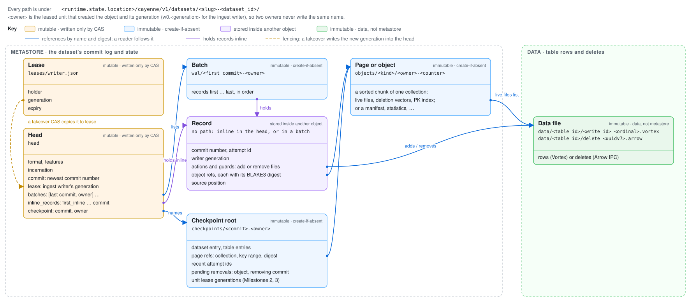
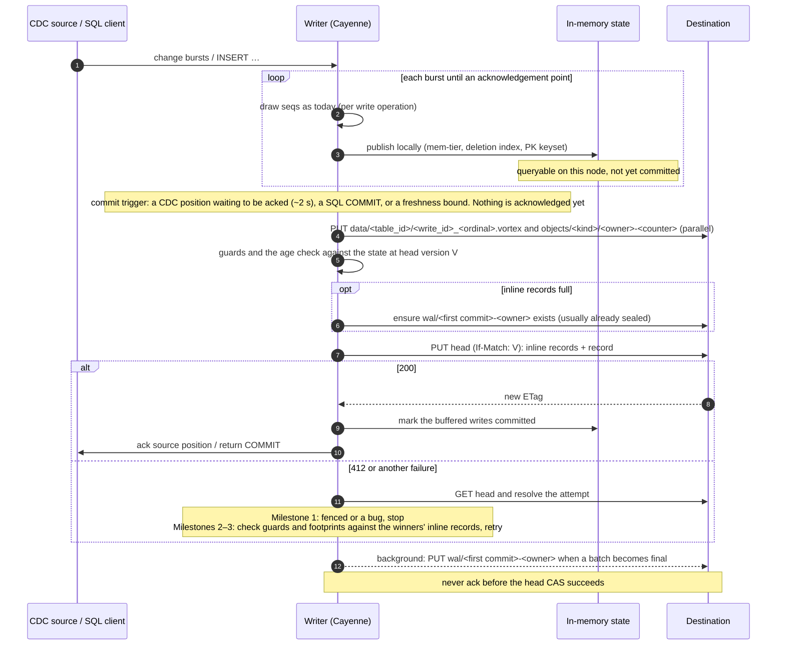
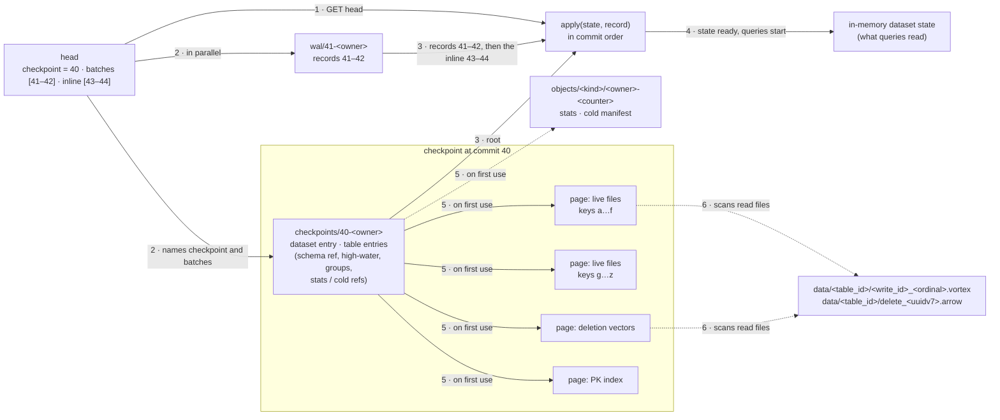
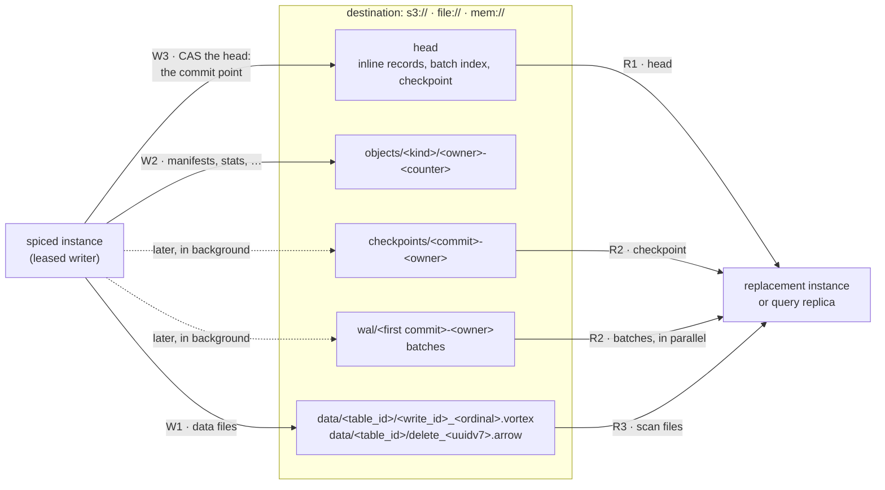
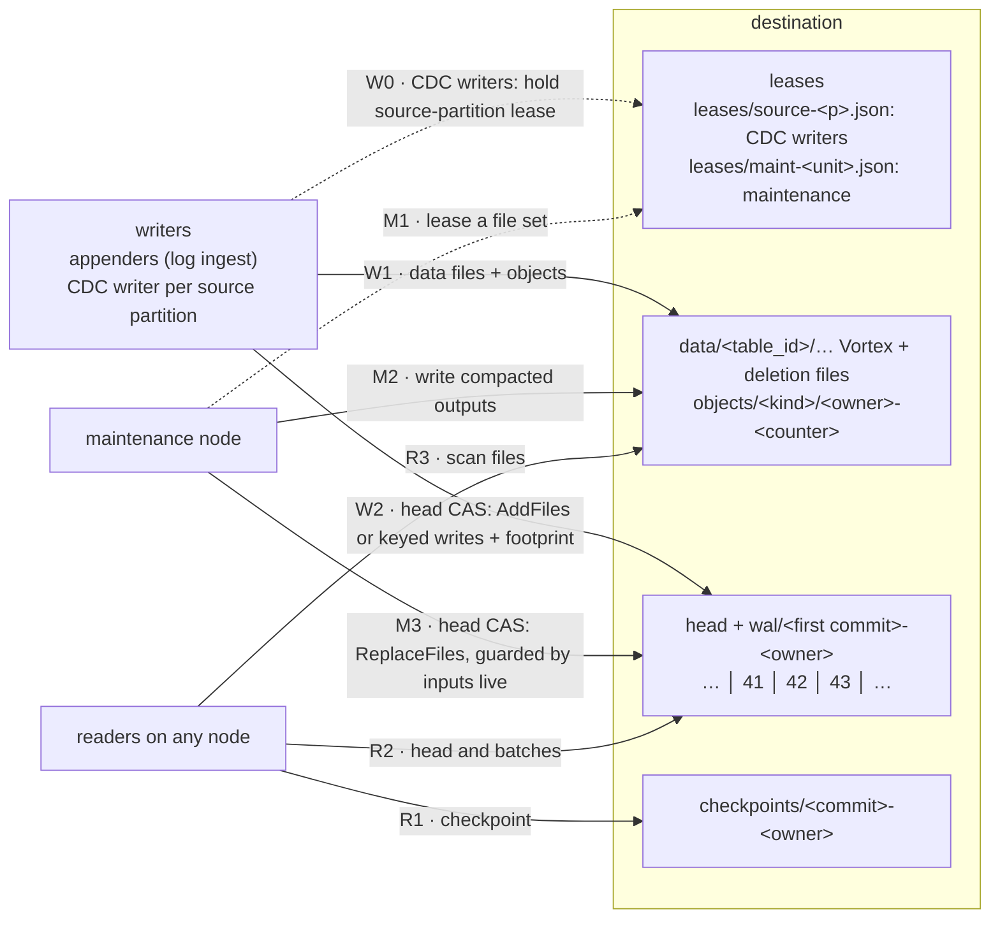

# Cayenne object-native metastore: technical design

Status: **draft for discussion.** This is the technical companion to the
[direction document](object-native-metastore.md), which holds the goals, the
milestones, decisions 1.1–1.10, 2.1–2.2 and 3.1–3.5, and every rejected
alternative. This document says what to build: the components, the rules each
follows, and the order of work, with the code each step changes. It is not a
full specification. Exact rules and their proofs live in the protocol model,
[`crates/cayenne-metastore-model`](../../crates/cayenne-metastore-model/README.md).
The user-facing surface is Enhancement [#15760](https://github.com/spiceai/spiceai/issues/15760); nothing here adds a user decision
beyond `runtime.state.location`.

**How to read it.** The [Summary](#summary) gives the whole picture. The
mechanism follows: the [head and the write path](#the-head-and-the-write-path),
[readers](#readers), [dataset state](#dataset-state-and-checkpoints) and
[GC](#garbage-collection). The [stored format](#stored-format) is reference
material. Then come [Milestones 2 and 3](#milestones-2-and-3-concurrent-writers),
the [roadmap](#implementation-roadmap) and one list of
[open decisions](#open-decisions). Milestone 2 runs maintenance on any node
beside one ingest writer per dataset; Milestone 3 adds concurrent ingest writers.

**Where the numbers come from.** The few measurements kept here still inform a
choice. "A prototype measured" means a prototype of a candidate protocol, run
against RustFS behind a proxy that injects a 20 ms median request latency (P99
five times the median), arms interleaved. These numbers compare designs on one
rig. They are not S3 performance, which roadmap step 1 measures.

**How model runs are cited.** A section ends with one line, "Model: `run`,
`run`", naming the runs that check it. A run named for a removed safeguard, such
as `retention-list-date`, is a negative control and must fail. The model README
gives each run's bounds and limits. `dataset-lifecycle` composes Milestone 1's
mechanisms for one dataset, and its siblings add a transaction, query expiry and
the head's byte budget. The model calls the inline records the *window* and
the head's `checkpoint` field the *floor*; run names keep those words.

**Terms.** The *destination* is the location in `runtime.state.location`. The
*mem-tier* is Cayenne's in-memory write buffer. A *file group* is a set of files
that share a delete fence; the *bake* merges file groups. *Coverage* and
`applied_through` are defined under [What the state holds](#what-the-state-holds).

## Summary

Each dataset has one small mutable object, the **head**. It carries the most
recent commit records themselves, not a pointer to them. A commit is one
conditional replace of the head: a compare-and-swap (CAS) on its ETag. Older
records move out of the head into immutable **batch** objects, many records per
object, before the head drops them. The head and its batches are the dataset's
commit log. Data files and other bulk content are immutable objects that records
reference.

| Component                                                                                  | Why it is needed                                                                                                                                                                                                                                                                                                                                                                                                                                                                                                                                                                                      |
| ------------------------------------------------------------------------------------------ | ----------------------------------------------------------------------------------------------------------------------------------------------------------------------------------------------------------------------------------------------------------------------------------------------------------------------------------------------------------------------------------------------------------------------------------------------------------------------------------------------------------------------------------------------------------------------------------------------------- |
| **Head, changed only by CAS**: the commit point; success is acceptance                     | One write orders and accepts a commit, and fails for a writer whose view is stale. Guards are checked once, locally, against the exact version the CAS replaces. A retry after a lost response is the identical CAS, so failure proves rejection. The [store contract](#appendix-the-store-contract) lists what this needs from the store.                                                                                                                                                                                                                                                            |
| **Inline records in the head, under a byte budget**                                        | A reader no further behind than the inline records polls with one GET, and a commit is its uploads, then one CAS. A prototype on RustFS (1974c52704, 2026-10-28) made 59,999 polls of 1,000 datasets with 59,999 requests, 593 of them changed, and its commits averaged one CAS and 0.05 batch creates. With one object per commit, as the `object_store_occ` WAL stores records today, a changed poll k commits behind costs 1 + k requests in two dependent steps. Keeping several records inline avoids copying each one out on the next commit; the budget bounds what a changed poll downloads. |
| **Commit numbers** name each accepted record and the state after it                        | Maintenance and schema changes alter state without drawing a `seq`, so naming states by `seq` gives two states one name.                                                                                                                                                                                                                                                                                                                                                                                                                                                                              |
| **Batches, listed in the head**, hold the records no longer inline                         | A cold open fetches a few objects in parallel. Batch lengths vary, so readers fetch exactly what the head lists, without a LIST. Both performance and correctness: a LIST is a slower, paged request that would add a dependent step to every cold open, and it shows objects no commit references, such as a late or duplicate batch create.                                                                                                                                                                                                                                                         |
| **The copy rule**: when a batch is sealed, by whom, and when the head may drop its records | Each part keeps a lagging reader from losing or misreading records. Each part is checked in the model, with a negative control per part ([The copy rule](#the-copy-rule)).                                                                                                                                                                                                                                                                                                                                                                                                                            |
| **The checkpoint in the head**                                                             | Readers and GC learn where to start and what is reclaimable from the same atomic object as the commits.                                                                                                                                                                                                                                                                                                                                                                                                                                                                                               |
| **Lease generation in the head**                                                           | A new writer's takeover CAS makes every older writer's next CAS fail, and tells it to stop rather than retry. With several writers (Milestones 2 and 3), each leased unit's generation is in the dataset state, and a takeover fences only that unit's older holder.                                                                                                                                                                                                                                                                                                                                  |
| **GC: removals after a retention T, uploads by age on the store's clock**                  | No LIST for what was once live; a query can read for the retention, and readers write nothing. No machine's clock is compared with the store's.                                                                                                                                                                                                                                                                                                                                                                                                                                                       |
| **Group commit**                                                                           | A writer has one useful CAS in flight; folding queued commits into the next CAS gives the throughput.                                                                                                                                                                                                                                                                                                                                                                                                                                                                                                 |

How the stored objects of one dataset relate. Each box is one object, with its
path and fields; an arrow leaves the field that holds a reference and enters the
object it names.



*Diagram 1: the stored objects of one dataset. Only the head and the lease are ever rewritten. Every other object is written once and becomes visible when the head or a record references it. The dataset state is these objects folded by `apply`, in memory.*

## What it builds on

The design changes two existing pieces rather than adding new ones beside them.
The `object_store_occ` WAL (`WalStateStore`, `object_store_occ/src/wal/`) is a
transactional K/V store on  
object storage that nothing outside its crate uses yet (a search of
`crates/`, `bin/` and `tools/` finds no caller). Step 1 replaces its storage, one
object per commit, with the head and batches, and keeps its commit point, its
receipts, its resolution of uncertain writes, its API and its test suite, so no
second log remains. Its sibling `object_store_occ::lease` already fences snapshot writers. Cayenne's
`MetadataCatalog` trait is the other: a new `ObjectNativeCatalog` implements it
over the head log, with no SQL. It replaces the SQL metastore, SQLite or Turso
behind `MetastoreBackend`, which has no object-storage commit protocol.
Everything else is listed by step in the [roadmap](#implementation-roadmap).

## Storage primitives

The design needs two conditional primitives, which `object_store` and
`object_store_occ` provide on S3, GCS, Azure, a local directory and memory:

- **Create-if-absent** for every immutable object: S3 `If-None-Match: *`, GCS
  `ifGenerationMatch=0`, and locally a staged file, then `link`.
- **Compare-and-swap on a version** for the head and leases. At open,
  `probe_conditional_writes` refuses a store that accepts conditions but ignores
  them.

**A version never repeats.** Once the head moves from version V, no later write
may produce V's ETag again, or a delayed CAS conditioned on V could apply. The
head's bytes never repeat, because its commit number, lease generation and
checkpoint only grow. This is required: one S3-compatible store returned the same ETag for
rewritten identical bytes, then accepted a delayed CAS conditioned on the first
version.

What the design needs from a store, and how each requirement is tested, is
the [store contract](#appendix-the-store-contract).

**Uploads and the head CAS proceed independently;** only writes to one path need
ordering. A prototype that funnelled every put through one writer measured head
CAS P99 rising from 12 ms to 175 ms behind 16 concurrent 1 MiB uploads.

## The head and the write path

### The head

The head is a small object, bounded by the byte budget H, holding:

| Field | Meaning | Why it is there |
|---|---|---|
| `format` | The encoding version of the head, records and batches. | A reader that does not know it refuses the dataset (I11), and every sealer must produce identical batch bytes. |
| `features` | The named features the records use, beyond those `format` implies. | A reader refuses a dataset listing a feature it does not know (I11), so a change in meaning can ship without a new `format`. |
| `incarnation` | A random id fixed when the dataset is created. | A dataset recreated under the same name never mixes with the old one's objects or attempts. |
| `commit` | The commit number of the newest accepted record. | Names the current state. Readers, recovery and GC compare commit numbers. |
| `inline_records` | The newest accepted records, ending at `commit`, oldest first, in full. `first_inline` is the commit number of the oldest. | One-request polls, two-round-trip commits, and records leave in batches. |
| `batches` | The last commit number of each sealed batch and its sealer's owner, in order, covering `checkpoint + 1 .. first_inline − 1`. A batch's name derives from its first commit and that owner. | Variable-length batches cannot be named by arithmetic, and readers fetch only what is listed. |
| `checkpoint` | The commit number of the newest published checkpoint, and the owner that wrote its root. | Readers start from it, and GC reclaims below it. |
| `lease` | The generation of the ingest writer's lease, `leases/writer.json`. Whoever takes that lease raises it, with one CAS of the head. Object names include it, as the ingest writer's owner `w0.<generation>`. | A stale writer learns it must stop, a takeover changes the head even with nothing committed, and names from different owners never collide. Other leased units, such as maintenance units and source partitions from Milestone 2, keep their generations in the dataset state ([Ownership and fencing](#ownership-and-fencing)). |

Each record holds the attempt id, the writer's lease generation, the actions with
their guards, the BLAKE3 digest of every object they reference, and any inline
payload. Per-table `seq` high-water marks, unresolved `Prepare` reservations and
per-partition lease generations live in the dataset state, so the head does not
grow with tables, partitions or transactions.

### Protocol constants

Internal constants, not head fields and not user settings:

| Constant | Meaning | Value |
|---|---|---|
| H | Head byte budget | About 128 KiB to start |
| B, K | Batch byte budget and record-count limit | Set in step 1 |
| R | Largest record; a record above about R/2 is stored as an object | Set in step 1 |
| M | Head content outside the inline records (fields, envelopes, the batch index at its largest) | Derived |
| T | Retention of removed objects | About an hour |
| S | Staleness bound for a head confirmation | Per dataset, from its freshness need |
| T_O | Age limit for uncommitted uploads | About a day |
| Margin | Allowance in the writer's age check for one-second timestamps and skew between the store's servers | Set in step 1 |
| Evidence horizon | Retention of attempt ids in checkpoint roots, measured as the head's store time | T_O |

The budgets must satisfy R ≤ B and H ≥ B + R + M; otherwise the record that makes
a batch final may not fit beside it. H ≥ B + R is not enough, because the head's
other content counts too. At H = 32, 128 and 512 KiB, a prototype sealed 1.0,
0.2 and 0.04 batches per commit and downloaded 24, 99 and 391 KB per changed poll.

### The write path

Writes accumulate in the writer's buffer and become durable in one remote commit
at the next acknowledgement point (decision 1.2). As today, a buffered write is
queryable on the writing node once applied; other nodes see it once the commit
succeeds and they poll. A writer holds the state at commit n, the head version V
that carries it, and V's ETag. A commit:

1. Uploads new objects in parallel, each under a fresh name. Small payloads ride
   inside the record instead ([Small writes](#small-writes)).
2. Evaluates the record's guards locally against the state at V, including the
   `seq` rule and the age check ([Garbage collection](#garbage-collection)). The
   CAS succeeds only on V, so this is exactly the state before the record.
3. If the inline records would exceed their byte or count budget, ensures the oldest final
   batch exists, drops its records and appends its range to `batches`.
4. CASes the head from V to the new head. **Success is acceptance.** The writer
   applies its own record and acknowledges.
5. In the background, seals any batch that has just become final.

**Acknowledgement.** A CDC source position or a SQL `COMMIT` is returned only
after the head CAS covering it has succeeded. A staged object or buffered change
never justifies one.

**Group commit.** Each head version can be replaced by exactly one successful
CAS; there is no lock and no leader. A writer's next CAS needs the version its
previous one produced, so commits that arrive meanwhile fold into the next
record: throughput grows with commits per record, and a commit waits for at most
one CAS ahead of its own. Across writers (Milestones 2 and 3), one CAS wins each
version and the rest re-read and retry, so a dataset completes about one head
replacement per round trip.

**Local directories: each durable write does its own full flush.** A local
create or CAS is durable across power loss before it returns. It syncs its
staged file, links or renames it into place, then syncs the directory, both with
`sync_all`, which Rust's standard library implements with `F_FULLFSYNC` on
macOS: two full flushes per write. A head is written only after every object it
references has returned, so a power loss cannot keep a head whose objects are
gone. A `file://` `runtime.state.location` uses the same writes. A prototype's
durable local CAS measured P99 14.4 ms and P99.9 19.3 ms (n = 10,000; 3b06c85377,
2026-10-28), less than an S3 PUT, so Cayenne has to perform well at object-store
latency anyway. The cost is cut by committing less often, at acknowledgement
points and with group commit, not by a faster flush.



*Diagram 2: writing. Bursts publish locally as they arrive, and one head CAS per acknowledgement point makes them durable. The acknowledgement follows the commit, never precedes it.*

Model: `commits-commit`, `commit-guards`, `commit-no-cas`, `commits-etag`, `commits-etag-repeat`.

### The copy rule

Every record above the checkpoint that is no longer inline is in a batch the
head lists, and that batch existed before the head stopped carrying the record.
Records at or below the checkpoint's commit are in the checkpoint and may be reclaimed. Commit
numbers are dense: each accepted CAS raises `commit` by exactly one, so record
`a + 1` follows record `a`. Three rules rely on it. A writer resolving an
uncertain write looks for its record at exactly n + 1, the commit after the
version its CAS replaced, instead of searching. The batch index stores only each
batch's last commit, because the next batch starts one later. And a reader can
tell a lost record from one that never existed, because every number from the
checkpoint to `commit` must be present. The model numbers commits densely; no
run checks a sparse variant.

- **Deterministic cut.** The batch starting at `a = first_inline` ends at
  `c = min(a + K − 1, largest c whose records a..c fit B)`. The cut depends only
  on the immutable records `a..`, never on which head a sealer read. A batch may
  be sealed only once final: the head holds record `c + 1` inline, or `c = a + K − 1`.
  So every write of a batch carries identical bytes.
- **Anyone may seal** a final batch from a head they observed, by
  create-if-absent; a duplicate or late create writes identical bytes, at worst
  a leak GC collects. A batch is never built from a planned, unpublished head:
  two sealers could race different bytes into one name, and a reader would see
  the losing proposal.
- **Drop only after the batch exists,** and list exactly the dropped range.
  Otherwise a lagging reader finds neither the record nor its batch, or the
  index and the batch disagree.
- **Sizes** count the encoded record, inline payload included, within the
  [budgets](#protocol-constants). A sealer copies each record's original bytes.
- **The checkpoint moves only to a batch end** (or to `first_inline − 1`), so a batch is
  wholly retained or wholly reclaimable.
- **A checkpoint bounds the batch index.** The writer checkpoints before the
  index would push the head past H.

Model: `window-storage`, `commit-no-copy`, `commit-no-observed`, `storage-no-exists`, `storage-no-stable-cut`, `storage-no-final`, `storage-no-range`.

### Uncertain writes

A record holds a unique attempt id, persisted before the CAS is sent. Every
failed CAS is ambiguous, `412 Precondition Failed` included: the `object_store`
crate re-sends a conditional PUT after a 5xx, and the re-send fails its own
condition. A writer resolves every failed CAS from the head before it retries or
re-plans. Sending head CASes without the crate's retries would make a 412
definite, but would not save a request: after any failed CAS the writer reads the
head anyway to retry or re-plan, and record n + 1 is almost always inline in it.
Timeouts would stay ambiguous, so resolution stays either way. There are three outcomes: **accepted**, **rejected**, **unresolved**.
Two kinds of retry differ: a **resend** repeats the identical CAS, the same
attempt, while a **new attempt** has a fresh id and may carry re-planned bytes.

| Head found | Outcome |
|---|---|
| Past commit n, and record n + 1 (inline or in a listed batch) is ours | accepted |
| Past commit n, and record n + 1 is another attempt | rejected |
| Still at version V | **resend the identical CAS** (same bytes, same condition); a success is acceptance, and a failure is as ambiguous as the first and is resolved again from the head |
| At commit n, but a version other than V (a takeover changed the head) | rejected: V can never hold again |
| Record n + 1 reclaimed below the checkpoint | accepted if retained evidence (attempt ids in checkpoint roots) names our attempt, else unresolved |
| Unreadable | unresolved: read the head again later; never resend or send a new attempt meanwhile |

- **A resend needs the original bytes and condition.** After a restart, an
  attempt id alone can establish acceptance from evidence. A writer that did not
  persist the bytes and condition treats a head still at commit n as unresolved,
  never as a reason to send a new attempt.
- **Never send a new attempt until the attempt has resolved as rejected.** A new
  attempt while the head is unreadable, after a failed resend, or while the
  outcome is unresolved can apply an acknowledged write twice: the original may
  still land.
- **An unresolved attempt is reported at once; it is final only past the evidence
  horizon.** While an attempt is unresolved, for example because the destination
  did not respond, Spice logs **commit outcome unknown** ([#15760](https://github.com/spiceai/spiceai/issues/15760)) and resolves it
  again on the next commit or on restart; the source is not acknowledged
  meanwhile. An attempt still unresolved past the evidence horizon is *final
  unresolved*: it is never retried, as a database reports a connection dropped
  during `COMMIT`. Nothing is lost: it was never acknowledged, and a CDC position
  commits with its data, so a new owner resumes from the head and the source
  re-delivers the rest. The horizon is T_O, measured on the head's store time,
  and checkpoint roots drop older attempt ids, which bounds their size. Any
  horizon is safe, because past it resolution reports unresolved, never
  rejected. T_O covers every retry that references an upload, since the age
  check refuses older uploads.
- **A lost upload response is resolved by reading the object back.** The
  writer's upload, present at its fresh name with the expected digest, counts as
  uploaded; its age counts from the first attempt.

Model: `commits-retry`, `commits-no-resolve-before-retry`, `commits-restart-turnover`, `commits-restart-no-persist-before-send`, `commit-no-identical`; evidence expiring at the horizon: `commits-retry-expiry` (reading missing evidence as rejection applies a write twice: `commits-retry-expiry-no-horizon`).

### Ownership and fencing

The writer holds a per-dataset lease, `leases/writer.json`. A new owner takes the
lease at generation g + 1, then CASes the head to `lease: g + 1`. Every older
writer's CAS is conditioned on an earlier version and fails; on re-reading the
head, the generation tells it to stop. This is the pattern
`object_store_occ::lease` documents. Nothing about ownership is checked at
replay, and the old writer's unacknowledged buffer is discarded.

- **Every committer carries the generation,** background tasks included:
  statistics, compaction and cold promotion commit through the writer's handle. A
  handle is closed when its session ends (a dataset reloaded or recreated in the
  same process), even if a task still holds it.
- **With several writers (Milestones 2 and 3),** the head's `lease` stays the
  ingest writer's generation. Each other unit, a maintenance unit or a source
  partition, has its own lease and its generation in the dataset state; a
  turnover is a head commit that raises it, and `apply` refuses a record whose
  unit generation is below the state's. A takeover therefore fences only that
  unit's older owner; writers of other units just lose one race and retry
  ([decision 2.2](object-native-metastore.md#milestones-2-and-3)).
- **Safety comes from the head, not from lease timing.** A new generation in the
  head fences every older writer, so an instance told it is the writer, such as a
  restarted pod or a replacement node, takes over at once. A standby is not told:
  it takes over only once the holder's lease has lapsed, which keeps two live
  instances from fencing each other back and forth. The lapse is judged on the
  observer's monotonic clock, so skew cannot expire a live holder.
- **Lease timing affects availability only.** A standby that takes the lease
  early, while the holder still renews, makes two instances ingest briefly, but
  the generation in the head fences the old one, and no safety property breaks.
  After the holder fails, some instance is ingesting again within the lease
  duration.

Model: `commit-no-lease`, `commits-commit`; standbys: `standby`, `standby-three`, `standby-early-safety` (early acquisition stays safe), `standby-no-generation` (fencing by the lease object alone accepts a stale commit), `standby-early-acquire`, `standby-no-renew`.

## Readers

- **The head is a cached value,** kept with its ETag and treated as fresh for the
  dataset's staleness bound S. A query that finds it older refreshes it with a
  conditional GET (`If-None-Match`); concurrent queries share one refresh. A 304
  means nothing changed; a 200 carries the inline records. S3 `GetObject` and GCS and
  Azure reads accept `If-None-Match`, and `object_store` exposes it as
  `GetOptions::with_if_none_match`, returning `Error::NotModified` for a 304; the
  snapshot reader already uses it (`runtime-acceleration/src/snapshot/mod.rs`).
  A prototype at 3b06c85377 checked it on RustFS and both local stores
  (2026-10-28): the current ETag gave `NotModified` and a stale one the body. A node further behind fetches
  the listed batches it needs, in parallel.
- **Freshness counts from when the GET was sent,** not when the response arrived,
  so a stalled response cannot make an old head look fresh.
- **Datasets in use refresh in the background** if queried within the last one
  or two intervals. Refreshing early is always safe. A dataset nobody queries
  costs nothing, and a writer never polls its own datasets.
- **Cost.** Head reads scale with datasets in use per node divided by S. A query
  on a stale dataset waits for one head read (not measured; tens of milliseconds
  on S3 Standard). Readers outnumber writers, which is why a poll is one GET.
  Every system surveyed (SlateDB, Lance, Delta Lake, Iceberg) polls; writers
  never hint.
- **Cold open: two dependent steps,** whatever the tail length: GET the head;
  then, in parallel with bounded concurrency, the checkpoint root named by
  `checkpoint` and the batches covering `checkpoint + 1 .. first_inline − 1`
  (Diagram 3). Then apply the inline records. The checkpoint cadence keeps the batch count small. Pages
  load when first needed: live files when a scan plans, deletion vectors when the
  deletion index builds.
- **The state lives in memory.** The writer and same-node readers keep it there,
  and queries never fetch from the metastore's storage.
- **A referenced object that is missing is an error, never an empty result**
  (I4). A listed batch missing above the checkpoint is an error, never an empty
  range; a reader older than the checkpoint reopens from it.
- **Readers consult only the head and what it lists,** so a late write elsewhere,
  such as a stale batch create, cannot change what they read.
- **A record whose guards fail on apply** is a corruption error that refuses the
  dataset, never a skipped record.

Model: `retention-readers-response-time`, `storage-no-missing`, `concurrent-floor-aligned`.

## Dataset state and checkpoints

Everything Cayenne's catalog holds becomes **dataset state**: one value per
dataset, the result of applying every committed record in log order to an empty
state. A deterministic `apply(state, record)` is the only code that changes it:
the writer runs it after its own commit, readers while following the log, and
recovery on open. Guards are checked inside `apply`, so all three agree. Nothing
in storage is updated in place.

### State is a checkpoint plus a tail

A checkpoint at commit n (`checkpoints/<n>-<owner>`) is:

- **the root**: the dataset entry, each table entry, per-collection page
  references (key range, digest), recent attempt ids, and the **pending
  removals**: each object a record removed that GC has not yet deleted, with the
  removing commit;
- **pages**: sorted, size-bounded (about 1–4 MiB) immutable chunks of one
  collection under `objects/`, as the `object_store_occ` WAL pages its
  checkpoints.

The tip is that checkpoint plus the records in listed batches, then the inline records.



*Diagram 3: dataset state. The head names a checkpoint and the batches after it, and holds the newest records inline; `apply` folds them into the in-memory state queries read. Edge numbers give the load order: queries can start at step 4, and pages and objects load lazily. Commit numbers are shown unpadded.*

**Writing a checkpoint at commit n,** a batch end: re-emit only the pages whose
key range changed, under fresh names; reference unchanged pages by name and
digest (they are live in the previous checkpoint); write the root after all its
pages. The next commit's CAS sets `checkpoint` to n and trims the batch index, so a
writer's checkpoint costs no CAS of its own; a separate maintenance process needs
one. Two checkpoints at one commit are identical, because `apply` is
deterministic and a commit number names one state.

**A checkpoint is a compaction of the log,** and its pages behave like LSM
levels. Appends land in key order and are cheap, but a scattered change, such as
compaction removing files across every key range, rewrites most pages. Whether
checkpoints need delta pages is an [open decision](#open-decisions), settled by
step 5's measurement.

Model: `naming`, `naming-no-commit-number`, `storage-no-published`, `dataset-byte-window-metadata-prefix*`.

### What the state holds

Per dataset, a **dataset entry** (name, partitions), and per table:

- **The table entry:** config, schema reference, the `seq` high-water mark, file
  groups, index runs, and the statistics and cold-manifest references.
  `CreateTable`, `SetSchema` and `DropTable` change it, each guarded (the name is
  free, the table exists), so a racing or stale writer has no effect. The
  *current snapshot* is the set of live files in no file group; where a stable
  identity is needed (cache keys, directory names), it is the commit number of
  the last record that replaced that set.
- **Live files:** path, rows, bytes, min/max `seq`, digest, per-file statistics,
  PK min/max, file group, the adding commit, and `applied_through`: the deletes
  the file already reflects, which is the cutoff of the compaction or promotion
  that wrote it, or none for a fresh file. Pages are sorted by (PK lower bound,
  file id), so planning and Milestone 3's footprint checks read only the pages
  they need. Only `AddFiles`, `RemoveFiles` and `ReplaceFiles` change it.
  Removal is guarded by the file being live, so two removals of one file cannot
  both apply.
- **File groups:** each group's delete fence is the table's `seq` high-water when
  the group was created. An upsert's `AddFiles{group: new}` creates one, with
  `apply` setting its fence to the record's highest `seq` for that table; the
  bake's `ReplaceFiles` merges groups, guarded by its inputs being live; a group
  whose last file is removed disappears in the same `apply`.
- **Deletion vectors:** path, kind (key or position), the target file of a
  position delete, `seq`, reinsert `seq`, count and size, in pages sorted by
  (`seq`, id); small recent ones are inline in their record. Changed by
  `AddDeleteFiles`, `RemoveDeleteFiles{ids}` (the orphan sweep) and
  `ClearDeleteFiles{seq_le: d}`, which is guarded by **coverage**: every live
  file, cold files included, whose `min_seq` is at most d has `applied_through`
  of at least d, so no file can still hold a row those deletes hide.
  - *Clearing follows coverage, not one compaction.* A compaction that rewrites
    every file a delete could hide rows in clears it in its own record; otherwise
    a later record, such as a cold promotion, clears it once the rest are
    rewritten.
  - *An unresolved `Prepare` caps the cutoffs.* A `Prepare`'s deletes take effect
    only at `Resolve{commit}`, so while one touching a table is unresolved, every
    `applied_through` and `seq_le` a maintenance record writes for that table
    stays below the lowest `seq` among its actions there. Otherwise a covered
    clear after the `Resolve` would bring a deleted row back. `Resolve{abort}`
    leaves no trace in coverage or cutoffs.
  - The deletion index is derived on open.
- **Write-back markers:** keys written but not yet delivered to the source, in
  pages sorted by (`seq`, pk), so delivery claims them in commit order with a
  prefix read. `MarkDirty{pks, seq}` is in **the same record** as the write it
  tracks; `ClearDelivered{pk, seq_le}` removes a marker only if no newer one
  exists for that key ("latest wins").
- **Statistics:** an object referenced with the commit it is valid as of. Changed
  by `SetTableStats{ref, as_of}`; a schema change that invalidates statistics
  clears the reference in the same record. `apply` drops "exact" on any later
  data-changing record, and each checkpoint stores that, so exactness never needs
  records that GC removed.
- **The PK index:** checkpoint pages with no action of its own. `apply` keeps
  the in-memory keyset current from file and deletion actions, and each
  checkpoint writes the pages that changed. Opening loads the pages and applies
  the tail; a checkpoint without them means a rebuild from live files.
- **The cold tier:** one cold-manifest object per promotion. A promotion is one
  record: `SetColdManifest{ref}` plus `RemoveFiles` of the promoted warm files,
  with GC rooted in the destination. Today's datalake tier is about where data
  lives; that belongs to the object-native data Enhancement ([#15818](https://github.com/spiceai/spiceai/issues/15818)). This
  design is about object-native metadata.
- **Source positions,** keyed by (source, partition): `AdvanceSourcePosition`, in
  the same record as the state it covers (decision 1.9). The connectors'
  checkpoint stores become reads of this state plus writes into the next commit,
  so their API does not change.
- **Small registries:** partitions in the dataset entry and index runs in the
  table entry (`AddPartition`, `RegisterIndexRun`, `RemoveIndexRun`).
- **Small writes** carry their rows inline in the record until the next
  checkpoint writes them as a level-0 file (decision 1.5,
  [Small writes](#small-writes)).

Every guarded operation is actions plus guards in one record: a compaction is
`ReplaceFiles` guarded by its inputs being live; an overwrite removes every live
file and adds the new ones; on-conflict deletions add deletion vectors and files
together; a schema change that invalidates statistics sets the schema and clears
them together.

Model: `delete-coverage`, `delete-coverage-no-cold`, `dataset-prepare-cutoff-cap`, `dataset-prepare-no-cutoff-cap`, `pk-index`, `pk-index-checkpoint-no-refresh`, `cold-promotion`, `cold-promotion-no-input-removal`.

**From today's tables,** for the migration:

| Today (SQLite) | Here |
|---|---|
| `cayenne_table` | The table entry |
| `cayenne_snapshot_file`, `cayenne_snapshot_file_statistics` | Live files |
| `cayenne_snapshot_sequence` (today's protected snapshots) | File groups |
| `cayenne_delete_file` | Deletion vectors |
| `cayenne_insert_record` | Retired before cutover; its last writer moves to `reinsert_sequence` |
| `cayenne_pending_write_back` | Write-back markers |
| `cayenne_table_statistics` | Statistics; exactness replaces the taint flag |
| `cayenne_pk_index` | The PK index |
| `cayenne_inlined_data`, `cayenne_inlined_delete` | Removed: rows inline in records, then level-0 files and deletion vectors |
| `cayenne_cold_tier_file` | The cold tier |
| `spice_sys_*` (through `runtime-checkpoint-sqlite`) | Source positions |
| `cayenne_partition`, `cayenne_index_run` | Small registries |

## Commit numbers and sequence numbers

Two numbers order things, and they are kept apart (decision 1.8):

| | Commit number (`commit`) | Sequence number (`seq`) |
|---|---|---|
| Counts | Every accepted record: data, maintenance, schema changes, `Resolve` | Mutations: an upsert draws a delete `seq` and a higher insert `seq`; an append draws one |
| Density | Dense | Sparse: a buffer lost in a crash leaves a gap |
| Scope | Per dataset (one head) | Per table: the parent and each partition child have their own allocator |
| Assigned by | The CAS that accepts the record | Cayenne's allocator, while buffering, as today |
| Used for | Naming states: snapshot tokens, checkpoints, batches, when a file was removed | Visibility, and compaction and bake cutoffs |

"Commit n" names both the n-th accepted record and the state after it. A byte
location inside a file is always a *file offset*. Iceberg splits its snapshot and
data sequence numbers the same way.

`seq`s are `i64`s drawn per write operation, per table, while buffering, and
stamped into the mem-tier, the deletion index, the PK keyset, and file and
deletion-vector metadata. This design changes neither allocation nor stamping.

- **A record carries a `[seq_lo, seq_hi]` range per table it touches.** Each
  table entry holds the highest `seq_hi` of any record that touched it. Ranges
  are sparse.
- **The rule: within each table, every `seq` in a record is above every `seq` of
  that table in earlier records.** The writer checks it before the CAS, like
  every guard. With one writer, each allocator is monotonic and each commit
  carries everything drawn since the last. Maintenance (compaction, the bake,
  cold promotion) draws no `seq`: its outputs keep their inputs' ranges and
  record the cutoff they applied, the committed `seq` they read. A new owner
  allocates above each high-water mark. In Milestone 3, a writer that loses a
  race restores the rule before retrying
  ([Lost races and `seq` order](#lost-races-and-seq-order)).
- **Why per table.** A dataset-wide rule compares different allocators: when one
  partition's allocator is behind, a correctly allocated record touching both is
  refused, and retrying cannot help. A per-table rule also survives flattening
  partitions into one table, or a log per subtable.

**What the rule guarantees.** Per-key visibility is unchanged: it compares one
key's `seq`s in one table, so a row with data `seq` s is hidden by a delete with
`seq ≥ s`, and a re-inserted row is visible iff its insert `seq` exceeds the
delete's. Cross-key cutoffs within a table equal commit order: the seq-prefix
bake's cutoff, compaction's "clear deletes at or below the cutoff", the orphan
deletion-vector sweep's floor, file-group fences, and the transaction begin
token `sequence_high_water()`.

**An example.** Table T, one writer:

| Commit | Record | T's `seq` high-water |
|---|---|---|
| 7 | Upserts drawing `seq`s 100–140 | 140 |
| 8 | Compaction of files A and B with cutoff 140; outputs keep A's and B's ranges and applied deletes through 140. Cold file C still holds rows at or below 140, so those deletes stay. | 140 |
| 9 | Cold promotion rewrites C through 140. Every file that could hold a hidden row has applied the deletes, so the record clears them. | 140 |
| 10 | A schema change | 140 |

Commits 8, 9 and 10 are three states with one `seq` high-water, which is why
states are named by commit number.

Model: `seq-order`, `seq-order-maintenance-draw`, `seq-order-drawn-cutoff`, `table-seq`, `table-seq-no-table-scope`, `naming`.

## Transactions and source positions

### Multi-table transactions across datasets

Within a dataset, a transaction is one record. Across datasets, it is two-phase
commit, each participant's records written by its own head CAS:

1. Write `transactions/<id>/intent.json`, listing the participants and a deadline.
2. **Prepare:** a record on each participant.
3. **Decide** by create-if-absent of `transactions/<id>/decision.json`: `commit`
   from the coordinator, or `abort` from anyone after the deadline. Exactly one
   outcome. Clock skew moves only when an abort can happen, and the deadline
   bounds how long a dead coordinator holds a reservation.
4. **Resolve:** a record on each participant, by the coordinator or any process
   that finds the decision.

The critical path is 4 round trips to the decision and 5 to both `Resolve`s
(counted, not measured). This path is rare.

- **Visibility changes only through the head.** Prepared actions become visible
  only at the `Resolve` record, and readers never consult the decision object, so
  the state at every commit is a function of the records up to it. Reads are not
  atomic across datasets, as today (decision 1.3).
- **Accepting a `Prepare`:** its CAS succeeds and its full guard set held at its
  base: its own guards (inputs live, lease generation, the age check) plus **no
  unresolved `Prepare` whose footprint intersects it**. Committing requires every
  participant's accepted `Prepare`.
- **The reservation.** `Resolve` does not re-run mutable guards, so what a
  `Prepare` depends on must stay valid. While it is unresolved, any later record
  whose footprint intersects it is rejected before its CAS and retries after the
  `Resolve`. This applies across transaction ids, to ordinary writes and other
  `Prepare`s. Maintenance continues under the cutoff cap.
- **`Resolve`** carries no lease-generation guard; anyone may write it. It is
  accepted iff the base holds an unresolved `Prepare` with the same transaction
  id **and** footprint, is exempt from that `Prepare`'s reservation and nothing
  else, and copies the decision into the record so replay never reads the
  decision object.
- **Rejected and late `Prepare`s.** A rejected `Prepare` leads to abort. One that
  lands after the abort keeps its reservation and roots until a matching abort
  `Resolve`. Recovery resolves every unresolved id against its decision.
- **GC and checkpoints.** GC treats an unresolved `Prepare`'s objects as
  referenced, and `Resolve` adds no references. Checkpoints carry unresolved
  `Prepare`s.
- **A begin snapshot is kept by the retention,** like a query's. A transaction
  open longer than T may fail and is retried.
- **Ownership changes** do not invalidate an accepted `Prepare`. The new owner
  inherits every unresolved one, resolves each from its decision, and may abort
  one past its deadline.

Today CDC applies each dataset separately, and this path serves SQL
`BEGIN … COMMIT` (code inspection). Making a CDC transaction that spans datasets
atomic is an [open decision](#open-decisions). A faster path is verified in the
model as an optional capability: when one writer, or one writer per source
partition, owns every key a transaction writes, it can commit the first
dataset's record with an intent for the others and roll it forward, never abort.
It needs the intent in the same record as the actions and the source position, an
apply checked by transaction id, each writer's generation in every participant's
head, a key-overlap check before rebasing a lost race, every transaction's keys
in one partition, and recovery that drains pending intents before ingesting
again. Another writer on the same keys breaks it, which is the case two-phase
commit serves (model: `intent-roll-forward*`, `intent-roll-forward-partitioned*`).

Model: `transactions-txn`, `transactions-three-participants`, `window-txn`, `concurrent-txn-overlap`, `concurrent-txn-disjoint`, `dataset-prepare-*`, `txn-no-reservation`, `txn-no-roots`, `txn-no-matching`, `txn-no-create-once`, `txn-no-reader-log`.

### Source positions and backfill

Some sources keep their position source-side, such as PostgreSQL's
`confirmed_flush_lsn`; the consumer-side ones live in the `spice_sys_*` tables,
written separately from data, so a replacement instance cannot resume from them.
Here `AdvanceSourcePosition{source, partition, position}` rides in the same
record as the state it covers (decision 1.9):

- recovery resumes from the position in the log, and the source is acknowledged
  as [the write path](#the-write-path) says;
- a source-side position may trail the log, so on restart the source replays a
  little, and changes at or below the logged position are skipped, including
  changes already buffered at recovery or any head refresh;
- in Milestone 3, each source partition's position lives in its writer's records.

**Backfill versus live CDC.** A backfill (an initial snapshot, a re-bootstrap
after slot loss, a repair) reflects the source as of its snapshot position P.
With one writer it commits before streaming resumes, so commit order is correct;
Milestone 1 may buffer live apply until the backfill commits, as effectively
happens today. Once a backfill runs alongside live CDC, commit order is wrong, so
backfill output carries P and, for any key, a live change after P wins over
backfilled data, whichever committed first. This is a narrow, internal form of
source-version ordering, not the user-selected version column Milestone 3
defers. It must be specified before parallel loaders exist.

Model: `source-positions`, `source-ack-before-acceptance`, `source-position-before-data`, `source-position-after-data`, `source-no-redelivery-skip`.

## Garbage collection

The owner checkpoints when the tail passes internal bounds, or before the batch
index would push the head past H. GC removes what no state within the retention
needs, and uploads that never committed (decision 1.10). As Delta Lake's
`VACUUM` and Iceberg's snapshot expiry are separate from orphan cleanup, GC has
two halves. The table at the end gives the reason for each rule.

**Removed objects: a fixed retention.**

- GC keeps every object the current state references; every object of an
  unresolved `Prepare`; every object removed less than T ago, timed on GC's own
  clock from when it observed the removal; and the checkpoint the head names and
  every batch above it.
- Moving the head's checkpoint is a removal. GC moves it first (by the next commit's CAS,
  or its own), uses only a checkpoint the head names, and never retires the
  newest one. A crash between a checkpoint's pages and its root leaves an
  uncommitted upload for the sweep.
- **Pending removals are durable:** in the records after the checkpoint and in each
  checkpoint root. A new GC after a takeover learns them there and restarts each
  timer. The orphan sweep skips them.
- Attempt evidence is kept for the evidence horizon, T_O.

**What a query is guaranteed.** **Readers never write.** A query starts from a
state confirmed current within S, **counted from when the confirming GET was
sent**. Every object that state references was live at the confirmation, so GC
deletes it no earlier than T after a later removal, and the query can read for at
least T − S. After that it gets its rows or an error, never other rows
([Readers](#readers)). A query that outlives the retention may fail with an error
saying to rerun it, on every node alike. Compaction is never blocked; the
retention only delays deleting its inputs.

**Uploads that never committed: age on the store's clock.**

- **Every object has a fresh name;** a writer never reuses an object because it
  finds one at an address. Unchanged checkpoint pages are reused by reference.
  A retried commit reuses its uploads; only a retry past the age limit
  re-uploads.
- **Every age is a difference of two store timestamps.** In Milestone 1 every
  object, data files included, is in the dataset's one location, so both come
  from the same store's clock.
- **A record may reference** objects live in the state its CAS is based on, or
  the writer's own never-published uploads. After a record publishes an upload,
  the writer references it only while it is live in the base.
- **The writer's age check is against its CAS base.** It refuses its upload once
  the base's store time is T_O minus the margin past a lower bound on the
  upload's `LastModified`, and uploads again under a new name. The base's store
  time is the `Date` of the response that gave it that head (a GET or its own
  CAS); the lower bound is the newest store time it saw before starting the
  upload.
- **GC ages uploads against the head.** It deletes a listed object that the head
  it read does not reference, that no pending removal names, and whose
  `LastModified` is at least T_O before the head's. **No head move or recheck is
  needed for safety.**
- **An idle head** never ages the uploads, so GC makes an empty commit to advance
  its time, for progress only.
- **The LIST is paged** (read the head, select, delete per page) and runs on a
  slow schedule, as `VACUUM` and Iceberg's `remove_orphan_files` do.
- **Long uploads** past T_O minus the margin are refused and re-uploaded; large
  loads commit in several records. If this binds, decision 1.10's
  `PREPARE_UPLOAD` record is the fallback, outside Milestone 1.

**Versioned buckets and replication,** which [#15760](https://github.com/spiceai/spiceai/issues/15760) Stage 2 supports:

- **Data objects replicate in any direction.**
- **The state has one writable copy.** It may replicate one way, to a copy
  nothing writes. Writers, the lease and GC use the source, and failing over to
  the copy is not supported.
- **On a versioned bucket, GC deletes without a version id,** then removes
  noncurrent versions and expired delete markers. How it removes them is an
  [open decision](#open-decisions).

| What could go wrong | Rule that prevents it, and why |
|---|---|
| A query starts, an object it needs is removed, GC deletes it | The retention. Every read returns the referenced object or fails, so a late delete can fail a query, never change its rows |
| GC deletes a writer's upload, then the writer publishes a reference | The writer's age check against its CAS base: a commit landing after GC read the head is based on that head or newer, so it would have refused the upload |
| A writer removes its upload, GC deletes it after T, the writer references it again first | Publication ends the writer's claim |
| GC takes over, or sweeps, while a removal waits out T | Pending removals are durable, and timers restart on the new GC's clock; the sweep skips them |
| A machine's clock and the store's disagree | Every age is a difference of two store timestamps |
| A head GET's response arrives long after the request | Freshness counts from the request |
| A CAS dispatched long ago reaches the store | The ETag never repeats |
| A sealer creates a batch long after GC deleted it | Readers consult only what the head lists; the batch is an uncommitted upload |
| A paused GC's delete, or a paused writer's commit, lands late | Names are fresh and old uploads are refused, so garbage stays garbage and a late commit fails its CAS; the GC lease only saves duplicate work |
| A fenced writer finishes an upload after a sweep | A bounded leak, collected by a later sweep |
| The state replicates two ways, or fails over to a replica | A conditional write is atomic only within a bucket, so a merge drops acknowledged commits; a replica's head may name objects that never arrived, and a lease cannot fence across buckets |
| A data object is replicated | Immutable and freshly named, a copy is absent or exactly the referenced object |
| A versioned bucket keeps a deleted object's bytes | Deleting without a version id leaves a marker that replicates and removes the replica's copy |

**Milestone 1's form.** GC runs in the writer's process: an idle head's empty
commit is the writer's, staging protection is an in-memory set, and the
checkpoint moves with the writer's next commit. A fenced former writer's delayed requests
can land after failover, so the age check is needed from the start. In
Milestone 2, GC on another node holds the GC lease (`leases/gc.json`) for its
empty commits; the layout does not change.

Model: `retention`, `retention-readers`; GC on another node: `retention-remote-gc`, `retention-readers-remote-gc`, `retention-remote-gc-blind-commit` (an unconditional empty commit resurrects a removed object); pending removals rebuilt from a checkpoint: `retention-readers-checkpoint`, `retention-readers-remote-gc-checkpoint`, `retention-readers-checkpoint-root-omits`, `retention-readers-checkpoint-tail-only`, `retention-readers-remote-gc-keep-timestamps`; and `retention-writer-clock`, `retention-list-date`, `retention-reref-published`, `retention-readers-volatile-removals`, `retention-readers-sweep-removed`, `retention-readers-response-time`, `retention-readers-keep-timestamps`, `retention-readers-stale-start`, `retention-readers-no-retention`, `retention-readers-missing-as-empty`, `retention-no-age-check`, `retention-no-margin`, `retention-reuse-found`, `dataset-lifecycle-no-query-log-retention`, `storage-no-published`.

## Small writes

Decision 1.5 sets the direction; the SQL inline tier is retired once step 5's
[small-write bar](#step-5-object-stores-and-more-sources) is met.

- **Buffering.** Small writes accumulate in the mem-tier and are written out at
  the next commit, at most one level-0 file per table per commit, so the file
  count is bounded by cadence, not write rate. Compaction merges them as today.
  Recent data stays in the mem-tier for queries, so small-file read
  amplification affects only replicas, until compaction runs.
- **Small commits carry their rows inline.** A one-row `INSERT; COMMIT` must be
  durable at its commit, and a few-KiB CDC batch gains little from a separate
  upload. Such a commit carries its rows in its record, below a per-record bound,
  and the next checkpoint moves them into a file (DuckLake's metadata inlining,
  in log form). The commit is the CAS alone: inline avoids an upload round trip.
- **Inline payloads cost bandwidth, not requests:** a reader re-downloads one in
  every changed poll while it is inline. That is what bounds H.
- **The per-record bound, not H, decides what stays inline.** A record above
  about R/2 is stored as an object referenced from its record. A busy CDC
  table's 2 s of changes is often tens of KB to MBs, so its rows go to files.
- **Caching writes** (`Recovery::Rebuildable`) need no durable acknowledgement,
  since the origin can re-supply them. They commit at the freshness and size
  bounds of decision 1.2, not per 500 ms batch; they go through the mem-tier (not
  yet evaluated); and their replacements are keyed tombstones that leave the base
  data in place, coalesced into at most one deletion-vector file per table per
  commit. Rewriting instead caused a cache-rebuild herd in release-candidate
  testing.

Model: `window-storage`.

## Stored format

### Layout

```text
<runtime.state.location>/cayenne/v1/
  catalog/                                 # the name registry: a small domain of the same shape
    head
    wal/…
  datasets/<slug>-<dataset_id>/
    head                                   # mutable, CAS only: commit number, inline records, batch index, checkpoint, lease generation
    wal/<first commit>-<owner>             # batches: immutable records first..last, in order
    checkpoints/<commit>-<owner>           # checkpoint root: table entries and the pages of each collection
    objects/<kind>/<owner>-<counter>       # pages, manifests, deletion-vector lists, stats, PK index, …
    data/<table_id>/<write_id>_<ordinal>.vortex
    data/<table_id>/delete_<uuidv7>.arrow
    leases/writer.json                     # object_store_occ::lease records
    leases/gc.json
  transactions/<id>/intent.json            # cross-dataset transactions
  transactions/<id>/decision.json          # create-if-absent
```

- **Fresh names.** Commit numbers in names are zero-padded to 20 digits, so
  lexical order is numeric order. No name is reused: `<owner>` is
  `<kind><unit>.<generation>`, the leased unit that created the object and that
  unit's lease generation. `kind` is `w` (writer), `m` (maintenance) or `g`
  (GC); `unit` is an id the dataset state assigns when the unit is created and
  never reuses. Milestone 1 writes only `w0`. From Milestone 2 each unit has its
  own generation, so two units can hold the same number, and the unit id keeps
  their names apart. A node gets no id of its own: taking a unit's lease raises
  that unit's generation, so successive holders write different names. Names
  never contain instance, host, disk or source identifiers, so they reveal
  nothing the head does not already hold. Not yet checked in the model. The head
  or a record names each object.
  References carry the object's BLAKE3 digest, which checks its bytes; the
  digest is not the name.
- **Data files keep their names.** They are not content-addressed: hashing a
  large file means reading it back, and the names are already unique. The
  dataset folder follows the datalake tier's `datalake_dir_segment`, so datasets
  are recognizable in the bucket and dropping one is one prefix. A file becomes
  visible when a record references it, so files never move.
- **A file reference carries an optional location id,** a `u32` varint; absent
  means 0, the destination. Milestone 1 writes one only for the temporary
  local-disk references of step 2. Multiple data locations belong to the
  object-native data design.
- **The root folder** `cayenne/v1/` sits beside `results-cache/`,
  `rate-control/`, `cluster/` and `snapshots/`. Its name is on-disk surface
  ([#15760](https://github.com/spiceai/spiceai/issues/15760)).



*Diagram 4: where a commit's pieces live and in what order they are written and read. Edge numbers give each actor's order (W = writer, R = reader). Files and objects are written before the record that references them, and the head CAS is the commit point.*

### Encoding

The head, records, batches, checkpoint roots and small pages are **Protocol
Buffers**, through `prost`. Leases and transaction objects stay JSON. Large
checkpoint collections (file lists, deletion-vector lists, the PK index) are
Arrow IPC pages, as delete files are today. Numbered fields give explicit
evolution rules (add fields, never renumber, reserve removed numbers), digests
and payloads are bytes, and the head must fit H, where binary is smaller than
JSON (unverified, not measured).

- **A record is encoded once.** The encoding is not canonical (`prost` encodes a
  `HashMap` field in hash order), so the head and batches carry each record as
  its original bytes, and a sealer copies them, never re-encodes. Protocol
  messages use no map fields (sorted repeated entries instead) and no
  floating-point values.
- **Unknown fields are skipped, so meaning changes fail closed.** An older node
  ignores fields it does not know, and `prost` drops them on re-encode. Skipping
  an action or guard returns wrong rows (I11). So a change in what a reader must
  do bumps `format` or adds a named entry to the head's `features`, which a
  reader that does not know it refuses, as Delta's reader and writer features
  and Iceberg's `format-version` do. An unknown field may carry only advisory
  data. No node re-encodes another node's message.
- **Zero and absent are the same value.** A field whose 0 differs from "not
  set" is `optional`; where absent should mean 0, as for the location id, plain
  proto3 gives that.
- **Unknown actions are an error.** A reader refuses the dataset with the
  "upgrade Spice or clear the acceleration" message, the role SQLite's
  `user_version` gate plays today.
- **Upgrade compatibility** is [#15760](https://github.com/spiceai/spiceai/issues/15760)'s rule: a feature is read by release N and
  written from N+1.

Model: `unknown-action-refusal`, `unknown-action-skip`.

## Milestones 2 and 3: concurrent writers

Milestone 1 is single-writer, but nothing in its format assumes it. Each commit
is a head CAS guarded against the exact version it replaces; actions are
file-level, so compaction conflicts only with commits touching its inputs;
unknown actions are refused ([Encoding](#encoding)), so later actions and
footprints cannot silently downgrade; leases are keyed by name; each dataset is
its own domain; snapshot tokens are opaque vectors; within a table `seq` order is
commit order; and GC state lives in the dataset state, so remote GC needs only
the GC lease.

No table needs a declared layout for write safety: writers prove independence
at commit time, and partitioning and sort order become read-layout choices
compaction can change.

### Milestone 2: maintenance on any node

One ingest writer per dataset stays. Compaction, the bake and cold promotion run
on any node and commit by CAS, racing the writer, under leases over file sets: a
compaction group in one key range, or a file-group range for the bake. They need
the lost-race classes below, but not key footprints or the lost-race `seq` rule:
maintenance draws no `seq`s and raises no high-water mark, so the writer's
buffered `seq`s stay above everything committed even when it loses a race to a
compaction, and a remote compaction's `applied_through` is at most the committed
high-water mark, below every buffered delete. Coverage needs no cap beyond the
`Prepare` cap.

A maintenance record that loses a race re-validates against the new head (inputs
live, coverage on its outputs, the `Prepare` cap, its lease) and retries, or
re-plans. A losing ingest writer retries its unchanged actions with their
original `seq`s. File-set leases avoid duplicate work; correctness rests on the
publication-time guards. Fencing follows decision 2.2: a unit's lease turnover
is a head commit, a retry checks the unit's generation in the head it lost to,
and the publication itself reads nothing but the head. The model's
`remote-maintenance-minimal-lease-outside-head` and
`remote-maintenance-no-retry-lease-check` show why a lease outside the head is
not enough.

Model: `remote-maintenance`, `remote-maintenance-prepare`, `remote-maintenance-minimal-lease-outside-head`, `remote-maintenance-no-retry-lease-check`, `remote-maintenance-no-stable-high-water`, `remote-maintenance-no-committed-cutoff`, `remote-maintenance-no-file-set-lease-no-guard-revalidation`.

### Lost races

A loser reads the winners and checks its guards and footprint against theirs
(decision 2.1). If nothing intersects, it takes the new head with the same
actions. This is safe because actions never carry values computed from what was
read: derived pointers are assigned at application, and every read dependency is
a declared guard or read footprint. `seq`s, stamped while buffering, are the
exception. Outcomes fall in four classes, as in Lance's transaction model:
**compatible** (retry unchanged), **rebasable** (transform the actions to apply
after the winner), **retryable** (re-plan) and **incompatible** (report the
conflict).

A position delete always has a higher `seq` than its target file, because the
target committed earlier:

| mine \\ theirs | append | keyed write | maintenance (`ReplaceFiles`) | position delete |
|---|---|---|---|---|
| append | commute | commute | commute | commute |
| keyed write | commute | blind upserts: commute (the later commit's `seq`s win); a write whose form depended on a read: retryable | commute (outputs inherit input sequences) | commute |
| maintenance | commute | commute | conflict iff inputs intersect | rebasable: remap its positions onto my outputs |
| position delete | commute | commute | rebasable: remap onto its outputs | commute |

**Remapping a position delete.** A position delete that loses to a compaction
follows the compaction's row mapping from (input file, position) to the same
row's output position, keeping its `seq`. If the mapping shows an earlier
accepted delete removed the row, the delete is done. A missing or expired mapping
is a conflict, never a silent success. If the delete commits first, the
compaction applies it or re-plans. Compactions keep mappings while any position
delete planned before them can still retry.

Model: `position-delete*`.

### Milestone 3: concurrent ingest writers

**Key footprints** (decision 3.1), checked cheapest first: PK hash buckets, when
writers are assigned them; per-file min/max of each key column; and the commit's
keys as sorted 64-bit digests, compared by one linear merge, O(n + m). Small
digest lists ride in the record; larger ones are an object counted against the
head budget only by reference. Any uncertainty is a conflict, and a digest
collision can only report a false conflict. Appenders' `service` ranges do not
overlap, so min/max decides the metric-appender case. Overlapping keys are
resolved by abort and re-plan, or key-range ownership with a lease per range
(decision 3.2).

**Read-dependent writes are serializable** (decision 3.5). `UPDATE … WHERE`,
`DELETE … WHERE`, `INSERT … ON CONFLICT`, `INSERT … SELECT` from a dataset it
writes, and every `BEGIN … COMMIT` are read-dependent; change-feed upserts,
deletes and appends are blind. The guarantee (I12): **the state at every commit
equals running the accepted writes one at a time in commit order.**

- **Read footprint:** the keys a write looked up, absent ones included, and the
  predicate of each scan that is not a key lookup, aggregates included. Every
  record publishes every key it inserts, replaces or deletes, including deletes
  that add no rows.
- **Validation** against every record committed after the write's snapshot, not
  only the newest. A record conflicts if it wrote a key the write wrote or looked
  up, or changed a row that matches a predicate before or after the change (the
  before image from the write's snapshot, the after image from the winner's added
  rows).
- **Retry and re-plan.** No conflict: keep snapshot, actions and footprint and
  retry under the `seq` rule. A conflict: discard the actions and re-run the
  statement on the new head, up to a bounded number of attempts.
- **A transaction validates as one unit.** `BEGIN` fixes one snapshot, each
  statement reads it plus the transaction's earlier writes, and `COMMIT`
  publishes one record whose footprint is the union over every statement,
  intermediate writes included. Any conflict re-runs the whole transaction.

Rows a winner changed that match no predicate never conflict, so unrelated
ingestion causes no conflicts. A predicate that cannot be evaluated at
validation, such as a non-deterministic function, conflicts with any change to
the table. Milestones 1 and 2 need none of this: the single ingest writer holds
the table write lock, and maintenance changes no row a predicate can see
(unverified, code inspection only). It extends today's transaction OCC
(`provider/transaction.rs`) to single statements, replacing its rule that a scan
without a key predicate conflicts with any commit to the table. Until it lands,
any commit to a table the write read is a conflict.

Model: `read-rule2*`, `read-widened-*`, `read-delivery-*`, `read-same-key*`, `read-progress*`, `read-transaction-*`.

**Partitioned CDC handoff.** When keys move between source partitions (a shard
split, a repartition), the new owner writes a moved key only after the old owner
has committed everything before the source's handoff point (parent shard closed,
partition drained). A handoff action records that point.

**Several writers on one head.** The protocol is optimistic, for mostly
non-conflicting writes. The CAS serializes writers, and any writer may seal a
final batch. A lost race costs one GET and a retry CAS; the inline records
hold the records to check. At a 2 s cadence and about 50 ms per conditional write, about
10% of commits race with 4 writers and about 40% with 20. A race between
independent writers costs a retry, not an abort, but only with randomized backoff
and group commit. A prototype measured 6.0–6.1 and 11.8–12.6 requests per commit
with 2 and 4 writers appending back to back, and without backoff some writers
starved: up to 207 attempts for one commit, and commit P99 of 2.5–7.6 s at 4
writers. Milestone 3 therefore needs randomized backoff and group commit, or
routes a dataset's commits through one committer. More throughput per dataset is
the "several logs per dataset" future work. Footprints count against the head
budget. Readers in other processes poll at the dataset's freshness interval.



*Diagram 5: Milestones 2 and 3. Maintenance nodes and, in Milestone 3, several writers commit to one dataset head; each commit carries the footprint that proves its independence. Edge numbers give each actor's order (W = writer, M = maintenance, R = reader). Leases come first, then files and objects, then the record.*

### Lost races and `seq` order

Decision 3.4, open until measured. A writer that loses to independent winners
holds buffered `seq`s below theirs in shared tables, and the per-table rule must
still hold. (A conflicting race re-plans instead.) Two options:

**(a) Shift the buffer.** In each table the winner touched, move every `seq` in
the window up by one amount, to start above the winner's `seq_hi`. A uniform shift
keeps the window's order; no shift, or a non-uniform renumbering, breaks I9.
Stamping does not change. The shift touches:

| Structure | How it holds `seq` | Shift cost |
|---|---|---|
| Mem-tier segments (`provider/mem_tier.rs`) | One `delete_sequence` and one `data_sequence` per segment | O(segments in the window), O(1) each |
| PK keyset OCC stamps (`provider/pk_index.rs`) | Per key, a monotonic max | Re-record the window's keys at the higher value |
| Deletion index (`provider/deletion_index.rs`) | Per key, `{delete_seq, insert_seq}`, active tier and frozen runs | Re-insert the window's tombstones at the higher values into the active tier |
| File and deletion-vector metadata | Per file | Free: the record is re-encoded for the retry |

The window is one commit interval of the writer's mutations, about 2 s. Buffered
writes are locally queryable, so the shift must be atomic with respect to local
reads, as the mem-tier's publish lock makes a burst's stamps.

**(b) Coalesce eagerly and stamp at commit.** The window keeps the set of keys it
affected and the rows it inserted, one per key; a key affected but not inserted
is deleted. Local reads put the window on top of committed state: a committed row
is hidden if its key is affected, and the window's rows are added. That needs no
`seq` and matches the outcome, since a commit after a lost race lands after the
winners. Final `seq`s are stamped once, into the PK keyset and deletion index,
when the commit succeeds. Appends need no coalescing; position deletes are kept
as hidden positions, remapped if a compaction rewrites their files. It changes
the mem-tier's apply path and may shrink the tier for hot keys (not measured).

Either is independent of publishing at commit. The gate is in the
[roadmap](#milestones-2-and-3-steps).

Model: `seq-order`, `seq-order-no-shift`, `seq-order-non-uniform`, `read-rule2-stamp-at-commit`.

## Future: multi-region

Not in any milestone. Regional read-only replicas are a separate Enhancement,
and these rules change code when it is built. Replicating data, and the state one
way, is Milestone 1 ([Garbage collection](#garbage-collection)).

- **Regional readers of replicated data** poll the source head and read files
  from the nearest replica. Retention is unchanged. A file missing from both is
  an error.
- **Regional readers of one-way replicated state** expose a **readable
  frontier**, adopting a head only once its newly referenced objects are present,
  and never a lower commit number than they hold; they read the highest head
  version that has arrived, because replication can deliver head versions out of
  order. The replica cannot show its lag, so a reader confirms its head with a
  conditional GET on the source head, timed from the request; only a confirmed
  head serves queries, and every object a confirmed head references is present.
  Lag does not shorten a query's protection (T − S from its start); it delays
  confirmation. A missing object is an error.
- **Reclaiming the replica:** one replica instance, under a lease, deletes a copy
  T after the replicated records show it removed, or once the source returns 404
  for it (names are never reused, so a 404 is permanent). An unreferenced copy
  is never deleted by the replica's age alone: on an idle head the writer may
  still commit that upload. No delete-marker replication or lifecycle rule is
  needed (model: `replicas`, `replicas-readers` and their controls).
- **Writers in several regions** over disjoint keys use one bucket and pay
  cross-region latency; overlapping keys need key ownership; one atomic commit
  across regions is out of scope.

## Implementation roadmap

**Principles:**

- **Replace, don't shadow.** The native catalog replaces SQL behind the flag
  rather than shadowing it: the two catalogs diverge internally, so comparing
  them call by call is the wrong check. Three checks that share no code with it
  take that role: Cayenne's suites run against the native catalog, prototype
  traces replay against the model, and spicescript variants compare answers with
  SQLite and the source.
- **Every step ships on its own** and keeps every SQLite-metastore dataset working
  until step 8.
- **Metadata does not wait on data:** the flag ships with data files where they
  are today; data placement follows and is a prerequisite for standbys and the
  replacement.
- **The surface waits for its review:** the flag (2) and the replacement (8) go
  through [#15760](https://github.com/spiceai/spiceai/issues/15760), and placement (6) through [#15818](https://github.com/spiceai/spiceai/issues/15818).
- **Exit criteria** are the runs that must pass before the next step builds on
  it. Kill, restart and failover criteria are spicescript scenarios, driving
  `spiced` from outside against an independent oracle; scenario names are
  proposed.
- **Tests use an in-memory store** for most suites, so their speed does not
  depend on fsync and no durability setting ships. Durable local writes are
  tested separately, including power loss.
- **Status** lines come from the prototype's own notes, not from runs in this
  document.

```mermaid
flowchart LR
    S1["1 · head log in<br/>object_store_occ"] --> S2["2 · native catalog<br/>behind the flag"]
    S2 --> S3["3 · acknowledgement-point<br/>commits, group commit"]
    S3 --> S4["4 · retention and GC"]
    S4 --> S5["5 · object stores,<br/>more sources"]
    S5 --> S6["6 · data placement ([#15818](https://github.com/spiceai/spiceai/issues/15818))"]
    S6 --> S7["7 · standbys"]
    S7 --> S8["8 · the replacement:<br/>SQLite removed"]
```



*Diagram 6: the Milestone 1 roadmap. The library, then the native catalog behind the flag ([#15760](https://github.com/spiceai/spiceai/issues/15760) Stage 1), then the commit cadence, GC, object stores and more sources, then data placement and standbys, and finally the replacement ([#15760](https://github.com/spiceai/spiceai/issues/15760) Stage 2).*

### Step 1: the head log in `object_store_occ`

**Status:** a prototype head log exists, on a local directory.

- **Change** (library only): durable local writes; the head log; GC (deletion
  from the log, the age sweep, pending removals); `WalStateStore` onto the head
  log, its API, receipts and whole-head OCC unchanged; the text decoder; the
  protocol constants.
- **Code:** `object_store_occ`: `wal/` rebuilt on the head log, keeping
  `WalStateStore`'s API so its storage suite runs unchanged;
  `LocalConditionalPut` (durable create and CAS, uploads independent of the head
  CAS); GC beside `cleanup.rs`;
  `probe_conditional_writes` (`capabilities.rs`), reused; the deterministic
  simulation in its tests. A text decoder for heads, records, batches and pages
  under `tools/`.
- **Why first:** the WAL's storage suite (process kills between storage
  operations, SlateDB and Redis oracles, local, MinIO, RustFS and spiceio CI
  legs) covers the new log from its first change.
- **Exit:** the WAL's suites pass on every CI leg; a deterministic simulation
  replays the model's schedules (delayed CAS completion, lost responses, lease
  turnover, uploads past the age limit, late uploads after a sweep) against the
  real storage code, compared with a serial reference; commit and poll latency
  at P99 and P99.9, with sample counts, on S3 Standard, S3 Express, RustFS and a
  fsync'd local directory; and a conformance suite with a test for every
  requirement of the [store contract](#appendix-the-store-contract), C1 to C9,
  each with its negative control, passing on memory, a local directory, a
  fsync'd local directory and RustFS in CI, and on S3 Standard and S3 Express
  before each is supported.

### Step 2: the native catalog behind the flag

**Status:** largely done in a prototype; `partition_by`, snapshot export and
import, and the remaining sources' positions are step 5.

- **Change:** `ObjectNativeCatalog` implements `MetadataCatalog` over the dataset
  state and the head log, with no SQL; `cayenne_metastore: object_native` selects
  it ([#15760](https://github.com/spiceai/spiceai/issues/15760) Stage 1). The record actions (`AddFiles`, `ReplaceFiles`,
  `AddDeleteFiles`, `SetTableStats`, `AdvanceSourcePosition`, …), the dataset
  state, `apply` and checkpoint pages. The provider's three downcasts to
  `CayenneCatalog` become trait methods (atomic append, multi-table transaction,
  write-back markers). The source-position stores and the dataset schema
  checkpoint commit through the same head log. The lease, fencing and
  resolution of uncertain writes ("commit outcome unknown").
- **Code:** `crates/cayenne`: actions, dataset state, `apply` and pages in a new
  module beside `metastore/sqlite.rs` (adds `cayenne` → `object_store_occ`, which
  `layers.toml` allows); `ObjectNativeCatalog` (`catalog.rs`, 82 methods); the
  provider's downcasts; `cayenne_insert_record`'s last writer,
  `upgrade_tombstones_for_flushed_pks` (`provider/table.rs`). `seq` allocators
  stay per table (today `cayenne_table.current_sequence_number`), as do begin
  tokens (`provider/transaction.rs`). `object_store_occ::lease` (`LeaseRecord`),
  reused. Source-position stores: `runtime-checkpoint-api` unchanged, wiring in
  `accelerators/accelerator-cayenne`, `runtime-checkpoint-sqlite` dropped for
  Cayenne. `runtime` and `runtime-state-location`: `cayenne/v1/` and the flag.
- **Fixes that shrink the cutover:** a missing referenced file is an error, never
  an empty snapshot (today it reads as empty); `cayenne_insert_record` is
  retired; a missing datalake-tier cold file is an error, so a scan that outlives
  the grace period fails instead of returning partial rows; a handle closes when
  its session ends, which today's SQL metastore does not enforce for a dropped
  provider's maintenance loop.
- **Data files stay where they are today** until step 6, on the writer's local
  disk. Such references carry an instance-local location id bound to the writing
  instance's identity, so they are never mistaken for destination files. A
  restart on the same disk continues from the head; another instance finds
  references it cannot read and reloads from the source, never serving the
  dataset without its files.
- **Exit:**
  - Cayenne's suites against the native catalog, most on an in-memory store,
    each with its own oracle, and a negative control showing the suite goes red
    (a prototype that dropped delete-file actions failed `mutation_model_test`);
  - the spicescript parity scenario (`postgres-cdc-parity.yaml`) with
    object-native and SQLite variants giving identical answers, the source as
    oracle, including a restart and a kill (a prototype passed every check), and
    with no SQLite catalog created;
  - prototype traces replayed against the model;
  - a process kill at every storage step, and injected lost responses.

### Step 3: commits at acknowledgement points

**Status:** next in the prototype, which commits once per catalog call today.

- **Change:** the catalog buffers changes and commits only at acknowledgement
  points (a CDC checkpoint, a refresh completing, a compaction or promotion
  finishing, a user write returning), answering reads from the buffer; group
  commit; the source position in the same record as the data it covers; caching writes per
  [Small writes](#small-writes).
- **Code:** `crates/cayenne` and `object_store_occ` (commit triggers, group
  commit); `accelerators/accelerator-cayenne/src/change_sink.rs`
  (caching writes).
- **Exit:** commits per second and CDC freshness at P99 and P99.9 against the
  per-call baseline, interleaved, on Linux and macOS; a power-loss test on a local
  directory; a keyless source never duplicating rows across a crash. A local
  speed comparison with the SQLite metastore runs SQLite at `synchronous = FULL`,
  or states that today's `synchronous = NORMAL` does not survive power loss.

### Step 4: retention and GC

**Status:** not started in the prototype.

- **Change:** fresh names for every object; the writer's age check against its
  CAS base; deletion of removed objects T after GC observes the removal; pending
  removals in checkpoint roots; the age sweep against the head's time; attempt
  evidence kept for T_O; readers write nothing.
- **Code:** `object_store_occ` GC (beside `cleanup.rs`), wired into
  `crates/cayenne`.
- **Exit:** the retention model's negative controls replayed against the
  implementation with the matching rule removed; deleted objects and bytes by
  reason; retained bytes per hour at P99 on a CH-benCH run.

### Step 5: object stores and more sources

- **Change:** RustFS, then S3, as the destination; MySQL, then the other
  sources' positions; `partition_by`; snapshot export and import to locations
  outside the destination ([#15760](https://github.com/spiceai/spiceai/issues/15760)); datalake-tier promotion as one record, with
  GC rooted in the destination.
- **Code:** `crates/cayenne` (`datalake_dir_segment`,
  `provider/cold_partition.rs`).
- **Exit:** the step 2 scenarios on a rustfs `shared_bucket`; MySQL parity;
  commit and poll latency at P99 and P99.9 on S3 Standard and S3 Express;
  checkpoint bytes per committed metadata byte (deciding delta pages);
  `testoperator run bench` and `run htap` against the SQLite metastore, no
  regression at any query or scale factor.
- **Exit for small writes,** the bar for retiring the SQL inline tier, from
  release-candidate testing of 2.4.0 with a caching dataset (string primary key,
  about 500 random lookups/s, about 99% misses):
  - caching writes commit at the freshness bound, not per 500 ms batch per table;
  - replacements add at most one deletion-vector file per table per commit;
  - level-0 files and mem-tier segments are pruned in one batched pass per query;
  - point lookups on random string keys do not scan every file's key column;
  - the small-file format comparison starts with Vortex.

### Step 6: data placement in the destination

- **Change:** new data and deletion files go under the dataset's `data/` folder
  in the destination, with local disk as a cache. Cayenne already builds scan
  URLs for an `s3://` table path (`snapshot_dir_url`), so this is mainly
  placement and the cache. The staging WAL (`_staging/<id>/_wal.json`) and
  per-snapshot directories (`<table_id>/<snapshot_id>/`) go away. Where files
  live is surface ([#15818](https://github.com/spiceai/spiceai/issues/15818)).
- **Code:** `crates/cayenne` (`snapshot_dir_url`); remove
  `provider/staging_wal.rs`.
- **Exit:** a spicescript scenario (proposed `object-metastore-failover.yaml`)
  with two variants over a rustfs `shared_bucket`: `kill-spiced` the writer, a new
  instance takes over from the destination alone, answers equal the source
  oracle, no duplicate or lost row; recovery on a fresh instance without the
  original data directory; read and write P99 and P99.9 against step 5 on the
  same rig.

### Step 7: standbys

- **Change:** instances running the same Spicepod on one destination share it.
  A lease picks the one that ingests; the others serve queries from shared state
  and take over when it fails. A standby opens a dataset from the head and polls
  it, and its provider follows commits it did not write: scans union their
  files, and the PK and deletion indexes merge their state. Each source adds
  three rules:
  - *consume only while holding the lease:* a PostgreSQL standby does not
    attach to the slot, and an SQS standby does not poll;
  - *acknowledge the source only after the commit* (decision 1.2);
  - *replay after takeover:* PostgreSQL resumes from the committed position;
    SQS redelivers undeleted messages, so the new holder skips files the log
    already records.
- **Prerequisites:** data placement (step 6). Until then data files are on the
  writer's local disk, so a standby could neither read them nor take over.
- **Code:** the `crates/cayenne` provider (`provider/table.rs`, `pk_index.rs`,
  `deletion_index.rs`), replacing the slice import (`metastore/snapshot.rs`) for
  these readers; `runtime`; lease gating in `connector-postgres`
  (`replication.rs`) and `s3-event-notifications`.
- **Model:** `standby` and its controls: two or three instances, crashes and
  pauses, fencing by the generation in the head, and ingestion resuming within
  the lease duration.
- **Why now:** without it, two instances started on one destination by
  accident each fence the other and both consume the source, which is tolerable
  behind the flag and an outage as the default.
- **Exit:** a spicescript scenario with two instances over a rustfs
  `shared_bucket`, the holder killed mid-stream: no source consumed by both, no
  position acknowledged before its commit, no duplicate or lost row against the
  source, the standby serving reads throughout; takeover time at P99 and P99.9.

### Step 8: the replacement

- **Change** ([#15760](https://github.com/spiceai/spiceai/issues/15760) Stage 2, the first release users see): the object-native
  metastore replaces SQLite for every Cayenne acceleration. An existing
  acceleration bootstraps from its source once; Spice does not open SQLite
  catalogs, and a warning names the old files. A dataset that sets
  `cayenne_metastore` fails to load. `cayenne_metadata_dir`,
  `cayenne_inline_max_*` and Cayenne snapshots stored in the destination are
  ignored with a warning. Remove the SQLite backend, `MetastoreBackend`, the SQL
  inline tier with its tombstones' two-phase `published` flag, and the flag.
  Accelerations holding data their source no longer has stay on the previous
  release ([#15492](https://github.com/spiceai/spiceai/issues/15492)).
- **Code:** remove `MetastoreBackend` (`crates/cayenne/src/metastore.rs`,
  `metastore/`), the SQLite backend and `provider/inlined_cache.rs`; `runtime`,
  `runtime-state-location`, and `runtime-acceleration/src/snapshot/` (snapshots
  stored in the destination ignored with a warning).
- **Prerequisites:** data placement (step 6) and standbys (step 7).
- **Gate:** re-bootstrap, compatibility and recovery shown behind the flag; the
  local-directory destination covers on-prem without object storage; step 5's
  small-write bar met.
- **Exit:** an upgrade from the previous release (spicescript `--from`) in which
  every test Spicepod's datasets bootstrap and answer equal to their oracles; the
  `cayenne_metastore` error (an `assert-log`); the full benchmark suite (TPC-H,
  TPC-DS, ClickBench, CH-benCH) against the previous release, no regression at
  any query or scale factor.

### Milestones 2 and 3 steps

These build on the object-native path only.

- **M2a, remote maintenance.** Proves maintenance off the writer node needs no
  footprints or `seq` shift. Code: `crates/cayenne` (`provider/compaction.rs`,
  `provider/maintenance.rs`); the GC lease (`object_store_occ::lease`). Exit: the
  `remote-maintenance*` runs; a spicescript scenario with a writer and a
  maintenance node on one destination that kills the maintenance node
  mid-compaction, answers equal to the oracle; CH-benCH with `--validate`,
  freshness P99 and P99.9 against Milestone 1; the model-based test extended
  with remote maintenance and fencing.
- **Gate: decision 3.4.** Shift time at P99 and P99.9 for 10k, 100k and 1M-key
  windows against a retry's GET plus CAS (about 50–200 ms on S3 Standard). Choose
  the shift unless it is a material fraction of that, then eager coalescing.
  Code: `crates/cayenne` (`provider/mem_tier.rs`, `pk_index.rs`,
  `deletion_index.rs`).
- **M3a, appenders with backoff and group commit.** Exit: lost-race rate and
  commit P99.9 at N writers on one head at a 2 s cadence.
- **M3b, disjoint-key footprints.** Code: the same `crates/cayenne` files as the
  gate. Exit: a property test that the check never reports independence for
  intersecting key sets; the model-based test extended with concurrent keyed
  writes, with the conflict rules as the model.
- **M3c, partitioned CDC with handoff.** Needs the backfill rule. Exit: the
  model-based test with handoff; a spicescript scenario extending
  `kafka-partitions.yaml` that kills a writer during a handoff, against the source.
- **M3d, distributed query writes.** Needs the cluster acceleration flow mapped.
  Exit: a spicescript `--cluster` scenario with `kill-executor` mid-write: one
  commit, no rows from retried or speculative attempts.
- **M3e, read-dependent validation**, last. Code:
  `crates/cayenne/src/provider/transaction.rs`. Exit: a differential test of
  concurrent read-dependent writes against serial execution in commit order;
  under continuous unrelated ingestion, a read-dependent write commits on its
  first plan.

## Open decisions

The direction document links here; this is the one list.

| Decision | What decides it | Needed by |
|---|---|---|
| What replaces per-dataset `mode: memory` (preferred: nothing; Cayenne holds a small table in memory) | Small tables against `mode: memory` on the same data and hardware (load time, resident memory, query P99 and P99.9), then [#15760](https://github.com/spiceai/spiceai/issues/15760) | Step 8 |
| Decision 3.4: shift the buffer or stamp at commit | Shift time at P99 and P99.9 against a retry, on Milestone 1's code | Gate before M3 |
| Checkpoint delta pages | Step 5's checkpoint bytes per committed metadata byte | Step 5 |
| Small-file format: Vortex only, or also Arrow IPC | The full ingest-and-query workload, counting replicas and compaction debt | Step 5 |
| An exact-key PK index on by default for caching datasets | Step 5's caching workload; a behavior change, so an Enhancement | Step 8 (retiring the inline tier) |
| Root folder name | [#15760](https://github.com/spiceai/spiceai/issues/15760) | Step 8 |
| Versioned buckets: GC removes noncurrent versions by version id once replicated (preferred), or the docs require a lifecycle rule | Design review | Step 8 (Stage 2 supports versioned buckets) |
| The backfill rule alongside live CDC | Specification, before parallel loaders exist | M3c |
| The cluster acceleration flow under shared state | Mapping the current flow | M3d |
| Source-version ordering (deferred, decision 3.2) | A use case: backfill alongside CDC, unpartitioned latest-state ingest, active-active upstreams | Not scheduled |
| Atomic CDC transactions across datasets: two-phase commit per checkpoint, an exclusive-writer roll-forward fast path (two head writes, no decision object), or one log for the datasets a CDC stream feeds (atomic reads too, at the cost of sharing one head's throughput) | Needed only once CDC transactions across tables are supported; the fast path, single-writer and per-partition, is verified in the model under its preconditions (see Multi-table transactions) | When CDC transactions are supported |
| Multi-region: how an instance is declared a regional reader (for example `runtime.state.replica_of`); readers wait for replication by default, and reading from the source is out of scope | The regional read-only replicas Enhancement | Multi-region |
| Multi-region: whether replicated objects keep their ETags under every encryption mode, or the head carries its commit number for the source check | Measurement per mode | Multi-region |
| Multiple data locations: whether footprint digests count as data for residency; the cost of sweeping many locations; the surface | The object-native data design | Not scheduled |
| Model coverage gaps | The model README's Limits | Ongoing |

## Considered

Approaches considered and not adopted. Rejected alternatives to the decisions
themselves are in the direction document, and the shadow log is the roadmap's
"Replace, don't shadow".

1. **A shared flush per group of local writes:** a plain `fsync` per file,
   then one `F_FULLFSYNC` (macOS) or `syncfs` (Linux) before the head and another
   before the acknowledgement. A prototype built it and reverted it before any
   measurement. Its power-loss safety rests on one full flush also flushing other
   files' earlier writes from the drive cache, which nothing has shown, and no
   power-loss test was run (unverified, code inspection only).
2. **A per-write publication id in the head.** Not included: the head's bytes
   never repeat without it (model: `commits-etag-repeat`).
3. **A checkpoint inside a batch**, with that batch still listed and readers
   skipping its records at or below the checkpoint. Not proposed: it complicates
   the decoder. Moving the checkpoint only to batch ends is a simplification, not a safety
   rule.
4. **FlatBuffers**, as SlateDB's manifest uses: zero-copy reads do not help a
   head decoded once per poll.
5. **Dense `seq`s, one per commit,** with an internal counter for coalescing.
   Not planned; no gain expected (code inspection only): files carry only
   per-file min/max `seq`, a mem-tier segment already carries one, and the
   allocator hands out blocks of 262,144 (`SEQ_RESERVE_BLOCK`). It would change
   the allocator and every stamping site. Option (b) of decision 3.4 is the
   closest step.
6. **Other `seq` schemes** beyond decision 1.8's: maintenance drawing a fresh
   `seq` (breaks the rule while the buffer holds lower ones; model:
   `seq-order-maintenance-draw`); packing a commit position and in-commit counter
   into the `i64` (a 2^20-per-commit limit, re-stamping after every commit);
   assigning `seq`s at `apply` from relative slots (PK keyset and deletion-index
   stamps rewritten after every commit); one shared counter object CASed per write
   (a round trip per write, one point of contention).
7. **Blocking maintenance on keys an unresolved `Prepare` reserves,** instead of
   the cutoff cap: it blocks compacting those files until the `Resolve`.
8. **Stamping a `Prepare`'s actions with fresh `seq`s at `Resolve`:** it moves
   buffered writes below them through the lost-race shift. The cap blocks no
   rewrite and re-stamps nothing.
9. **Iceberg's form for clearing deletes** (`use-starting-sequence-number`,
   `remove-dangling-deletes`): it changes the `seq` on compaction outputs, which
   Cayenne's visibility code reads; `applied_through` adds a field instead.
10. **The PK index as a separate object tagged with `as_of`:** GC removes records
   below the checkpoint regardless, so an older index could not be brought up to date,
   and one that misses keys can admit duplicate live rows.

## Appendix: invariants

The model, the deterministic simulation and the tests refer to these by number;
the model README maps each to its runs.

| # | Invariant |
|---|---|
| I1 | Each head version is followed by at most one accepted record, so each commit number is given to exactly one record. |
| I2 | Nothing is acknowledged (a source position, a SQL `COMMIT`) unless the record covering it is accepted. |
| I3 | No record from a lease generation older than the head's is accepted. |
| I4 | No object referenced by the current state or by an unresolved `Prepare` is deleted, and none that a state within the retention references. A referenced object that is missing is an error, never an empty result. |
| I5 | Resolution of an uncertain write never reports *accepted* for a rejected attempt or *rejected* for an accepted one; *unresolved* is always allowed. |
| I6 | A cross-dataset transaction is accepted in all participants or in none, and the state at each `(dataset, commit)` depends only on the records up to that commit. |
| I7 | A query that starts from a state confirmed current within the staleness bound S reads that state for at least the retention T minus S; after that it gets its rows or an error. |
| I8 | Replay is deterministic: applying the same records gives the same state, a commit number names exactly one state, and a checkpoint at commit n equals replaying the records up to n, derived collections such as the PK index included. |
| I9 | Per key within a table, visibility follows commit order: a later accepted write to a key wins, and a delete hides exactly the earlier versions of its keys. |
| I10 | A source position becomes durable only together with the state it covers. |
| I11 | A reader that meets an action it does not understand refuses the dataset; it never skips the action. |
| I12 | The state at every commit equals running the accepted writes one at a time in commit order, read-dependent writes included, and each key has at most one live row. |

## Appendix: the store contract

Everything the design assumes about a store, numbered so that tests and review
can cite them. Each requirement has a test in the conformance suite step 1
builds, and a store wrapper that breaks it (ignoring conditions, reissuing
versions, delaying writes, losing unsynced writes) must fail that test.

| #   | The store must                                                                                                                                 | Why                                                              | Tested by                                                                                                                                |
| --- | ---------------------------------------------------------------------------------------------------------------------------------------------- | ---------------------------------------------------------------- | ---------------------------------------------------------------------------------------------------------------------------------------- |
| C1  | Accept exactly one of concurrent creates of one name and keep the first bytes.                                                                 | Immutable objects never change; sealers race safely              | Many clients create one name at once, over many rounds: one succeeds, the rest conflict, and a read returns the winner's bytes           |
| C2  | Apply a write conditioned on version V only while the object is at V, accept exactly one of concurrent writes on V, and return the new version | The head CAS is the commit point                                 | Concurrent CASes on one version, over many rounds: one winner each; a stale CAS is refused; the returned version conditions the next CAS |
| C3  | Enforce conditions, not accept and ignore them                                                                                                 | Otherwise commits are lost silently                              | `probe_conditional_writes` at open, and a store wrapper that drops conditions must fail C1 and C2                                        |
| C4  | Never reissue a version for different bytes                                                                                                    | A delayed CAS conditioned on V must fail once the head has moved | Rewrite an object with different bytes, then CAS on the first version: refused                                                           |
| C5  | Evaluate a delayed or retried conditional write against the version at the time it applies                                                     | A lost response leaves a write in flight                         | A proxy holds a CAS while a competing write lands, then releases it: refused                                                             |
| C6  | Return a write, or a later one, to every GET once the write has succeeded                                                                      | A missing referenced object is an error, never an empty result   | After each successful write, a second client's GET returns it or a later version                                                         |
| C7  | Answer `If-None-Match` with the current version with 304, and with an older one with the body                                                  | One-request polls                                                | Conditional GETs with the current and an older version                                                                                   |
| C8  | Set `LastModified` from the store's clock, with skew between its servers within the margin                                                     | GC compares the head's and an upload's ages on the store's clock | Writes in sequence from several clients: `LastModified` never goes back by more than the margin                                          |
| C9  | For a local directory: keep every write whose call returned through a crash                                                                    | Acknowledged state survives a restart                            | The WAL's process-kill suite: kill between operations, reopen, and every returned write is present                                       |

GC needs nothing from LIST beyond eventual completeness: an object a LIST misses
is a leak a later sweep collects.
