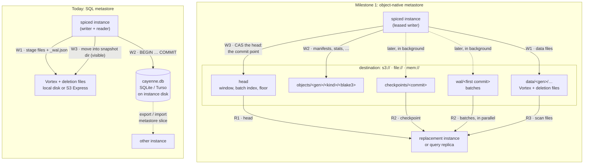
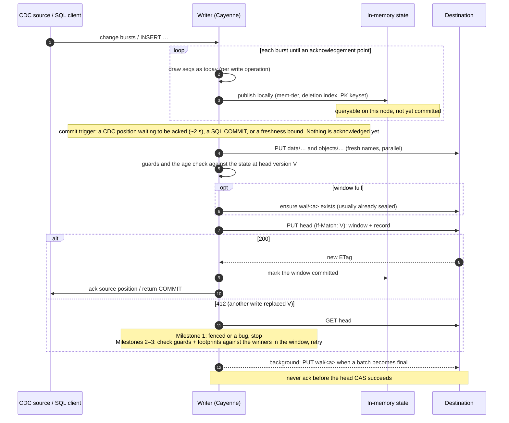
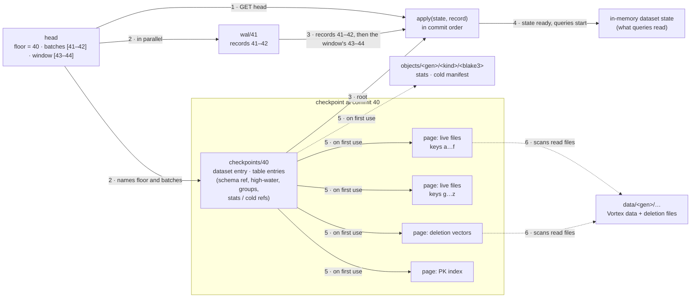
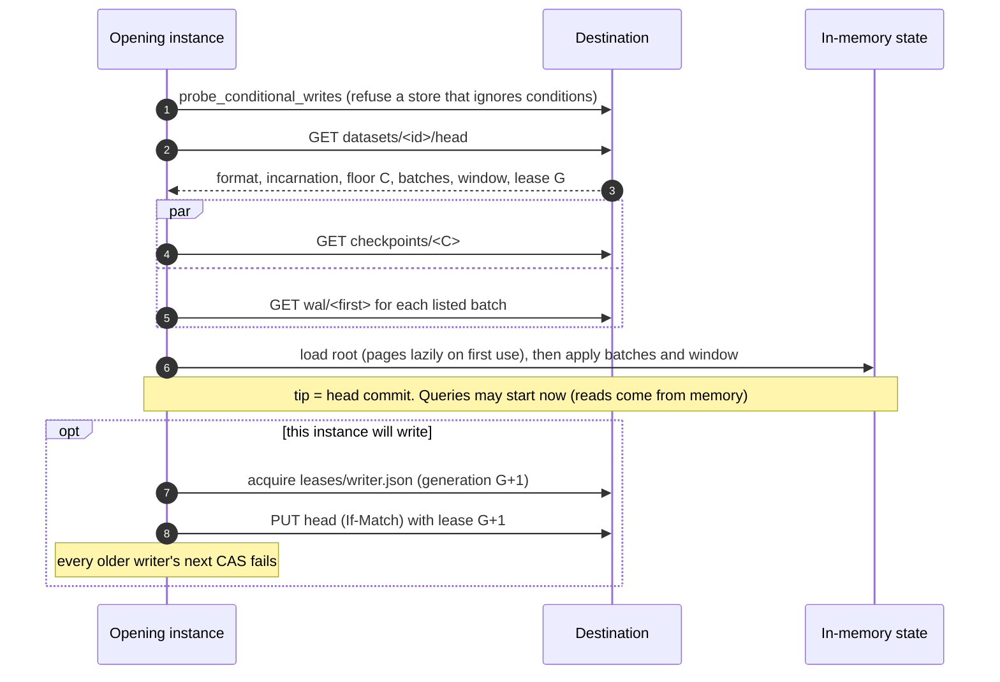
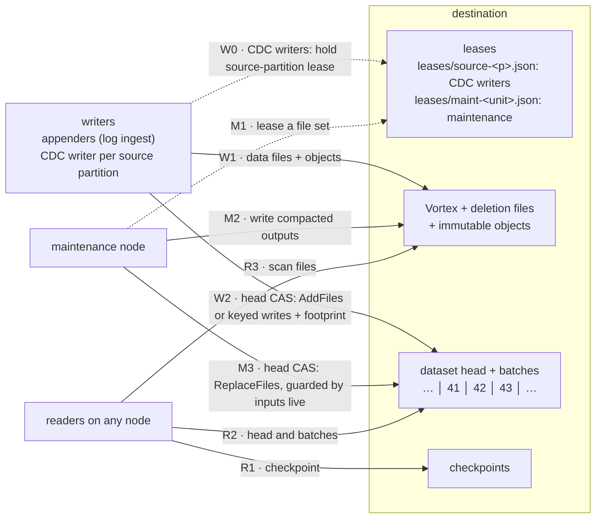
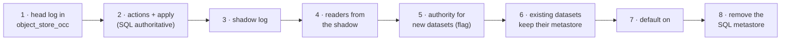

# Cayenne object-native metastore: technical design

Status: **draft for discussion.** This is the technical companion to the
[direction document](object-native-metastore.md), which states the goals,
milestones and decisions, and the alternatives behind each. This document holds
what implementing them needs: the invariants, how Cayenne works today where the
design changes it, and the details, organized by subsystem rather than by
milestone. Sections and items that apply only to a later milestone say so: Milestone 2
runs maintenance on any node beside one ingest writer per dataset, and Milestone 3
adds concurrent ingest writers.

**Where the numbers come from.** "Measured" figures come from prototypes of
the candidate protocols run against RustFS behind a proxy that injects a
20 ms median request latency (P99 five times the median), with the arms
interleaved. They compare designs on one rig; they are not S3 performance,
which roadmap step 1 measures. "Model" claims come from the protocol model in
[`crates/cayenne-metastore-model`](../../crates/cayenne-metastore-model/README.md),
where removing the safeguard breaks a safety invariant; each claim names the
runs, and the [invariants](#invariants) table says what the model covers and
what it does not.

It runs from the top down: the components and why each is needed, the
invariants, then the details by subsystem, the
[implementation roadmap](#implementation-roadmap), and finally a note on
[multiple data locations](#future-multiple-data-locations), a possible future
direction.

**Terminology.** Two numbers order things, and they are kept apart:

| | Commit number (`commit`) | Sequence number (`seq`) |
|---|---|---|
| Counts | Every accepted record: data commits, maintenance, schema changes, `Resolve` | Mutations: an upsert draws a delete `seq` and a higher insert `seq`; an append draws one |
| Density | Dense: one more per accepted record | Sparse: a buffer lost in a crash leaves a gap |
| Scope | Per dataset, which has one head | Per table: the parent table and each partition child have their own allocator |
| Assigned by | The CAS that accepts the record | Cayenne's allocator, while buffering, as today |
| Used for | Naming states: snapshot tokens, checkpoints, batches, the floor, and when a file was removed | Visibility: a delete hides rows at or below its `seq`; compaction and bake cutoffs |

"Commit n" names both the n-th accepted record and the dataset state after
it. [Commit numbers and sequence numbers](#commit-numbers-and-sequence-numbers)
gives the rules. A byte location inside a file is always called a *file
offset*.

## Summary

Each dataset has one small mutable object, the **head**. It carries the most
recent commit records themselves, not a pointer to them. A commit is one
conditional replace of the head (compare-and-swap, CAS, on its ETag). Older
records move out of the head into immutable **batch** objects, many records
per object, before the head drops them. Together, the head and its batches are
the dataset's commit log. Data files and other bulk content are immutable
objects that records reference.

### The components and why each is needed

"Measured" and "model" are as described at the top of this document, under
"Where the numbers come from".

| Component | What it does | Why it is needed |
|---|---|---|
| **Head, changed only by CAS** | The commit point. Success is acceptance. | One write both orders and accepts a commit, and fails for any writer whose view is stale. A commit's guards are checked once, locally, against the exact version the CAS replaces (model). |
| **Records inline in the head** | A reader gets new commits from the head itself. | A poll is one request instead of 1.5, and reader lag P99 drops from 428 to 346 ms, against a head that points to its records (measured). A commit is two round trips, the upload and the CAS, instead of three: commit P50 77 ms against 105–107 ms (measured). |
| **Commit numbers** | Name each accepted record and the state after it. | Maintenance and schema changes alter state without drawing a `seq`, so naming states by `seq` gives two states one name (model). |
| **A window of several records**, not only the latest | Records leave the head in groups. | With only the latest record inline, every commit must first copy the previous record out. With 2 payload uploads per commit, that is 3 creates + 1 CAS; with a window and batches it is 2.07 creates + 1 CAS (measured). |
| **A byte budget on the window** | Bounds the head's size. | Inline payloads, and in Milestone 3 footprints, would otherwise grow the head without bound. Every changed poll downloads the whole window: 24, 99 and 391 KB at budgets of 32, 128 and 512 KiB (measured). |
| **Batches** | Immutable objects holding the records that left the window, many per object. | Cold opens fetch a few objects in parallel instead of one object per commit: 12 requests and 175–186 ms at a 128-record tail, against 3.9 s for a serial walk of per-commit objects (measured). |
| **The batch index in the head** | Lists each batch's range. | The byte budget makes batch lengths vary, so their names cannot be computed. Readers fetch exactly what the head lists, in parallel, without a LIST. A missing listed batch is an error, never an empty range (model). |
| **The copy rule** | When a batch is sealed, by whom, and when the head may drop its records. | Each part is needed: a cut that depends on the observed head, sealing before a batch is final, dropping before the batch exists, or a listed range that does not match the dropped records each lose or corrupt records for lagging readers (model). |
| **Floor and checkpoint in the head** | Where readers start, and what GC may reclaim. | Readers and GC learn both from the same atomic object as the commits. GC that uses a checkpoint the head does not name loses a running query's state (model). |
| **Lease generation in the head** | The current owner's generation. | A new owner's CAS makes every older writer's next CAS fail, and the generation tells the older writer, once it re-reads, that it must stop rather than retry (model). |
| **Deletion from the log, after a retention** | GC deletes a file a fixed retention T after the record that removed it. | No LIST for what was once live; the records already say what left. A query that starts from a recent state can read for the retention, with no reader write (model). |
| **Uploads collected by age** | Every object has a fresh name; GC deletes an unreferenced upload once it is old by the store's clock, after the head has moved and been re-read. | A delayed or fenced writer's upload is either collected or never referenced: a writer references only its own young uploads, and a commit sent before an upload was old fails once the head moves (model). |
| **Identical retry** | Resolves a lost CAS response. | The retry carries the same bytes and condition, so success is acceptance and failure proves rejection, with no extra record to write (model). |
| **Group commit** | Folds queued commits into the next CAS. | A writer can have one useful CAS in flight, because each CAS needs the version the previous one produced. Group commit gives the throughput instead. |

### Compared with the existing implementation

There are two existing implementations to compare with:

- **The SQL metastore** that Cayenne uses today (SQLite or Turso behind
  `MetastoreBackend`). It has no object-storage commit protocol at all.
- **The `object_store_occ` WAL** (`WalStateStore`), a library in trunk that
  Cayenne does not use yet. It is a transactional K/V store on object storage.
  Its sibling `object_store_occ::lease` already fences snapshot writers.

**This protocol is close to the `object_store_occ` WAL.** The WAL already
commits by a CAS of a head object. This design keeps that commit point and the
WAL's way of resolving uncertain writes, and changes where the records live:

| | `object_store_occ` WAL today | This design |
|---|---|---|
| Commit point | CAS of `head` | CAS of `head` |
| Where records live | One object per commit, `wal/<uuid>`, each pointing to its parent; the head points to the newest | The newest inline in the head; older ones in batches, `wal/<first commit>` |
| Commit round trips | 2: the record, then the CAS (3 with a separate data upload) | 2: the data upload, then the CAS; 1 when the payload is inline |
| Reader poll | `snapshot()` reads the head and rebuilds from the checkpoint and the tail; an incremental reader reads the head, then the new record | One conditional GET of the head |
| Cold open | The checkpoint, then a serial walk back through parents | The head, then the checkpoint and batches in parallel |
| Uncertain writes | A receipt saved before sending; retry the exact attempt; resolve by ancestry | The attempt id saved before sending; retry the identical CAS; resolve from the head |
| Checkpoint | Pages and a manifest, then its own head CAS | A root and pages, then named by the next commit's CAS |
| Ownership | None in the WAL; whole-head OCC rejects a stale base. `object_store_occ::lease` provides leases | `object_store_occ::lease`, with its generation carried in the head |
| Garbage collection | None | Deletion from the log after a retention; uploads that never committed collected by age |
| Contents | Key/value mutations | Cayenne file actions |

A prototype with the WAL's layout, a head pointing to a chain of per-commit
records, was measured against this design. The chain is why its cold open is
slow (3.9 s at a 128-record tail), and why a reader needs a second request
after each changed head. Building this design therefore extends the WAL rather than replacing it
(roadmap step 1).

---

# Details

## Invariants

These are the properties the design must keep. The protocol model, the
deterministic simulation and the tests refer to them by number. The model
checks small bounds, exhaustively, with a negative control per safeguard; its
[README](../../crates/cayenne-metastore-model/README.md) gives every run's
bounds. Composing the runs with one another is not checked: each composition
covers the mechanisms its column names.

| # | Invariant | Model coverage |
|---|---|---|
| I1 | Each head version is followed by at most one accepted record, so each commit number is given to exactly one record. | `commits-*`, `commit-guards` |
| I2 | Nothing is acknowledged (a source position, a SQL `COMMIT`) unless the record covering it is accepted. | `commits-commit`, `commits-retry`, `commits-restart-*`, `source-*` |
| I3 | No record from a lease generation older than the head's is accepted. | `commits-commit`, `commit-guards`, `transactions-txn` |
| I4 | No object referenced by the current state or by an unresolved `Prepare` is deleted, and none that a state within the retention references. A referenced object that is missing is an error, never an empty result. | `retention*`, `commits-storage`, `window-storage`, `transactions-txn`, `dataset-lifecycle`, `dataset-prepare-*`, `dataset-query-expiry-*` |
| I5 | Resolution of an uncertain write never reports *accepted* for a rejected attempt or *rejected* for an accepted one; *unresolved* is always allowed. | `commits-*` |
| I6 | A cross-dataset transaction is accepted in all participants or in none, and the state at each `(dataset, commit)` depends only on the records up to that commit. | `transactions-*`, `window-txn`, `concurrent-txn-*`, `dataset-prepare-*` |
| I7 | A query that starts from a state confirmed current within the staleness bound S reads that state for at least the retention T minus S; after that it gets its rows or an error. | `retention*`, `commits-storage`, `window-storage`, `concurrent-floor-aligned`, `dataset-lifecycle`, `dataset-query-expiry-*`, `dataset-byte-window-*` |
| I8 | Replay is deterministic: applying the same records gives the same state, a commit number names exactly one state, and a checkpoint at commit n equals replaying the records up to n, derived collections such as the PK index included. | `commits-*`, `window-*`, `naming-*`, `pk-index-*`, `dataset-lifecycle`, `dataset-prepare-*`, `dataset-byte-window-*` |
| I9 | Per key within a table, visibility follows commit order: a later accepted write to a key wins, and a delete hides exactly the earlier versions of its keys. | `seq-order-*`, `table-seq-*`, `delete-coverage-*`, `dataset-lifecycle`, `dataset-prepare-*` |
| I10 | A source position becomes durable only together with the state it covers. | `source-*` |
| I11 | A reader that meets an action it does not understand refuses the dataset; it never skips the action. | `unknown-action-*` |
| I12 | The state at every commit equals running the accepted writes one at a time in commit order, read-dependent writes included, and each key has at most one live row. | `read-rule2*`, `read-widened-*`, `read-delivery-*`, `read-same-key*`, `read-progress*`; one live row per key also in `dataset-lifecycle`, `delete-coverage`, `cold-promotion`, `source-*` and their siblings |

## Storage primitives

The design needs two conditional primitives, which `object_store` and
`object_store_occ` already provide everywhere, including a local directory:

- **Create-if-absent** for every immutable object: data files, batches,
  checkpoint roots and pages, and the cross-dataset decision. S3
  (`If-None-Match: *`), GCS (`ifGenerationMatch=0`), Azure, the local
  filesystem (stage, then `link`) and memory.
- **Compare-and-swap on a version** for the two kinds of mutable object: the
  dataset head and leases. At open, `probe_conditional_writes` refuses a store
  that accepts conditions but ignores them.

The protocol also needs a version to **never repeat**: once the head moves
from version V, no later write may produce V's ETag again, or a delayed CAS
conditioned on V could apply. The head's bytes never repeat, because its
commit number, the lease generation and the floor only grow, and the model shows that this is
enough, and it is required, not a precaution: an S3-compatible store whose
ETag is a content hash was observed to return the same ETag for rewritten
identical bytes and then accept a delayed CAS conditioned on the first
version. What remains is a store whose ETag can repeat for different bytes; the
local store had that defect and it was fixed in `object_store_occ`
(`d735f39a6a`).

Two extensions to `object_store_occ` are needed:

- **Durable local writes.** `LocalConditionalPut` mirrors `LocalFileSystem`,
which never fsyncs, so it survives a process crash but not power loss. Every
local create becomes:
  1. write the staged file and `sync_all`;
  2. `link` (or `rename` for CAS);
  3. `sync_all` the parent directory, and the parent of every directory the
     create made: a new directory is durable only once the
     entry linking it into its own parent is;
  4. unlink the staged name.

  A record may reference only objects whose directory syncs have completed.

  *Cost:* this is mandatory, not optional. A durable local create or CAS
  measured about 8 ms P50 and 14–15 ms P99 on macOS (APFS, `F_FULLFSYNC`),
  below a remote object-store commit.

  *Concurrency:* uploads and the head CAS must proceed independently; only
  writes to one path need ordering. A local store that funnels every put
  through one writer makes each commit wait behind unrelated uploads: a
  prototype measured head CAS P99 rising from 12 ms to 175 ms with 16
  concurrent 1 MiB uploads, and to 909 ms behind four 64 MiB uploads.
- **The head log:** the head, its window, batches and the copy rule; commit,
  identical retry and resolution; an "advance after my own commit" call, so a
  writer keeps its state in memory instead of rebuilding a snapshot per
  commit; a conditional poll and a parallel cold open. LIST is used only by
  the sweep for uploads that never committed.

## Layout

```text
<runtime.state.location>/cayenne/v1/
  catalog/                                 # the name registry: a small domain of the same shape
    head
    wal/…
  datasets/<slug>-<dataset_id>/
    head                                   # mutable, CAS only: commit number, window, batch index, floor, lease generation
    wal/<first commit>-<lease>             # batches: immutable records first..last, in order
    checkpoints/<commit>-<lease>           # checkpoint root: table entries and the pages of each collection
    objects/<kind>/<lease>-<counter>       # pages, manifests, deletion-vector lists, stats, PK index, …
    data/<table_id>/<write_id>_<ordinal>.vortex
    data/<table_id>/delete_<uuidv7>.arrow
    leases/writer.json                     # object_store_occ::lease records
    leases/gc.json
  transactions/<id>/intent.json            # cross-dataset transactions
  transactions/<id>/decision.json          # create-if-absent
```

Commit numbers in object names are zero-padded to 20 digits, so lexical order
is numeric order. **Every object has a fresh name**, never reused: `<lease>` is
the lease generation of the writer that created it, so two owners never
produce the same name, and the head or a record names each object (see
[Checkpoints and garbage collection](#checkpoints-and-garbage-collection)).
References carry the object's BLAKE3 digest, which checks its bytes; the digest
is not its name.

How it lines up with what exists:

- **`object_store_occ` WAL:** the same `head` object and the same `wal/`
  folder for records, but holding batches named by their first commit and
  their sealer's lease generation instead of one object per commit named by a
  random id. References carry a BLAKE3 digest, as the WAL's
  `Reference { id, digest }` does, and the head carries a
  `format` and an `incarnation`, as the WAL's head does.
- **`object_store_occ::lease`:** leases are its `LeaseRecord` JSON objects,
  in a `leases/` folder, as snapshot writers' leases are in
  `snapshots/leases/<dataset>.json`. Mutable coordination objects are `.json`, as in
  `state.rs`; the log and checkpoints use Protocol Buffers (see
  [Encoding](#encoding)).
- **Cayenne's data files** keep their names: `<write_id>_<ordinal>.vortex`
  for data and `delete_<uuidv7>.arrow` for deletion vectors. They are not
  content-addressed, because hashing a large file means reading it back, and
  their names are already unique. The dataset folder is named
  `<slug>-<id>/data/`, as the datalake tier already names its folders
  (`datalake_dir_segment`), so a person browsing the bucket can tell datasets
  apart, and dropping one is one prefix.
- **What goes away:** the per-snapshot directory (`<table_id>/<snapshot_id>/`),
  and the `_staging/<id>/_wal.json` staging WAL that moves files into it. A
  file becomes visible when a record references it, so files never move.
- **The root folder.** `cayenne/v1/` sits beside the other features' folders
  in `runtime.state.location` (`results-cache/`, `rate-control/`, `cluster/`,
  `snapshots/`). The name is part of the user-facing on-disk layout, so it is
  settled in the Enhancement.



*Before and after Milestone 1: the metastore moves from a database on the instance's disk to a head and its batches in the destination, which any instance can recover from. Edge numbers give the order of each actor's steps (W = writer, R = reader). Data files and objects are written before the record that references them, and the head CAS is the commit point.*

## Encoding

**The log and checkpoints use Protocol Buffers**, through `prost`, which the
workspace already depends on. That covers the head, records, batches,
checkpoint roots and small pages. Leases and transaction objects
stay JSON, as `object_store_occ`'s are: they are small, never compared byte for
byte, and readable when debugging. Large collections in a checkpoint (file
lists, deletion-vector lists, the PK index) are columnar pages in Arrow IPC, as
delete files are today, not long runs of repeated messages.

The reasons: numbered fields give explicit evolution rules (add fields, never
renumber, reserve removed numbers); digests and inline payloads are bytes
rather than base64 text; and the head must fit its byte budget H, where a
binary encoding is smaller than JSON (unverified; not measured on this
design). FlatBuffers, as SlateDB uses for its manifest, would add zero-copy
reads, which a head decoded once per poll does not need.

Three properties of Protocol Buffers conflict with the protocol, so each comes
with a rule:

- **Its encoding is not canonical, so a record is encoded once.** The format
  does not promise one byte string per message, and `prost` encodes a map field
  held in a `HashMap` in hash order: 50 encodings of the same 8-entry map gave
  50 distinct byte strings (`prost` 0.14.1). Every sealer must produce identical
  batch bytes, and digests name objects, so the writer encodes its record once.
  The head and batches carry each record as its original bytes (a `bytes`
  field), and a sealer copies those bytes; it never decodes and re-encodes
  them. Byte equality and digests then never depend on the encoder or its
  version. Protocol messages also use no map fields (sorted repeated entries
  instead) and no floating-point values.
- **Unknown fields are skipped, so meaning changes fail closed.** An older node
  decodes a newer message without error and ignores what it does not know, and
  `prost` drops the unknown field if the message is re-encoded. In the run, a
  message with fields 1 and 2 decoded on the old schema as `RecordV1 { commit:
  7 }` and re-encoded to `[8, 7]`, without field 2. Skipping an action or guard
  returns wrong rows, which I11 forbids. So a change that alters what a reader
  must do bumps `format` or adds a named entry to the head's `features`
  list, which a reader that does not know it refuses, as Delta's reader
  and writer features and Iceberg's `format-version` do. An unknown field may
  only carry advisory data, such as statistics or hints. Because no node
  re-encodes another node's message, none can drop a field it does not know.
- **Zero and absent are the same value.** A proto3 scalar at its default is
  not encoded, so a field whose 0 means something different from "not set"
  is declared `optional`. Where absent is meant to equal 0, as for the
  location id in [multiple data locations](#future-multiple-data-locations),
  plain proto3 fields already give that.

A binary log cannot be read with `cat`, so a decoder that prints any head,
record, batch or checkpoint page as text is part of the developer tooling.

## The head

The head is a small object (see [Encoding](#encoding)), bounded by an
internal byte budget H (on the order of 128 KiB), holding:

| Field | Meaning | Why it is there |
|---|---|---|
| `format` | The encoding version of the head, records and batches. | A reader that does not know the format refuses the dataset (I11), and every sealer must produce identical batch bytes. |
| `features` | The named features the dataset's records use, beyond those `format` implies. | A reader refuses a dataset that lists a feature it does not know (I11), so a change in meaning can ship without a new `format`; an unknown Protocol Buffers field is otherwise skipped silently (see [Encoding](#encoding)). |
| `incarnation` | A random id fixed when the dataset is created. | A dataset recreated under the same name never mixes with the old one's objects or attempts. |
| `commit` | The commit number of the newest accepted record. | Names the current state. Readers, recovery and GC compare commit numbers. |
| `window` | The newest accepted records, ending at `commit`, oldest first, in full. Its first record's number, `w_first`, is derived: `commit` minus the window's length, plus one. | One-request polls, two-round-trip commits, and records leave in batches rather than one copy per commit. |
| `batches` | The last commit number of each sealed batch and its sealer's lease generation, in order, covering `floor + 1 .. w_first - 1`. Each batch starts after the previous one ends, and its name is derived from its first commit and that generation. | Variable-length batches cannot be named by arithmetic, and readers fetch only what is listed. A small number per entry is all a fresh name costs. |
| `floor` | The commit number of the newest published checkpoint, and the lease generation that wrote its root. | Readers start from it. Without it, recovery and running queries' reads break (model). |
| `lease` | The lease generation of the current owner. Object names include it. | A stale owner learns from it that it must stop, and a takeover changes the head even when nothing is committed. Names from different owners never collide. |

The per-table `seq` high-water marks live in the table entries of the dataset
state, not in the head.

Each record in the window holds the attempt id, the writer's lease
generation, the actions with their guards, the BLAKE3 digests of every object
they reference, and any inline payload.

Unresolved `Prepare` reservations and per-partition lease generations live in
the dataset state (records and checkpoints), not in the head, so the head
does not grow with partitions or transactions.

*Not included: a per-write publication id.* An earlier draft added a fresh id
to every head so its bytes could never repeat. The model shows the head's
bytes never repeat without it, so it is left out (see
[Storage primitives](#storage-primitives)).

## The write path

Writes accumulate in the writer's buffer and become durable in one remote
commit at the next acknowledgement point (direction document, decision
1.2). Data files and objects are uploaded first, and the head CAS that references
them is the commit point. As today, a buffered write is queryable on the
writing node as soon as it is applied; other nodes see it once the commit
succeeds and they poll. Publishing at commit instead is an option (direction
document, decision 1.2), independent of how `seq`s are stamped.

A writer holds the dataset state at commit n, the head version V that carries
it, and V's ETag. A commit:

1. Uploads new objects, each under a fresh name, in parallel. Small payloads
   skip this step and travel inside the record (see
   [Small writes](#small-writes-and-the-inline-tier)).
2. Evaluates the record's guards locally against the state at V, including
   the `seq` rule and the age check: the record references only objects live
   at V and the writer's own uploads younger than the age limit. Because the
   CAS succeeds only on V, this is exactly the state before the record.
3. If the window would exceed its byte or count budget, ensures the oldest
   final batch exists, then drops its records from the window and appends its
   range to `batches` (see [The copy rule](#the-copy-rule)).
4. CASes the head from V to the new head (window plus record n + 1).
   **Success is acceptance.** It applies its own record and acknowledges.
5. In the background, seals any batch that has just become final.



*Writing: bursts publish locally as they arrive, and one head CAS per acknowledgement point makes them durable; the acknowledgement follows the commit, never precedes it.*

**Acknowledgement.** An acknowledgement — a CDC source position or a SQL
`COMMIT` — is returned only after the head CAS covering it has succeeded. A
staged object or buffered change never justifies one.

### The copy rule

Every record above the floor that has left the window is in a batch the head
lists, and that batch existed before the head stopped carrying the record.
Records at or below the floor are in the checkpoint and may be reclaimed.

Records are identified by commit number, which is dense, so record `a + 1` is
the one after record `a`. A batch is named by its first record's commit number
and its sealer's lease generation, both in its index entry.

- **Deterministic cut.** The batch starting at `a = w_first` ends at
  `c = min(a + K − 1, largest c whose records a..c fit the batch budget B)`.
  The cut depends only on records `a..`, which are immutable, never on which
  head a sealer read. A batch may be sealed only once it is final: the window
  holds record `c + 1`, or `c = a + K − 1`. So every write of `wal/<a>`
  carries identical bytes.
- **Anyone may seal** a final batch from a head they observed:
  create-if-absent, and a duplicate or late create writes identical bytes, at
  worst a leak after GC. A batch is never built from a planned, unpublished
  head. The model shows that lets two sealers race different bytes into one
  name, and a reader then sees the losing proposal.
- **Drop only after the batch exists,** and list exactly the dropped range.
  Otherwise a reader behind the window finds neither the record nor its
  batch, or the index and the batch disagree.
- **Feasible budgets.** The largest record R must fit a batch (R ≤ B), and the
  head must hold a full batch plus one more record beside everything else it
  carries: H ≥ B + R + M, where M bounds the head's content outside the window
  (its fields, record envelopes, and the batch index at its largest before a
  checkpoint trims it). Otherwise the record that makes a batch final may not
  fit beside it. H ≥ B + R alone is not enough: a prototype at H = 300,
  B = 200, R = 100 could not fit the third 100-byte record once the head's
  other content was counted. The cut, R, B, H and
  K are protocol constants, not head fields.
- **One canonical encoding.** Every sealer must produce identical bytes, so the
  record and batch encodings are versioned with `format`, and a sealer copies
  each record's original bytes rather than re-encoding it (see
  [Encoding](#encoding)). Sizes count the
  canonical encoded record, inline payload included.
- **The floor moves only to a batch end** (or to `w_first − 1`). The floor
  never splits a batch, so a batch is either wholly retained or wholly
  reclaimable, and readers never clip one. This is a simplification, not a
  safety rule: a clipped alternative, in which a batch above the floor stays
  listed and readers skip its records at or below the floor, is not proposed
  because it complicates the decoder.
- **The batch index is bounded by the checkpoint cadence.** A checkpoint moves
  the floor and trims the index. The writer checkpoints before the index
  would push the head past its budget.

The model ran with records of two sizes, so that byte and count cuts both
occur. Measured at H = 32, 128 and 512 KiB, the writer sealed 1.0, 0.2 and
0.04 batches per commit, and each changed poll downloaded 24, 99 and 391 KB.
H around 128 KiB is the starting point.

### Uncertain writes

A record holds a unique attempt id, persisted before the CAS is sent. Every
failed CAS is ambiguous, including `412 Precondition Failed`: the client
library may have re-sent a request the store accepted (the `object_store`
crate re-sends a conditional PUT after a 5xx, and the re-send then fails its
own condition). A writer therefore resolves every failed CAS from the head
before it retries or re-plans:

| Head found | Outcome |
|---|---|
| Past commit n, and record n + 1 (in the window or a listed batch) is ours | accepted |
| Past commit n, and record n + 1 is another attempt | rejected |
| Still at version V | **retry the identical CAS** (same bytes, same condition). A success is acceptance. |
| Still at commit n, but a version other than V (a takeover changed the head) | rejected: V can never hold again |
| Record n + 1 reclaimed below the floor | accepted if retained evidence (recent attempt ids in checkpoint roots) names our attempt, else **unresolved** |
| Unreadable | **undecided**: read the head again later, and never retry meanwhile |

A delayed original can never apply after any later write, because the head's
ETag never repeats.

**A retry needs the original bytes and condition.** After a restart, an
attempt id alone can still establish acceptance from retained evidence. An
identical retry also needs the attempt's exact bytes and CAS condition, so a
writer that did not persist them treats a head still at commit n as
*unresolved*, never as a reason to send a new attempt. Sending before the
attempt id is persisted lets a restarted writer apply one logical write twice
(model: `commits-restart-no-persist-before-send` fails;
`commits-restart-turnover` holds with a restart and a takeover).

**Never retry an attempt until it has resolved as rejected.** Retrying an
undecided attempt, or treating *unresolved* as *rejected*, can apply an
acknowledged write twice; the protocol model finds both.

An *unresolved* attempt is reported as **commit outcome unknown**, the same
result a database gives when a connection drops during `COMMIT`, and the
writer stops retrying it. Nothing is lost by this:

- The attempt was never acknowledged.
- A CDC source position commits in the same record as its data, so a new
  owner resumes from whatever the head holds, and the source re-delivers
  anything after it.
- *Unresolved* is final only past the evidence-retention horizon, so only for a
  writer absent longer than that. An unreadable head leaves the attempt
  undecided until a read succeeds. Attempt ids are small, so the horizon can
  be long.

The `object_store_occ` WAL resolves the same way: it retries the exact attempt
and keeps a receipt to resolve from.

Three more rules:

- **Unknown actions are an error.** A reader that does not recognize an action
  refuses the dataset with the "upgrade Spice or clear the acceleration"
  message, which is the role the SQLite `user_version` gate plays today.
  Skipping an action would silently drop rows.
- **A lost upload response is resolved by reading the object back,** never
  assumed absent. The writer's own upload, present at its fresh name with the
  expected digest, counts as uploaded, and its age still counts from the
  first attempt.
- **A referenced object that is missing is an error, never an empty result.**
  If a record or checkpoint names an object (data file, deletion vector, page)
  that cannot be read, opening or scanning fails with a corruption error. Today
  a published snapshot whose files are gone reads as empty, which the rc.3
  testing showed with a forced interleaving. An empty answer is indistinguishable
  from a correct one, so it must never stand in for missing data.

### Ownership and fencing

The writer holds a per-dataset lease, `leases/writer.json`
(`object_store_occ::lease`). A new owner takes the lease at generation g+1,
then CASes the head to `lease: g+1`. Every older writer's CAS is conditioned on
an earlier version and fails; when it re-reads the head, the generation tells
it to stop. This is the pattern `object_store_occ::lease` already documents: a
holder checks its generation inside its own conditional writes of the state it
guards. Nothing about ownership is checked at replay. The old writer's
unflushed buffer is discarded, since it was never acknowledged.

**Every committer carries the generation, background tasks included.**
Statistics, compaction, cold promotion and every other background task commit
through the writer's handle, so the head CAS fences them like ingest. A
writer's handle is closed when its session ends (a dataset reloaded or
recreated in the same process), even if a background task still holds it;
otherwise a task that outlives its session commits after the new session has
written. Today's SQL metastore accepts exactly that late write, from a
dropped provider's post-write maintenance loop persisting table statistics: a
prototype reproduced it 3 times out of 3.

**Safety comes from the head, not from the lease's timing.** Recording a new
generation in the head fences every older writer whatever its lease says, so
a replacement that is told it is the writer (a restarted pod, an orchestrator
replacing a node) takes over at once: it increments the generation, CASes the
head, and proceeds. The lease object only arbitrates when several instances
could each become the writer: a candidate takes over only once the holder's
lease has lapsed, which keeps two live instances from fencing each other back
and forth. The lease's lapse rule is `object_store_occ::lease`'s, judged on the
observer's own monotonic clock, so clock skew cannot expire a live holder.

### Throughput and group commit

Each version of a dataset's head can be replaced by exactly one successful
CAS. Nothing enforces this beyond the store's conditional write: there is no
lock and no leader.

- **Within one writer,** the next CAS needs the version the previous one
  produced, so a writer has one useful CAS in flight. **Group commit** removes
  the limit: commits that arrive while a CAS is in flight are folded into the
  next record, so throughput grows with commits per record, and a commit
  waits for at most one CAS ahead of its own.
- **Across writers (Milestones 2 and 3),** any number of CASes can be in flight on one
  head. Each is conditioned on the version its writer last saw, so one wins
  each version and the rest fail (412), re-read the head and retry. A dataset
  completes about one head replacement per round trip, whoever the writers
  are.

Pipelining CASes by predicting the next ETag was considered and dropped. It
works only where the ETag is a documented function of the bytes: S3 Standard,
single-part, plaintext or SSE-S3. It does not work under SSE-KMS, for
multipart uploads, on S3 Express, or on GCS or Azure.

## Readers

- **The head is a cached value.** Each node keeps the last head it read, with
  its ETag, and treats it as fresh for the dataset's staleness bound. A query
  that finds it older refreshes it first, with a conditional GET
  (`If-None-Match` its ETag), and concurrent queries share one refresh. A 304
  means nothing changed. A 200 carries every record still in the window,
  inline. A node that is further behind fetches the listed batches it needs,
  in parallel.
- **Datasets in use refresh in the background.** A dataset queried within the
  last one or two refresh intervals is refreshed ahead of its queries, so they
  rarely wait. Refreshing early is always safe: a newer committed head never
  breaks monotonic reads, so it costs only requests. A dataset nobody queries
  costs none, and a writer never polls its own datasets.
- **What it costs.** Head reads scale with the datasets in use on each node,
  divided by the staleness bound, not with every dataset. A query on a stale
  dataset waits for one head read (not measured; tens of milliseconds on S3
  Standard).
- **Cold open:** GET the head, then in parallel the checkpoint root named by
  `floor` and the batches covering `floor + 1 .. w_first − 1`, then apply the
  window. Two dependent steps, regardless of the tail length. Loading pages
  when a scan first needs them comes after these and is not counted. A
  reader writes nothing.
- A listed batch that is missing above the floor is an error, never an empty
  range. A reader below the floor reopens from the checkpoint.
- Readers never consult anything but the head and what it lists. A late
  write elsewhere, such as a stale batch create, cannot change what they read.
- Readers check each record's guards while applying it. A record whose guards
  fail is a corruption error that refuses the dataset, never a skipped record.

**How other systems' readers find new commits.** Every system surveyed polls;
none pushes.

- *SlateDB:* its read-only `DbReader` re-reads the manifest every 10 s by
  default (its writer every 1 s), probing forward from the manifest id it has
  cached
  ([`config.rs`](https://github.com/slatedb/slatedb/blob/e25cfc8dca17714d4b71ab6f6ee48053f10f37e7/slatedb/src/config.rs),
  `db_reader.rs`).
- *Lance:* manifests are named `_versions/{u64::MAX - version}.manifest`, so
  one LIST finds the latest on stores that list in key order, and a
  `latest_version_hint.json` plus HEAD probes replaces the listing on S3
  Express
  ([`commit.rs`](https://github.com/lance-format/lance/blob/e93917330641ccdda70ba676989284c4b1935fcc/rust/lance-table/src/io/commit.rs)).
- *Delta Lake:* a reader lists `_delta_log` from the `_last_checkpoint` hint,
  or asks the catalog first on catalog-managed tables
  ([Delta blog](https://delta.io/blog/2026-02-02-delta-catalog-managed-tables/)).
- *Iceberg:* a reader loads the metadata pointer from the catalog: one read,
  the shape this design has.

A reader's cost is requests per poll × polls per second × readers, and with
more readers than writers it outweighs the writer's. That is why a poll here
is one conditional GET.

**Readers poll; writers never hint.** Polling is the only notification, as in
every system above. The staleness bound is internal, set from the dataset's
freshness need.

## Dataset state: where it lives and how it changes

Everything the SQL tables hold today becomes **dataset state**: one logical
value per dataset, defined as the result of applying every committed record, in
log order, to an empty state.

**One function changes it.** A deterministic `apply(state, record)` is the only
code that modifies state. The writer runs it after its own commit succeeds,
readers run it while following the log, and recovery runs it on open. Nothing
is ever updated in place in storage:

- a record is immutable once created;
- a checkpoint is a new set of immutable objects;
- so "safely modified" means *committed in a record and applied by
`apply`*.

The guards in the record are checked inside `apply`, so all three paths agree
on what took effect.

**It is stored as a checkpoint plus a tail.** A checkpoint of the state at
commit n (`checkpoints/<n>`) consists of:

- **The root**, a small object holding:
  - the dataset entry: name and partitions;
  - one **table entry** per table: config, a schema reference, the table's
  `seq` high-water mark, the protected-group list, index runs, the stats
  reference with the commit it is valid as of and whether the stats are exact,
  and the cold-manifest reference;
  - per table, a list of **pages** for each large collection (live files,
  deletion vectors, write-back markers, the PK index), each with its key range
  and BLAKE3 digest;
  - recent attempt ids, the retained evidence for resolving uncertain writes.
- **Pages**: sorted, size-bounded (~1–4 MiB), immutable chunks of one
collection, such as live files or deletion vectors, stored as objects. The
`object_store_occ` WAL splits its checkpoints into pages the same way.

The state at the tip is that checkpoint plus the records after its commit:
those in listed batches, then those in the head's window.



*Dataset state: the head names a checkpoint and the batches after it, and its window holds the newest records; `apply` folds them into the in-memory state queries read. Edge numbers give the load order: queries can start at step 4, and pages and objects load lazily afterwards.*

**Reconstruction:**

1. GET the head.
2. In parallel, with bounded concurrency, GET the checkpoint root named by
   `floor` and every listed batch. An unbounded fan-out saturated an
   S3-compatible test server (1,025 GETs at once: P99 6.2 s, against 28 ms on
   a local directory); the checkpoint cadence keeps the batch count, and so
   the fan-out, small.
3. Apply the batches' records, then the window's, in commit order.
4. Load pages lazily, per collection, when they are first needed: live files
   when a scan plans, deletion vectors when the deletion index builds.



*Loading on startup: the head, then the checkpoint and batches it names in parallel; a writer then takes the lease and records its generation in the head.*

The writer and same-node readers keep the result in memory. Queries read that
in-memory state and never fetch from the metastore's storage.

**Writing a checkpoint at commit n,** where n is a batch end, so the floor
never splits a batch:

1. Re-emit only the pages whose key range changed since the previous
   checkpoint, under fresh names.
2. Reference the unchanged pages by name and digest; they are live in the
   previous checkpoint.
3. Write the root at `checkpoints/<n>-<lease>`, after all its pages.
4. The next commit's CAS sets `floor` to n, and trims the batch index below
   it. A checkpoint therefore costs no CAS of its own when the writer writes
   it; a separate maintenance process needs its own.

A checkpoint's commit determines its contents: two checkpoints at the same
commit are identical, because `apply` is deterministic and a commit number
names one state (model: `naming` holds; without the commit number,
`naming-no-commit-number` fails).

**A checkpoint is a compaction of the log.** Its pages behave like the levels
of an LSM tree, and rewriting only changed pages works when changes are
localized. New files are appended in key order and are cheap, but a scattered
change, such as compaction removing files across every key range, rewrites
most pages for a few entries each. If that dominates, a checkpoint can write
delta pages over its base and merge them once they accumulate, as Delta Lake's
log compaction files aggregate a commit range and Iceberg merges manifests.
Roadmap step 3 measures checkpoint bytes per committed metadata byte before
this is decided.

## Commit numbers and sequence numbers

The [terminology](#cayenne-object-native-metastore-technical-design) table sets
out the two numbers. Commit numbers name states; `seq`s decide visibility.

**Commit numbers.** The CAS that accepts a record gives it the next commit
number, whatever the record holds: a data commit, a compaction, a schema
change, a `Resolve`. The head's `commit` is the newest record's number, and
snapshot tokens and the floor are commit numbers, and so is the commit part
of checkpoint and batch names.

- *Why states need their own number.* A compaction draws no `seq`, and a
  schema change touches no rows, yet each changes the state. Named by `seq`,
  the states before and after either would share one name, and so would their
  checkpoints. A dense commit number gives each state its own name
  (`naming`).
- *Iceberg keeps the same split:* each commit gets a snapshot sequence number,
  while a rewrite's output files carry an explicit, older data sequence number
  "for data that logically belongs to an older sequence number"
  ([Iceberg spec](https://iceberg.apache.org/spec/#sequence-number-inheritance)).
  Delta Lake's table version plays the commit number's role.

**Sequence numbers.** Cayenne's `seq` stays as it is: an `i64` drawn per write
operation, per table. An upsert draws a delete `seq` and a higher insert
`seq`, and an append draws one. Cayenne stamps it into the mem-tier, the
deletion index and the PK keyset, and stores it as each file's
`min/max_sequence` and each deletion vector's `sequence_number` and
`reinsert_sequence`. Allocation and stamping do not change.

- **Each table has its own allocator.** A dataset is a parent table plus, when
  partitioned, one child table per partition, and each is its own
  `cayenne_table` row with its own `current_sequence_number`. Transaction begin
  tokens are already per table ("allocators are per-table, so the token is
  meaningless across tables", `provider/transaction.rs`).
- **A record carries a `[seq_lo, seq_hi]` range for each table it touches.**
  Each table entry holds its high-water `seq`, the highest `seq_hi` of any
  record that touched the table. Ranges are sparse, so nothing assumes the next
  record starts at the high-water mark plus one.
- **The rule: within each table, every `seq` in a record is above every `seq`
  of that table in earlier records.** The writer checks it locally before the
  CAS, as it checks every other guard, and a record that would break it is
  never sent.
  - *One writer:* each table's allocator is monotonic, and each commit carries
    everything drawn since the previous one.
  - *Maintenance* (compaction, the bake, cold promotion) draws no `seq`. Its
    outputs keep their inputs' `seq` ranges, and record the cutoff they applied
    (see [`cayenne_delete_file`](#cayenne_delete_file)). Its cutoffs are the
    committed `seq` it read. Its record still gets a commit number, which is
    what names the state it produces.
  - *A new owner* allocates above each table's high-water mark.
  - *Milestone 3:* a writer that loses a race must bring its buffered `seq`s above
    the winner's, in each table they share, before retrying; the options are in
    [Lost races and `seq` order](#lost-races-and-seq-order).
- **Why per table, not per dataset.** A dataset-wide rule would compare
  numbers from different allocators. When one partition's allocator is behind
  another's, a correctly allocated record that touches both is refused, and
  retrying the same bytes cannot help (model: without the per-table scope,
  `table-seq-no-table-scope` fails; `table-seq` holds, including a key that moves between partitions in one
  record). So a record that meets each touched table's rule is never refused
  because another table's high-water mark is higher. A per-table rule also survives either future for partitions:
  flattening them into one table makes it per dataset, and a log per subtable
  makes it per log.

**Why every existing comparison keeps its meaning.** Per-key visibility
compares the `seq`s of one key in one table: a row with data `seq` `s` is
hidden by a delete with `seq ≥ s`, and a re-inserted row is visible iff its
insert `seq` exceeds the delete's. Several other paths compare `seq`s across
keys of one table as a proxy for commit order, and with this rule that is
exactly what they are:

- the seq-prefix bake's cutoff;
- compaction's "clear deletes at or below the cutoff";
- the orphan deletion-vector sweep's floor;
- protected-snapshot thresholds;
- the user-transaction begin token, `sequence_high_water()`.

**An example.** Table T, one writer:

| Commit | Record | T's `seq` high-water |
|---|---|---|
| 7 | Upserts in T, drawing `seq`s 100–140 | 140 |
| 8 | Compaction of files A and B with cutoff 140. No new `seq`; the outputs keep A's and B's ranges, and record that they applied deletes through 140. Cold file C still holds rows at or below 140, so those deletes stay. | 140 |
| 9 | Cold promotion rewrites C, applying deletes through 140. Every live file that could hold a row they hide has now applied them, so the record clears them. | 140 |
| 10 | A schema change | 140 |

Commits 8, 9 and 10 are three different states with the same `seq`
high-water, which is why states are named by commit number.

**Coalescing.** A mem-tier checkpoint writes only each key's last version in
its window. Measured with a Cayenne integration test at `ad2c1fbaed`, with 1 and
4 shards: seven versions of four keys in one window (three writes of one key, a
delete then re-insert, an insert then delete) flushed as three rows, and two
more updates of one key flushed as one row. The checkpoint encodes
`visible_mem_tier_batches_by_shard`, the tier with its own tombstones applied.
Correctness here does not depend on it; it keeps flushed files to one version
per key. Durable-mode CDC applies, SQL statements and the inline tier were not
measured.

**Considered: dense `seq`s, one per commit.** Every row and delete in a commit
would carry the commit's `seq`, with an internal counter ordering operations
inside the buffer for coalescing. It is purely an implementation choice, and
no performance gain is expected (code inspection only, not measured): data
files carry no per-row `seq`, only a per-file min and max; a mem-tier segment
already carries one `seq`; and the allocator hands out `seq`s from cached
blocks of 262,144 (`SEQ_RESERVE_BLOCK`). It would need every write path to
coalesce, and it changes the allocator and every stamping site. Not planned.
Milestone 3's eager-coalescing option ([Lost races and `seq`
order](#lost-races-and-seq-order)) is the closest step toward it.

**Rejected alternatives:**

- **Naming states by `seq`, with no commit number.** Two states share a name
  after any maintenance or metadata-only commit (above).
- **One `seq` allocator per dataset.** It would make the rule dataset-wide,
  but it changes allocation code that per-table transactions depend on.
- **Maintenance drawing a fresh `seq`.** While the buffer holds lower `seq`s,
  the next data commit would break the rule; the model's
  `seq-order-maintenance-draw` control shows a resurrected row.
- **Independent `seq` blocks reserved per writer.** Each Milestone 3 writer would
  draw from its own range, so `seq` order would differ from commit order across
  writers, and every cross-key comparison above would need rewriting.
- **Packing a commit position and an in-commit counter into the `i64`.** A
  second number inside every `seq`, a 2^20-per-commit limit, and provisional
  stamps re-stamped after every commit.
- **Assigning `seq`s at `apply` from relative slots.** Cayenne stamps `seq`s
  into the PK keyset and the deletion index while buffering, so those stamps
  would have to be rewritten after every commit.
- **One shared counter object updated by CAS per write.** A round trip per
  write and a single point of contention.

**Model-checked.** The `seq-order` runs, with per-key versions, buffered
windows, maintenance commits and two writers, show the rule keeps I9. A
maintenance commit that draws a `seq` below a buffered one, compaction that
clears deletes by a `seq` it drew rather than the committed `seq` it read, and
a lost race retried without a uniform shift each break I9. The `table-seq`
runs add per-table allocators under one head. Neither composition models
relative updates, predicate reads or real PK and deletion-index stamping.

## Mapping the metastore tables

Each table below has the same four entries:

- **SQL metastore**: what the table holds in the current SQLite/Turso metastore.
- **Stored as**: where it lives in the [dataset state](#dataset-state-where-it-lives-and-how-it-changes).
- **Changed by**: the actions that modify it, and what makes that safe.
- **Derived or rebuilt**: what is computed rather than stored, and how it is
  rebuilt on open.

Tables that go away have one line.

### `cayenne_table`

- **SQL metastore:** name, schema, config, `current_snapshot_id` and
  `current_sequence_number`.
- **Stored as:** the table entry in the checkpoint root.
- **Changed by:** `CreateTable`, `SetSchema` and `DropTable`. Each is guarded
  (the name is free, the table exists), so a racing or stale writer has no
  effect.
- **Derived or rebuilt:**
  - The *current snapshot* is the set of live files that belong to no protected
    group (next entry). A commit that replaces it is a `ReplaceFiles` of those
    files. Where a stable identity is needed, such as cache keys or directory
    names, it is the commit number of the last record that replaced that set.
  - The *high-water `seq`* is maintained by `apply`: the highest `seq_hi` of
    any record that touched the table (see
    [Commit numbers and sequence numbers](#commit-numbers-and-sequence-numbers)).
    It is written into the table entry at each checkpoint.

### `cayenne_snapshot_file` and `cayenne_snapshot_file_statistics`

- **SQL metastore:** one row per (snapshot, file), replaced wholesale per snapshot. Rows
  for dead snapshots pile up. The second table is a separate per-file stats
  cache.
- **Stored as:** the per-table **live-file collection**. Each entry holds the
  file's path, rows, bytes, min/max `seq`, digest, per-file stats, PK min/max,
  protected group (if any), the commit that added it, and `applied_through`:
  the deletes it already reflects, which is the cutoff of the compaction or
  promotion that wrote it, or none for a fresh file. Entries are kept in
  checkpoint pages sorted by (PK lower bound, file id), so planning and Milestone 3's
  footprint checks read only the pages they need.
- **Changed by:** `AddFiles`, `RemoveFiles` and `ReplaceFiles`, and nothing
  else. Removal is guarded by the file still being live, so two removals of the
  same file cannot both take effect.
- **Derived or rebuilt:** rebuilt on open from the root's pages plus the tail.
  There is no dead-row backlog: a removed file leaves the collection at the
  record that removes it, and GC deletes the physical file the retention T
  after that record.

### `cayenne_snapshot_sequence`

- **SQL metastore:** a row per protected snapshot, holding its delete-`seq` fence.
- **Stored as:** a protected snapshot becomes a **group of files that share a
  fence**. The fence is the table's `seq` high-water when the group was
  created, so "deletes after the fence" means deletes with a higher `seq`. The
  group list, `(group_id, fence_seq)`, lives in the table entry,
  because the bake keeps it to a few entries. Each live file records its group.
- **Changed by:** records in which a group and its files always change
  together:
  - an upsert's `AddFiles{group: new}` creates the group with its files, and
    `apply` sets its fence to the record's `seq_hi` for that table;
  - the bake's `ReplaceFiles` merges groups, guarded by its inputs still being
    live;
  - a group whose last file is removed disappears in the same `apply`.
- **Derived or rebuilt:** group membership is read from the file entries; the
  list is rebuilt from the root.

### `cayenne_delete_file`

- **SQL metastore:** a row per deletion vector. Compaction clears rows by `seq` cutoff,
  the orphan sweep removes the lowest ones by `seq`, and every row is read when
  the deletion index is built.
- **Stored as:** the per-table **deletion-vector collection**. Each entry holds
  path, kind (key or position), target file for a position delete, `seq`,
  reinsert `seq`, count and size. Entries are kept in pages sorted by (`seq`,
  id). Recent additions live in the tail, or inline in the record when small.
- **Changed by:**
  - `AddDeleteFiles`;
  - `RemoveDeleteFiles{ids}`, used by the orphan sweep;
  - `ClearDeleteFiles{seq_le: d}`, guarded by **coverage**: every live file in
    the table, cold files included, whose `min_seq` is at most d must have
    `applied_through` of at least d. Only then can no file still hold a row
    those deletes hide.
- **An unresolved `Prepare` caps the cutoffs.** A `Prepare`'s deletes keep the
  `seq`s drawn while buffering but take effect only at `Resolve{commit}`. A
  maintenance record committed in between could otherwise record
  `applied_through` at or above such a delete without having applied it, and
  after the `Resolve` a covered clear would remove the delete and bring the row
  back. While any `Prepare` touching a table is unresolved, every
  `applied_through` and `seq_le` a maintenance record writes for that table is
  capped below the lowest `seq` among the unresolved `Prepare`s' actions on it.
  Rewrites and disjoint writes continue; applying and clearing deletes at or
  above the cap waits for the `Resolve`, which the transaction deadline bounds.
  A `Resolve{abort}` leaves no trace in coverage or cutoffs.
  - *Model-checked:* `dataset-prepare-cutoff-cap` holds. Without a cap
    (`dataset-prepare-no-cutoff-cap`):
    prepare a delete of key 0, compact the warm files and promote the cold
    ones, `Resolve{commit}`, then a covered clear removes the delete and key 0
    is visible again.
  - *Alternatives considered:* rejecting maintenance whose inputs hold a
    key an unresolved `Prepare` reserves, which blocks compacting those files
    until the `Resolve`; and stamping the `Prepare`'s actions with fresh
    `seq`s at `Resolve`, which moves buffered writes below them through the
    lost-race shift. The cap is chosen because it blocks no rewrite
    and re-stamps nothing.
- **Clearing follows coverage, not a single compaction.** A compaction that
  rewrites every file a delete could still hide rows in clears it in its own
  record. One that rewrites only some files leaves the deletes, and a later
  record clears them once the remaining files have been rewritten, for example
  by a cold promotion. Today's code reaches the same answer conservatively: it
  clears only after a full rewrite of the hot files, capped at the cold
  manifest's newest `seq` (`provider/table.rs`, `RewriteScope::Fenced`).
  - *Model-checked:* `delete-coverage` holds with compaction of any subset of
    files and a cold file only promotion rewrites. Leaving cold files out of
    the coverage check (`delete-coverage-no-cold`) makes a deleted row
    visible again.
  - *Alternative: Iceberg's form.* An Iceberg rewrite by default gives its
    outputs the sequence number of the snapshot it started from
    (`use-starting-sequence-number`), so deletes before it no longer apply to
    the outputs, and a delete that applies to no live file is dangling
    (`remove-dangling-deletes`). It is not proposed because it changes
    the `seq` stamped on compaction outputs, which Cayenne's visibility code
    reads; `applied_through` adds a field instead.
- **Derived or rebuilt:**
  - The deletion index is built from this collection on open.
  - A cleared cutoff drops whole pages below it and trims the one straddling
    page at the next checkpoint.
  - The orphan sweep reads the oldest pages first. Its floor is the committed
    `seq` it read.

### `cayenne_insert_record`

Retired. Its one remaining writer, the flush path at
`provider/table.rs:18215`, moves to `reinsert_sequence` before cutover.

### `cayenne_pending_write_back`

- **SQL metastore:** a row per primary key that has been written but not yet delivered
  to the source. It is written in the user write's transaction, claimed in
  (`seq`, pk) order, and cleared on delivery.
- **Stored as:** the per-table **write-back marker collection**, kept in pages
  sorted by (`seq`, pk), so the delivery worker claims markers in commit order
  with a prefix read.
- **Changed by:**
  - `MarkDirty{pks, seq}`, in **the same record** as the user write it
    tracks, so the data and its marker commit together;
  - `ClearDelivered{pk, seq_le}`, which removes a marker only if no newer mark
    exists for that key in that table, keeping today's "latest wins" rule. A
    key that moves between partitions has a marker in each table, and each is
    cleared on its own (not modeled).
- **Derived or rebuilt:** a `pk → latest seq` index, rebuilt in memory on
  open.

### `cayenne_table_statistics`

- **SQL metastore:** a per-table stats blob, `num_rows`, a `num_rows_exact` taint flag,
  and NDV sketches.
- **Stored as:** a stats object, plus a reference to it in the table entry
  tagged with the commit it was computed at (`as_of`), and whether the stats
  are still exact.
- **Changed by:** `SetTableStats{ref, as_of}`. A schema change that invalidates
  statistics clears the reference in the same record.
- **Derived or rebuilt:** "exact" is maintained by `apply`: a data-changing
  record for the table after `as_of` clears it, and each checkpoint stores it.
  So deciding exactness never needs records that GC has removed. This replaces
  the taint flag.

### `cayenne_pk_index`

- **SQL metastore:** a PK-existence checkpoint blob, so a restart can skip the keyset
  rebuild.
- **Stored as:** a per-table **PK-index collection** in the checkpoint, paged
  like the others, so it is always as of its checkpoint.
- **Changed by:** no action of its own. `apply` keeps the in-memory keyset
  current from file and deletion actions, and each checkpoint writes the pages
  that changed.
- **Derived or rebuilt:** on open, load the checkpoint's collection and apply
  the tail's file and deletion actions. A checkpoint without the collection,
  such as one written by a format that predates it, means the keyset is
  rebuilt from the live files, as today's path does when a persisted index does
  not match.
- *Why not a separate object tagged with `as_of`:* GC removes records below the
  floor regardless of an index's `as_of`, so an older index could no longer be
  brought up to date, and an index that misses keys can admit duplicate live
  rows. The model checks recovery from the checkpoint collection
  (`pk-index-checkpoint` holds; without refreshing the collection,
  `pk-index-checkpoint-no-refresh` loses keys).

### `cayenne_inlined_data` and `cayenne_inlined_delete`

Removed. Small writes become ordinary level-0 files in the live-file collection,
and their tombstones become ordinary deletion vectors (direction document, decision 1.5).

### `cayenne_cold_tier_file`

- **SQL metastore:** a row per cold-tier file, replaced atomically per promotion.
- **Stored as:** a cold-manifest object per promotion, plus a reference in the
  table entry.
- **Changed by:** one record per promotion, containing
  `SetColdManifest{ref}` plus `RemoveFiles` of the promoted warm files, guarded
  by the configured datalake location. The new manifest and the removal of the
  warm files it replaces commit together.
- **Derived or rebuilt:** loaded from the referenced object on open.

How the datalake tier today compares with the tier on the object-native
metastore (direction document, "Relationship to the datalake tier"):

|                                  | Datalake tier today                                                                                             | Object-native metastore                                         |
| -------------------------------- | --------------------------------------------------------------------------------------------------------------- | --------------------------------------------------------------- |
| In object storage                | Cold data files                                                                                                 | Commits, checkpoints and every data file a dataset references   |
| Record of which files are live   | Local metastore                                                                                                 | The destination                                                 |
| After losing the instance's disk | The S3 files remain, but nothing says which are live                                                            | Recovered from the destination alone                            |
| Readers                          | The owning instance only                                                                                        | Any instance                                                    |
| GC of S3 objects                 | Root in the local metastore; deletes objects unreferenced for a grace period (5 min by default)                 | Deletion from the log after a retention; uploads collected by age after a head move (decision 1.10) |
| Requirements                     | A primary key, `changes` or `append` refresh, no partitioned tables                                             | None of these                                                   |
| Settings                         | Location, promotion thresholds, file size, check and GC intervals                                               | The destination                                                 |

### `spice_sys_*` sidecar tables (CDC source checkpoints)

- **SQL metastore:** per-dataset checkpoint tables that CDC connectors write
  through `runtime-checkpoint-api`: Kafka and Debezium offsets, MongoDB resume
  tokens, MySQL binlog positions, a generic blob checkpoint, and the dataset
  refresh checkpoint. They live in the Cayenne SQLite metastore
  (`runtime-checkpoint-sqlite`) and are written separately from data commits.
- **Stored as:** a per-dataset source-position collection in the checkpoint
  root, keyed by `(source, partition)`. The collection is small.
- **Changed by:** `AdvanceSourcePosition`, carried in the same record as the
  state the position covers (direction document, decision 1.9). The connector-facing stores become
  reads of this state plus writes into the writer's next commit, so the
  connector API does not change.
- **Derived or rebuilt:** rebuilt from the root and the tail on open. A
  replacement instance resumes from it without the old instance's disk.

### `cayenne_partition` and `cayenne_index_run`

- **SQL metastore:** small registries.
- **Stored as:** lists: partitions in the dataset entry, index runs in the table
  entry.
- **Changed by:** `AddPartition`, and `RegisterIndexRun` / `RemoveIndexRun`.
- **Derived or rebuilt:** rebuilt from the root.

Every guarded catalog operation becomes "actions plus guards in one record":

- `commit_compaction(_fenced)` is `ReplaceFiles`, guarded by its inputs being
live.
- `commit_overwrite` removes every live file and adds the new ones.
- `commit_on_conflict_deletions` adds deletion vectors and files.
- A schema change that invalidates statistics sets the schema and clears the
statistics together.

Queries read in-memory state; they never touch the metastore's storage.

## Multi-table transactions across datasets

Within a dataset, a transaction is one record. Across datasets, it is two-phase
commit, with each participant's records written by its own head CAS:

1. Write `transactions/<id>/intent.json`, listing the participants and a
 deadline.
2. **Prepare:** a record on each participant, by its normal head CAS.
3. **Decide** by create-if-absent of `transactions/<id>/decision.json`:
 `commit` from the coordinator, or `abort` from anyone after the deadline.
 That gives exactly one outcome.
4. **Resolve:** a record on each participant, written by the coordinator, or by
 any process that finds the decision.

The coordinator's critical path is 4 round trips to the decision and 5 to both
`Resolve`s, counted from the specification, not measured. This path is rare,
so those round trips are acceptable.

- **Visibility changes only through the head.** A prepared transaction's
  actions become visible in a dataset only at its `Resolve` record. Readers
  never consult the decision object to change what a commit shows. That
  keeps the state at every commit a function of the records up to it, and
  keeps "two checkpoints at the same commit are identical" true.
- **Reads are not atomic across datasets.** A query can still see A's `Resolve`
  but not yet B's. That matches today, where no multi-table read is atomic. A
  catalog transaction frontier would close the gap later (direction document,
  decision 1.3).
- **Accepting a `Prepare`.** A `Prepare` is accepted iff its CAS succeeds and
  its full guard set held at its base: the participant's own guards (inputs
  live, lease generation, the age check), plus **no unresolved `Prepare` whose
  footprint intersects this one's**. The commit decision requires every
  participant's accepted `Prepare`.
- **The reservation.** `Resolve` applies the decision without re-running
  mutable guards, so whatever a `Prepare` depends on must stay valid until
  then. While a `Prepare` is unresolved, any later record whose footprint
  intersects it is rejected before its CAS, and its writer retries after the
  `Resolve`. Reservations apply across transaction ids: ordinary writes and
  other transactions' `Prepare`s are all subject to them. The `Prepare`'s
  actions apply only at a `Resolve{commit}`, and a `Resolve{abort}` discards
  them. Maintenance keeps running on the table meanwhile, with its delete
  cutoffs capped below the `Prepare`'s `seq`s (see
  [`cayenne_delete_file`](#cayenne_delete_file)).
- **`Resolve` records.**
  - A `Resolve` carries no lease-generation guard; anyone may write it.
  - It is accepted iff the base state holds an unresolved `Prepare` with the
    same transaction id **and** footprint. A matching `Resolve` is exempt from
    its own `Prepare`'s reservation, and from nothing else.
  - It copies the decision (commit or abort) into the record, so replay never
    reads the decision object.
- **Rejected and late `Prepare`s.**
  - A transaction commits only if every participant accepted its `Prepare`.
  - A rejected `Prepare`, for example one blocked by another transaction's
    reservation, leads to abort.
  - A `Prepare` that lands after the abort still holds its reservation and
    roots until a matching abort `Resolve`.
  - Recovery resolves every unresolved transaction id against its own
    decision.
- **Concurrent transactions** need no further rule. Transactions acquiring
  participants in opposite orders resolve by abort, not by a global
  acquisition order. Ordered acquisition or backoff only improves progress.
- **GC.** An unresolved `Prepare`'s referenced objects count as referenced,
  so GC treats it as a retained root. A sweep after the `Prepare` therefore
  cannot delete them, and `Resolve` adds no new references.
- **A transaction's begin snapshot is kept by the retention,** like a running
  query's. A transaction that reads at its begin commit and stays open longer
  than the retention may fail with an error, and is retried.
- **Ownership changes.** A lease change after an accepted `Prepare` does not
  invalidate it, because the outcome is decided outside the dataset. The new
  owner inherits every unresolved `Prepare` in its state, resolves each from
  its decision object, and may abort one whose deadline has passed.
- **Deadlines.** Clock skew affects only *when* an abort can happen: an early
  abort makes the coordinator's commit attempt fail, and the transaction aborts
  safely. The deadline bounds how long a dead coordinator can hold a
  reservation.
- **Checkpoints** carry unresolved `Prepare`s as part of the state.
- **Model-checked** with lease turnover, GC, checkpoint
  recovery, `Prepare` and `Resolve` records leaving the window into batches,
  and concurrent transactions. Removing the reservation or the matching check
  breaks prefix determinism (I6); removing the roots loses a referenced object
  (I4).

### Source positions and backfill

Source positions commit with the state they cover (direction document,
decision 1.9).

- **Where positions live today.** Some sources keep their position source-side,
  such as PostgreSQL's slot `confirmed_flush_lsn`. The consumer-side ones live in
  `spice_sys_*` sidecar tables **inside the dataset's accelerator database**:
  - the stores are defined by `runtime-checkpoint-api`: Kafka and Debezium
    offsets, MongoDB resume tokens, MySQL binlog positions, a generic blob
    checkpoint, and the dataset refresh checkpoint;
  - for Cayenne they are tables in its SQLite metastore
    (`runtime-checkpoint-sqlite`: "The Cayenne metastore is also a SQLite
    connection, so it reuses every store here");
  - a connector writes them through those stores **separately from Cayenne's
    data commits**, so today a position and the state it covers are written
    independently.
- **What breaks.** A replacement instance cannot resume from a position that
  lived on the old instance's disk.
- **The design.** An `AdvanceSourcePosition{source, partition, position}`
  action rides in **the same record** as the state it covers, so state and
  position become durable together. The `runtime-checkpoint-api` stores become
  views over that state, and the sidecar tables move into the metastore along
  with everything else (see the table mapping).
  - Recovery resumes from the position in the log.
  - The source is acknowledged only after that record is accepted.
  - A source-side position may trail the log, because the acknowledgement
    follows the commit. On restart the source replays a little, and changes at
    or below the logged position are skipped rather than re-applied. After
    recovery or any head refresh, the skip applies to changes already buffered
    as well as to new ones.
  - *Model-checked* with crashes, ambiguous commits and takeovers: each change
    is applied exactly once and the logged position always matches the rows.
    Acknowledging before acceptance breaks I2; writing the position in its own
    record, before or after the data, breaks I10; and so does skipping no
    replayed change (`source-positions` holds; `source-ack-before-acceptance`,
    `source-position-before-data`, `source-position-after-data` and
    `source-no-redelivery-skip` fail).
  - In Milestone 3, each source partition's position lives in its own writer's
    records.
- **Backfill versus live CDC.** A backfill is an initial snapshot, a
  re-bootstrap after slot loss, or a repair. It reflects the source *as of* its
  snapshot position S.
  - With one writer, the backfill commits before streaming resumes, so commit
    order is correct.
  - Once a backfill can run alongside live CDC (a re-bootstrap, or Milestone 3's
    parallel loaders), commit order is wrong. Backfill output therefore carries
    S, and for any key a live change after S wins over backfilled data,
    whichever committed first.
  - This is a narrow, internal form of source-version ordering, not the
    user-selected version column Milestone 3 defers.
  - Milestone 1 may instead buffer live apply until the backfill commits, which is
    effectively what happens today. The rule must be specified before parallel
    loaders exist.

## Checkpoints and garbage collection

The owner checkpoints when the tail passes internal bounds, or before the
batch index would push the head past its budget. GC removes batches,
checkpoints and objects that no state within the retention needs, and uploads
that never committed. **Readers never write.** The only protection a running
query gets is a fixed retention, T, and that is safe only because every read
returns the referenced object or fails the query. A late delete can fail a
query; it can never change its rows. The rc.3 testing showed the failure this
rules out: a published snapshot whose files were gone read as empty.

GC has two halves, as Delta Lake's `VACUUM` of removed files and Iceberg's
snapshot expiry are separate from orphan-file cleanup:

- **Objects that were once live** are deleted T after GC observes the record
  that removed them. The records say what left, so no LIST is needed.
- **Uploads that never committed** (a failed commit, a crash, a fenced writer,
  a partial checkpoint) are found by a paged LIST and deleted once they are
  old by the store's clock, after the head has moved and been re-read.

Both halves are checked in one graph (model: `retention`, exhaustive, with a
negative control per rule).

**Removed objects: a fixed retention.** An object leaves the live state at the
record that removes it. GC keeps:

- every object the current state references, and every object of an
  unresolved `Prepare`;
- every object removed less than T ago, timed on GC's own clock from when it
  observed the removal (`retention-no-retention` fails);
- the checkpoint the head names as `floor`, and every batch above it. A
  checkpoint or batch that a floor move supersedes is a removal like any
  other, kept for T, so a reader that has just read the head can still open
  what it names (`dataset-lifecycle-no-query-log-retention` keeps the data but
  loses a running query's metadata).

A takeover restarts the timer for everything waiting to be deleted, so no
clock is compared across machines (`retention-keep-timestamps`, which keeps
the predecessor's times from a clock one tick apart, fails).

**What a query is guaranteed.**

- A query starts from a state confirmed current within the staleness bound S.
  The poll already gives this; a query on a staler dataset first re-reads the
  head, one conditional GET.
- Every object that state references was live at the confirmation, so its
  removal came later, and GC deletes it no earlier than T after that. The
  query can read for at least T − S (`retention` holds;
  `retention-stale-start` fails).
- **Rows or an error, never other rows.** Each read returns the referenced
  immutable object or fails the query; a missing object is never empty
  (`retention-missing-as-empty` and `dataset-query-expiry-missing-as-empty`
  fail). A query error is final: a read that completes after it cannot turn
  the query back into a result.
- **A query that outlives the retention may fail**, with an error that says to
  rerun it. T is an internal constant, about an hour; queries and read
  transactions on accelerated datasets rarely run that long. The rule is the
  same on the writer and on every other node.
- **Maintenance is never blocked.** Compaction commits whenever it is ready.
  The retention only delays deleting its inputs.

**Uploads that never committed: age, a head move and a recheck.**

- **Every object has a fresh name.** Data files already do
  (`<write_id>_<ordinal>`). Batches, checkpoint roots and pages are named by
  what identifies them plus the lease generation of the writer that created
  them, and the head or a record names each one. A writer never reuses an
  object because it finds one at an address (`retention-reuse-found` fails).
  Unchanged checkpoint pages are reused by reference, because they are live in
  the checkpoint that names them. A retried commit, identical or after a lost
  race, references the same uploads; only a retry past the age limit
  re-uploads.
- **The writer's age check.** A record may reference only objects live in the
  state its CAS is conditioned on, or the writer's own uploads younger than
  T_O minus a margin. The writer measures that age on its monotonic clock from
  when it started the upload, and the margin covers that clock's rate error.
  An upload past the limit is uploaded again under a new name
  (`retention-no-age-check` and `retention-no-margin` fail).
- **GC's age test uses the store's clock.** It compares each object's
  `LastModified` with the `Date` of the same LIST response, so GC's own clock
  is never involved. `LastModified` is at or after the moment the upload
  started, which is all the writer's check relies on. On a local directory,
  the file's modification time and GC's clock are the same machine's.
- **GC waits for the head to move, then rechecks.** GC selects unreferenced
  objects at least T_O old, waits until the head has moved past the version it
  read, re-reads the head, keeps anything a late commit just referenced, and
  deletes the rest. In Milestone 1 the move is the writer's next commit; on an
  idle dataset GC makes an empty commit. A commit sent before an object was
  old was conditioned on an older head, so once the head moves it cannot land;
  a commit sent after fails the writer's age check (`retention-no-head-move`
  and `retention-no-recheck` fail). A bound on create-to-commit time alone
  would not be enough: the check happens when a commit is sent, and a store
  can apply a request much later, for example after a writer process paused
  mid-commit resumes.
- **The LIST is paged.** GC works one page at a time: select, wait for one
  head move, recheck, delete.
- **Cost.** Orphan cleanup LISTs the dataset's prefix on a slow schedule, as
  Delta Lake's `VACUUM` and Iceberg's `remove_orphan_files` do. Removed
  objects are still deleted from the log, without a LIST.
- **Long uploads.** An upload that takes longer than T_O minus the margin to
  commit is refused and uploaded again. T_O is about a day (Iceberg's orphan
  cleanup defaults to three), and large loads commit in several records.
  *Mitigation if this binds:* a `PREPARE_UPLOAD` record names a long upload's
  objects, so they are protected by reference until its commit or a
  `RELEASE_UPLOAD` drops them, and a takeover releases a dead writer's. It is
  not part of Milestone 1.
- **A fenced writer's late upload** is never referenced, because its commits
  fail, and a later sweep collects it once it is old.

**Why not leased reader pins.** A pin per reading node, a low-water commit it
renews as SlateDB's `DbReader` refreshes its checkpoint's expiry
([RFC 0004](https://github.com/slatedb/slatedb/blob/main/rfcs/0004-checkpoints.md)),
protects a query of any length. It costs every reader write access to the
store, a lease with renewal writes, a write-then-recheck before the first
read, and GC listing pins. A lease is also a time bound: a reader paused past
it fails its query. Delta Lake (`VACUUM` keeps removed files 7 days by
default, [Delta utilities](https://docs.delta.io/latest/delta-utility.html)),
Iceberg (snapshot expiry and orphan cleanup by age,
[Iceberg maintenance](https://iceberg.apache.org/docs/latest/maintenance/))
and Hudi (the cleaner keeps the last N commits) protect readers with a
retention bound, and none has readers register.

**Why not generations.** Listing only the generations no live writer uses
avoids listing the whole prefix, but it needs explicit generation closes once
writers run on several nodes, a retirement interlock and an admission guard
for content-addressed reuse, and repeated sweeps to catch late uploads. Age, a
head move and fresh names need none of them.

**The floor.** The head's `floor` is the newest published checkpoint.

- GC advances the floor first (by the next commit's CAS, or its own); the
  checkpoint and batches it supersedes are then removals kept for T.
- GC uses only a checkpoint the head names. A written but unpublished root is
  not a floor: the model loses a running query's state when it is.
- GC never retires the newest checkpoint. A checkpoint's pages are written
  before its root, and a root is used only once the head names it. A crash
  between them leaves an unused partial checkpoint, an upload that never
  committed, which the orphan sweep removes.
- Evidence of an attempt's outcome is kept by retaining recent attempt ids in
  checkpoint roots, so an attempt accepted before its batch was reclaimed
  still resolves as accepted. That evidence has an explicit **retention
  horizon**. After it, resolving an attempt returns *unresolved*, never
  *rejected*, because the evidence may simply be gone. The horizon is an
  internal bound, and it must be longer than any writer's resolution window.

**The schedules the protocol must handle:**

| Schedule | Handled by |
|---|---|
| A query starts on a state, an object it needs is removed, and GC deletes it | **The retention.** The removal came after the query's confirmation, and GC waits T after it, so the query has at least T − S. Past that, it fails with an error, never other rows. |
| A writer's upload is deleted by GC, and the writer then publishes a record referencing it | **The age check and the head move.** GC deletes only uploads at least T_O old, after the head has moved: an older commit's CAS fails, and a newer one fails the age check. |
| A CAS dispatched long ago finally reaches the store | **The ETag never repeats.** Its condition names a head version that was replaced, so it fails. |
| A sealer creates a batch long after GC deleted it | **Readers consult only what the head lists.** The batch is unlisted, so no reader reads it; it is an upload that never committed, and a later sweep collects it. |
| A GC process loses its lease, and a delete it issued earlier completes after the new owner has moved on | **Garbage is permanent, so a late delete is harmless.** An object GC selected is unreachable from every state within the retention, and no record can reference it again: names are fresh, and the age check refuses old uploads. The lease only saves duplicate work. |
| A fenced writer finishes an upload after a sweep | **A bounded leak, collected by a later sweep.** Nothing references it, because the writer's commits fail. |

**Lessons taken from `slatedb-txn-obj` (0.17.0, read in full but not run):**

- advance a monotonic marker by a CAS retry loop that never moves it backward
  (here, the floor);
- use conditional GETs (`If-None-Match`) so that re-reading an unchanged head
  costs almost nothing;
- a cached copy of the latest record may outlive its deletion from storage;
- a file can be listed and then be gone by the time it is read: GC deleted it
  in between (SlateDB issue #1215).

Collection by age with a head move, and acceptance guards beyond writer
fencing, are not in it; those are ours.

**Milestone 1's form.** GC runs in the writer's process, so the head move is
the writer's own next commit, staging protection is an in-memory set, and the
floor moves with the writer's next commit. Cross-process races still exist,
because a fenced former writer's delayed requests can land after failover, so
the age check and the head move are needed from day one. In Milestone 2, GC on
another node moves the head itself, so it holds the GC lease
(`leases/gc.json`); nothing in the layout changes.

## Small writes and the inline tier

Small writes are buffered locally, and the inline tier is retired once its
replacement is measured (direction document, decision 1.5).

- **Buffering.** Small writes accumulate in the writer's local buffer (the RAM
  tier) and are written out at the next commit. A flush then writes at most one
  small level-0 file per table per commit, so the file count is bounded by
  cadence, not by write rate, and compaction merges those files as it does
  today. Recent data stays in the RAM tier for queries, so read amplification
  from small files applies only to replicas, and only until compaction runs.
- **Small commits carry their rows inline.** Buffering does not help a
  one-row `INSERT; COMMIT`, which must be durable at its commit, and a CDC
  batch of a few KiB gains little from a separate upload. Such a commit carries
  its rows inside its record, below a per-record bound, and the next
  checkpoint moves them into a file. This is DuckLake's metadata inlining in
  log form. The record stays in the head's window until it leaves in a batch,
  so the commit is the CAS alone. Measured with 2 × 4 KiB payloads
  (H = 128 KiB), against the same commits uploading their payloads:

  | | Payloads uploaded | Inline in the window |
  |---|---|---|
  | Commit P50 / P99 | 71–72 / 179–190 ms | 31 / 114–118 ms |
  | Poll P99 | 102–108 ms | 104–106 ms |
  | Cold open P90, 128-record tail | 237–248 ms | 153–175 ms |
  | Writer requests per commit | 2.07 creates + 1 CAS | 1 CAS + 0.21 creates + 0.21 GETs |

  A reader re-downloads an inline payload in every changed poll while it is
  still in the window. That is bandwidth, not requests (in-region transfer is
  free on S3), and it is what bounds H. Readers and recovery reproduce the
  inline bytes exactly in the protocol model.
- **The per-record bound decides what stays inline, not H.** A record above
  about R/2 is stored as an object and the window carries its reference, so a
  few large records cannot keep the head near its budget. In a prototype at
  H = 128 KiB, 28 KiB inline records sealed a batch every two commits
  (1.5 creates and 1 GET per commit, against 0.05 creates at 1 KiB). A busy
  CDC table's 2 s window is often tens of KB to MBs, so for those tables the
  rows go to files and only small tables' commits stay inline.
- **Retirement is conditional.** The SQL inline tier is removed only once this
  replacement meets the bar measured against it (see [roadmap step 5](#step-5-the-object-native-metastore-as-authority-for-new-datasets)),
  including the caching workload below. Its removal would also remove the
  inline tombstone's two-phase `published` flag.
- *Small-file format:* start the comparison with Vortex, keeping one format.
  Adopt Arrow IPC only if the full ingest-and-query workload justifies a second
  format, counting replicas and compaction debt.
- *Caching writes depend on the inline tier today and must be designed in with
  it.* Testing of 2.4.0-rc.3 used a caching dataset: a string primary key,
  ~500 random lookups/s and ~99% misses, on trunk `1eeca96555` on macOS. It
  found:
  - **Caching writes bypass the RAM tier.** They are `Recovery::Rebuildable`,
    so they never go through the RAM tier. Each 500 ms batch (~250 rows)
    becomes one inline entry plus one metastore transaction, about 2 per second
    per table.
  - **Without the inline tier,** each batch became a staged Vortex write
    (12–24 ms) plus a deletion-vector row and file per replacement. One orphan
    sweep reclaimed 959 deletion-vector files after ~4 minutes.

  This design changes three things for that workload:
  1. **Commits.** A caching write needs no durable acknowledgement, because the
     data can always be fetched again from the origin. Its commit cadence is set
     by the freshness and size bounds of decision 1.2, not by the 500 ms batch.
     So the remote rate is one record per bound, not one conditional write per
     batch per table.
  2. **Where the batches live until then.** Rebuildable writes go into the
     writer's RAM tier, as that testing suggested (not yet evaluated), instead
     of a file per batch.
  3. **Replacements.** These are keyed tombstones that leave the base data in
     place, coalesced into at most one deletion-vector file per table per
     commit. The same testing measured the cost of rewriting instead: inline
     rewrites caused a cache-rebuild herd, and switching to tombstones took
     ~230 rebuilds to 2, P99 from 75 ms to 6.4 ms, and RSS from 5 GB to 1.3 GB.
- *Many small containers must prune in one pass per query.* Pruning each
  container separately rebuilds the predicate every time. Criterion (estimates
  per query, not tail percentiles) measured 1.28 ms per query at 170
  containers, against 26 µs batched, on the local branch
  `ben/batched-segment-pruning`. Level-0 files and RAM-tier segments must be
  pruned in one batched pass.
- *Point lookups on random string keys need the exact-key index.* Min/max
  statistics can't prune them: each lookup scans every file's key column, about
  0.4–0.7 cores at 500 lookups/s. Replacing the inline tier with more small files
  makes that worse until compaction catches up. Indexing the primary key by
  default for caching datasets would change user-facing behavior, so it needs an
  Enhancement.

## Existing datasets

An existing dataset is neither migrated nor switched automatically. It keeps
the metastore it is on, and a setting that names a different one is an error;
moving it means deleting its acceleration so it loads from its source as a new
dataset does, as [roadmap step 6](#step-6-existing-datasets-keep-their-metastore)
describes. Migrating metastore contents, if it is ever needed, is separate
work.

## How Milestone 1 sets up Milestones 2 and 3

Milestone 1 is single-writer, but nothing in its format assumes it:

| Milestone 1 choice                                               | Why Milestones 2 and 3 need it                                                             |
| ------------------------------------------------------------ | -------------------------------------------------------------------------------------- |
| Each commit is a head CAS whose guards are checked against the exact version it replaces | Concurrent writers race cleanly; the loser re-reads the head, whose window holds the commits that won, and a rejected record never takes effect |
| File-level actions, derived "current snapshot"               | Compaction conflicts only with commits touching its input files, not with every append |
| Guards re-checked against the new head on every retry | A retried action's validity is checked at its final position |
| Unknown actions rejected                                     | Later milestones add actions and footprints without a silent-downgrade risk                |
| Leases keyed by name, not hard-wired to "the dataset writer" | Milestone 2 leases maintenance units, and Milestone 3 source partitions                        |
| Domain per dataset                                           | Writers in different datasets never contend                                            |
| Snapshot tokens are opaque in the snapshot type | A future several-heads-per-dataset improvement can generalize a token to one commit number per head |
| Within a table, `seq` order is commit order from Milestone 1 | Milestone 3 adds writers without changing what any `seq` comparison means |
| GC by retention and age with a head move; the floor in the head | Remote GC needs no layout change, only the GC lease to move the head |
| Snapshot tokens are vectors; cross-dataset outcomes are logged `Resolve` records | Atomic cross-dataset reads can be added later |

Two traps to avoid:

- committing a record whose `seq`s are not all above every earlier record's in
the same table, including a maintenance commit that draws a `seq` while the
buffer holds lower ones;
- any action whose validity depends on reading state that is not declared as a
guard.

## Milestones 2 and 3: concurrent writers

*The decisions here are settled. What is still open waits on evidence, not on
design: how a losing writer keeps `seq` order (a measurement on Milestone 1's
code, see [Lost races and `seq` order](#lost-races-and-seq-order)), and the
model checks listed under "Still open" below.*

Milestone 2 keeps one ingest writer per dataset and adds maintenance writers on any
node: compaction, the bake and cold promotion commit to the head by CAS,
racing the writer, under leases over file sets. It needs the lost-race classes
and leases below, but not key footprints or the lost-race `seq` rule:

- maintenance draws no new `seq`s and raises no high-water mark, so the ingest
  writer's buffered `seq`s stay above everything committed even when it loses
  a race to a compaction;
- for the same reason, a remote compaction's `applied_through` is at most the
  committed high-water mark, below every delete the ingest writer still has
  buffered, so delete coverage needs no cap beyond the one for unresolved
  `Prepare`s.

A maintenance record that loses a race re-validates against the new head
(its inputs still live, coverage on its proposed outputs, the `Prepare`
cap, its lease) and retries, or re-plans. The ingest writer that loses
retries its unchanged actions with their original `seq`s. Leases over file
sets avoid duplicate work; correctness rests on the publication-time guards
and on a fence that the head CAS itself enforces. Checking a separately
stored lease and then sending an unfenced CAS is not enough.

*Model-checked* (`remote-maintenance*`): one ingest writer buffering keyed
upserts and deletes on two tables, racing one or two maintenance nodes that
compact any file subset, promote warm files to cold, rewrite cold files,
clear covered deletes and write checkpoints. I4, I8, I9 per table and one
live row per key hold at every committed version (11.9M unique states, 46 s),
and with a `Prepare` and its cap (2.8M, 10 s). The writer's retried record is
accepted with its original `seq`s. Each safeguard removed breaks it:
maintenance that raises a high-water mark makes the writer's retry
inadmissible (the guard refuses it; rows stay correct); taking
`applied_through` from the allocator instead of the committed high-water mark
resurrects a deleted row; checking the lease only before sending publishes a
stale plan (I3). Without file-set leases, or without guard re-validation, it
still holds; without both, two outputs of one input leave two live rows. The
graph has no upload failures, GC, readers or unknown outcomes.

Milestone 3 adds concurrent ingest writers, and everything else in this
section.

### Decisions in detail

**A writer that loses a race retries if the winners did not touch what it
depends on.** The losing writer reads the commits that won and checks its
guards and its footprint against theirs. If nothing intersects, it takes the
new head with the same actions; otherwise it reports a conflict. This is
safe because actions never carry values computed from what was read: derived
pointers are assigned at application, and every read dependency is a declared
guard; read-dependent writes declare theirs as a read footprint (see
"Read-dependent writes are serializable" below). Sequence numbers are the exception, since they are stamped while
buffering; a rebased record must first restore `seq` order (see
[Lost races and `seq` order](#lost-races-and-seq-order)).

The outcome has more than two classes (Lance's transaction model makes the same
distinction):

- **compatible:** commute, and retry on the new head unchanged;
- **rebasable:** transform the actions to apply after the winner, for example
  remapping a position delete onto a compaction's outputs;
- **retryable:** re-plan from the new state;
- **incompatible:** return the conflict to the caller.

**Commits publish key footprints.** A keyed commit records what it touched,
checked cheapest first:

1. hash buckets of the primary key, when writers are assigned PK hash buckets
 (exact, and free to compare);
2. per-file min/max of each key column (already in file statistics);
3. the commit's keys as sorted 64-bit digests, compared with the other
 commit's by one linear merge, O(n + m). Small digest lists ride in the
 record; larger ones are an object the record references, counted against the
 window budget only by reference.

Any uncertainty is a conflict. A digest collision can only report a false
conflict, never miss a real one. Bloom filters are not used for footprints:
their false positives compound over a commit's keys (at 1% per key, a
1,000-key commit matches some other commit's filter with probability
1 − 0.99^1000, effectively always). At about 10 bits per key they are
smaller than 64-bit digests, but they decide only small commits, so the
digests are needed anyway. The metric-appender case is decided at step 2,
because appenders' `service` ranges do not overlap.

**Overlapping keys are resolved by the writers.** Writers whose keys do not
overlap need no resolution and no coordination; that is the common case this
milestone targets. When keys can overlap, Milestone 3 supports two resolutions:

- **Abort and re-plan.** Suits rare overlap and user transactions.
- **Key-range ownership.** A lease per key range, with writes routed to the
owner.

*Deferred, pending a use case: source-version ordering.* Each row would carry
the source's version (an LSN, a commit timestamp or an event time). The highest
version of a key would win regardless of commit order, so writers would commute
even on shared keys. It changes visibility semantics, and it adds a user-facing
choice of version column, so it would need its own Enhancement. Candidate use
cases to weigh before taking it on:

- **Backfill alongside live CDC.** A bulk re-load or initial snapshot writes the
same keys as the live change stream. Source versions keep an older backfilled
row from overwriting a newer streamed one, without pausing either writer.
- **Latest state from ingest that is not partitioned by key.** Device or entity
state arrives through load-balanced HTTP or gateway ingest, so any node may see
any key. "Latest event time wins" gives last-value semantics without routing.
- **Active-active upstreams.** Two regions each replicate changes for the same
keys from a source that is itself multi-writer.

If none of these is a near-term need, Milestone 3 ships without it, and overlapping
writers use abort-and-retry or ownership.

**Read-dependent writes are serializable.** A write is *read-dependent* when
what it writes depends on what it read: `UPDATE … WHERE`, `DELETE … WHERE`,
`INSERT … ON CONFLICT`, `INSERT … SELECT` from a dataset it writes, and every
`BEGIN … COMMIT` transaction. Change-feed upserts and deletes, and appends, are
*blind*: they read nothing. Two read-dependent writes can each write a row the
other read and passed over, giving a state that no serial order gives, although
the keys they write are disjoint. With rows `r(a=0, b=1)` and `s(a=1, b=0)`,
`UPDATE t SET b = b + 1 WHERE a = 1` writes only `s` and
`UPDATE t SET a = a + 1 WHERE b = 1` writes only `r`. Committing both gives
`r(1, 1), s(1, 1)`; running them in either order gives `s(2, 1)` or `r(1, 2)`
instead. The guarantee, for single statements and transactions alike: **the
state at every commit equals running the accepted writes one at a time in
commit order** (I12). Every read-dependent write gets it from optimistic
concurrency with predicate validation:

- **The read footprint.** A read-dependent write records the keys it looked
  up, absent ones included, and the predicate of each scan that is not a key
  lookup, aggregates included. Every record publishes every key it inserts,
  replaces or deletes, including deletes that add no rows, so a later
  validation can find the rows the record changed.
- **Validation.** On a lost race, the write is checked against every record
  that committed after its snapshot, not only the newest. A record conflicts
  with it if:
  1. it wrote a key the write also wrote or looked up; or
  2. a row it changed matches one of the write's predicates, either before or
     after the change. The before image comes from the write's own snapshot;
     the after image from the winner's added rows.
- **Retry and re-plan.** A write with no conflict keeps its snapshot, actions
  and footprint and retries on the new head under the `seq` rule. A conflict
  discards the actions and re-runs the statement on the new head, up to a
  bounded number of attempts, then reports the conflict.

Rows a winner changed that match no predicate never conflict, so continuous
ingestion of unrelated rows does not cause conflicts. A predicate that cannot be evaluated at
validation, such as one calling a non-deterministic function, conflicts with
any change to the table. Milestones 1 and 2 need none of this: their single ingest
writer holds the table write lock, as single statements do today, and a
maintenance record changes no row a predicate can see (unverified, code
inspection only). This extends today's
transaction OCC (`provider/transaction.rs`) to single statements, and replaces
its rule that a scan without a key predicate conflicts with any commit to the
table.

*Model-checked* (`read-rule2*`, `read-widened-*`, `read-delivery-*`,
`read-same-key*`, `read-progress*`): the guarantee and I9 hold at every
committed version for the modeled statement families (relative `UPDATE`,
predicate `DELETE`, `INSERT … SELECT` into the same or another table,
absent-key conditional writes, an aggregate gate before an `INSERT`) racing
blind upserts, deletes and appends, with `seq`s either shifted on retry or
stamped at commit. Two read-dependent writers each choose any of 28 statements
for up to two statements in sequence, against a blind writer choosing any of
15 writes touching both tables; three statements in all hold exhaustively
(10.7M unique states, 20 s), and six are sampled. The same holds with lost CAS
responses resolved by reading the head, and a delayed identical retry, at two
statements (35.9M unique states, 232 s). Treating an unknown outcome as a loss
and re-planning applies a relative `UPDATE` twice
(`read-widened-delivery-no-resolve-before-replan`). Each safeguard removed breaks it:
checking only after images, only before images, omitting absent lookups,
omitting deleted keys from a record (the stale-`UPDATE` undelete), reusing
actions after a conflict, or checking only the newest winner. Two inserts of
the same absent key leave two live rows unless inserted keys are in the
footprint. Under continuous unrelated ingestion the write commits on its first
plan, while conflicting on any commit to the table exhausts every attempt.
That progress result assumes a bound on how many records commit between
attempts; fair scheduling alone bounds no retry count.

**A transaction validates as one unit.** `BEGIN` fixes one snapshot. Each
statement reads that snapshot plus the transaction's earlier writes, and
`COMMIT` publishes one record. Its footprint is the union over every
statement: written keys (intermediate writes included), looked-up keys
(absent included) and predicates. Any conflict discards and re-runs the whole
transaction. A lookup of a key the transaction already wrote needs no second
entry, since the written key already conflicts.

*Model-checked* (`read-transaction-*`): two transactions of two statements,
each statement any of the 28, racing the blind writer, hold exhaustively at
two transactions (18.6M unique states, 50 s), with `seq`s shifted or stamped
at commit; three are sampled. Validating only the last statement fails: a
stale `UPDATE` in the first statement commits.

*Considered and rejected: one read-dependent write at a time.* Excluding
other read-dependent writes on the same tables, with blind writes checked only
by key footprints, is not enough. `UPDATE t
SET b = b + 1 WHERE a = 1` plans at commit 0 and selects only `s`. A blind
upsert then commits `r(1, 0)`, which now matches the predicate. The keys are
disjoint, so the `UPDATE` commits its stale plan, giving `r(1, 0), s(1, 1)`
where running it after the upsert gives `r(1, 1), s(1, 1)`. Making it safe
needs validation against blind winners anyway: either predicate validation as
above, or re-planning whenever any winner wrote a table the statement reads,
which never commits under ingestion.

**Leases coordinate work; guards guarantee correctness.** CDC writers hold
one lease per source partition. Maintenance nodes lease a deterministic unit: a
compaction group in one key range, or a protected-sequence range for the bake.
A lost lease or a racing node fails its guard and wastes work; it cannot corrupt
state.

**Distributed execution writes by source partition, not table partition.**

- A distributed query that writes commits once, with every successful task
attempt's output (retries and speculative attempts excluded).
- Distributed ingest assigns source partitions to executors, and each executor
is an independent writer.
- Today's cluster mode assigns *table* partitions to executors. With shared
state, that assignment remains useful for caching and read routing, but is no
longer needed for write safety. (The current cluster acceleration flow still
needs mapping.)

**Several writers on one head.**

- **Correctness is unchanged:** every writer CASes the same head, and the
  CAS serializes them. Any writer may seal a final batch from a head it read.
- **A lost race costs one GET of the head and a retry CAS.** The head's window
  already holds the records the loser must check its footprint against. With
  2 and 4 writers committing disjoint appends back to back, writers made
  6.0–6.1 and 11.8–12.6 requests per commit.
- **Writers saturate one dataset.** Without backoff, some writers starved: up
  to 207 attempts for one commit, and P99 of 2.5–7.6 s at 4 writers. Milestone 3
  needs randomized backoff and group commit, or routes a dataset's commits
  through one committer. More throughput per dataset is "several heads per
  dataset" (direction document, possible future improvements).
- **Footprints count against the window's byte budget.**

### Writers, maintenance and readers



*Milestones 2 and 3: maintenance nodes and, in Milestone 3, several writers commit to one dataset head; each commit carries the footprint that proves its independence. Edge numbers give each actor's order (W = writer, M = maintenance, R = reader). Leases come first, then files and objects, then the record.*

**Conflict rules.** A position delete always has a higher `seq` than its target file, because the target committed earlier:

| mine \\ theirs  | append  | keyed write                 | maintenance (`ReplaceFiles`)              | position delete                   |
| --------------- | ------- | --------------------------- | ----------------------------------------- | --------------------------------- |
| append          | commute | commute                     | commute                                   | commute                           |
| keyed write     | commute | blind upserts: commute (the later commit's `seq`s are higher, so it wins). A write whose form depended on a read: retryable | commute (outputs inherit input sequences) | commute                           |
| maintenance     | commute | commute                     | conflict iff inputs intersect             | rebasable: remap its positions onto my outputs |
| position delete | commute | commute                     | rebasable: remap onto its outputs         | commute                           |

**Remapping a position delete.** A position delete that loses to a
compaction follows the compaction's row mapping from (input file, position)
to the output position of the same row, keeping its `seq`. If the mapping
shows that an earlier accepted delete already removed the row, the delete is
done and changes nothing. A missing or expired mapping is a conflict, never
a silent success. If the delete commits first, the compaction applies it to
its output or re-plans. Compactions keep their mappings while any position
delete planned before them can still retry.

*Model-checked* (`position-delete*`), one file, one compaction and one delete,
in both commit orders: the remapped delete removes exactly its target row.
Without remapping, the target stays (whether the delete is dropped or
silently rejected); a shifted mapping deletes a different row. Chains of
compactions and mapping retention are not modeled.

### Lost races and `seq` order

A writer that loses a race to independent winners holds buffered `seq`s below
the winners' in the tables they share, and the rule of
[Commit numbers and sequence numbers](#commit-numbers-and-sequence-numbers)
(within a table, every record above every earlier one) must still hold. Milestone 1 has one writer, so it
never meets this. A conflicting race is different: the writer re-plans or
reports the conflict. Two options, decided by measurement:

**(a) Shift the buffer.** In each table the winner touched, move every `seq`
in the window up by the same amount, to start above the winner's `seq_hi`. A
uniform shift keeps the window's own order; the model's `seq-order` runs check that it keeps I9, and that a retry
without the shift, or a non-uniform renumbering, breaks it. Nothing in how
Cayenne stamps changes. What a shift touches, where Cayenne stamps `seq`s today
while it applies a burst:

| Structure | How it holds `seq` | Shift cost |
|---|---|---|
| Mem-tier segments (`provider/mem_tier.rs`) | One `delete_sequence` and one `data_sequence` per segment (one CDC apply) | O(segments in the window), O(1) each |
| PK keyset OCC stamps (`provider/pk_index.rs`) | Per key, a monotonic max | Re-record the window's keys at the higher value; the max keeps the new one |
| Deletion index (`provider/deletion_index.rs`) | Per key, `{delete_seq, insert_seq}`, in an active tier and frozen runs | Re-insert the window's tombstones at the higher values into the active tier; the per-side max keeps them |
| File and deletion-vector metadata in the record | Per file | Free: the record is re-encoded for the retry anyway; no file embeds a `seq` |

The window is bounded by one commit interval of the writer's own mutations,
about 2 s. Buffered writes are queryable on the writing node (Milestone 1 keeps
today's local visibility), so the shift must be atomic with respect to local
reads, as the mem-tier's publish lock already makes a burst's stamps.

**(b) Coalesce eagerly and stamp at commit.** The window keeps two things: the
set of keys it affected, and the set of rows it inserted, one per key. A key
affected but not inserted is deleted. Local reads put the window on top of
committed state, treating it as newer: a committed row is hidden if its key is
in the affected set, and the window's rows are added. That needs no `seq`, and
it matches the outcome, because a commit that succeeds after a lost race lands
after the winners. The window's final `seq`s are stamped once, into the PK
keyset and deletion index, when its commit succeeds, so a lost race renumbers
nothing. Appends without a key need no coalescing. Position deletes are kept
as a set of hidden positions in committed files, remapped if a concurrent
compaction rewrites those files (the "rebasable" case above). It changes the
mem-tier's apply path, and may shrink the tier for hot keys (not measured).

**The gate.** Before Milestone 3 is built, measure (a)'s shift for a window of
10k, 100k and 1M keys, at P99 and P99.9, against a retry's GET plus CAS (about
50–200 ms on S3 Standard). Choose (a) unless the shift is a material fraction
of that, then (b). Either is independent of publishing at commit, which only
decides whether the writing node shows the window before the commit
succeeds.

**Partitioned CDC handoff.** Keys can move between source partitions (a shard
split, a repartition). The new owner must not write a moved key until the old
owner has committed everything before the handoff point the source defines
(parent shard closed, partition drained). A handoff action records that point.

**Readers in other processes** poll the head at an interval set by the
dataset's freshness need. Visibility across nodes is bounded by the writers'
commit cadence.

**Follow-on Cayenne work.** The metastore supports these patterns, but the
provider must also follow commits written by other processes: scans union other
writers' files, and the PK and deletion indexes merge state they did not write.

### Multi-region

- **Write in one region, read in others:** supported. Replicated buckets do not
preserve object order, so a replica may receive a record before the objects it
references.
  - A replica therefore exposes only a **readable frontier**: the highest commit
    whose entire dependency closure (every record, page and object it needs)
    it has confirmed present.
  - Content hashes verify an object's identity; they do not show that
    replication is complete.
  - A referenced object missing *below* the frontier is still an error.
- **Writers in several regions over disjoint keys:** supported, either against
one bucket (paying cross-region latency per commit) or with a log per region
(a possible future improvement).
- **Overlapping keys across regions:** only with key ownership (one region owns each key range); coordination-free resolution would need the deferred source-version ordering.
- **One atomic commit across regions:** out of scope.

## Implementation roadmap

The order of discrete changes that builds the object-native metastore, puts it
to real use while it grows, cuts over to it, and only then removes the SQL
metastore.

**Principles:**

- **Every step ships on its own** and leaves every existing dataset on the SQL
  metastore working. No step needs the next one to be useful or safe.
- **Use it early, as a follower before an authority.** The new format first
  shadows the SQL metastore, then serves readers, and only then becomes the
  authority for new datasets. Each stage runs the format on real workloads
  before anything depends on it.
- **Cut over before tearing out.** The default changes only after re-bootstrap
  and recovery are shown, and the old code is removed only after that.
- **The surface waits for its review.** Steps 1–3 change nothing a user
  configures or sees. Step 4 changes where files live and how a replica
  starts, and step 5 adds the flag; each goes through the Enhancement and its
  PM and UX/DX review before it ships.
- **Each step has an exit proof:** the run that must pass before the next step
  builds on it.



*The roadmap: library first, then Cayenne's catalog changes expressed as actions, then the new format as a shadow, a source for readers, an opt-in authority, and finally the default.*

### Step 1: the head log in `object_store_occ`

A library change, with no Cayenne or runtime change.

- **Change:**
  - durable local writes (the fsync sequence in
    [Storage primitives](#storage-primitives));
  - the head log: head, window, batch index, floor, lease generation, the copy
    rule, identical retry and resolution, a conditional poll, a parallel cold
    open, and "advance after my own commit";
  - GC: deletion from the log after the retention, and collection of uploads
    that never committed by age, with the head move and the recheck;
  - `WalStateStore` moves onto the head log. Its API, receipts and whole-head
    OCC stay as they are; its records move from `wal/<uuid>` chains into the
    window and batches.
- **Why this order:** the WAL already has a thorough storage test suite
  (process kills between storage operations, SlateDB and Redis oracles, and
  local, MinIO, RustFS and spiceio legs in CI). Moving the WAL
  onto the head log puts the new log under that suite in its first change.
- **Exit proof:**
  - the WAL's existing suites pass on the head log, on every CI leg;
  - a deterministic simulation that replays the protocol model's schedules
    (delayed CAS completion, lost responses, lease turnover, uploads past the
    age limit, late uploads after a sweep) against the real storage code,
    compared with a serial reference;
  - commit and poll latency at P99 and P99.9 on S3 Standard, S3 Express,
    RustFS and a fsync'd local directory, and a check that each store enforces
    the conditions.

### Step 2: catalog changes as actions, with the SQL metastore authoritative

- **Change:** define the record actions (`AddFiles`, `ReplaceFiles`,
  `AddDeleteFiles`, `SetTableStats`, `AdvanceSourcePosition`, …), the
  in-memory dataset state, and a deterministic `apply`. Every
  `MetadataCatalog` mutation builds its actions first, and `CayenneCatalog`
  applies them to SQL in the same transaction as today. The trait has about 80
  methods, and each converts on its own, so this lands as a series of small
  changes rather than one.
- **Fixes that shrink the cutover,** each its own change on the SQL metastore:
  - a referenced file that is missing is an error, never an empty snapshot;
  - the last writer of `cayenne_insert_record` moves to `reinsert_sequence`,
    and the table is retired;
  - source positions are written in the same SQL transaction as the state they
    cover, where the connector's store allows it (they already share the
    database);
  - for the datalake tier's GC, a cold file that is missing reads as an error,
    never as empty, so a scan that outlives its grace period fails instead of
    returning partial rows (see
    [Checkpoints and garbage collection](#checkpoints-and-garbage-collection)).
- **Exit proof:** a differential test. After every commit in the
  `mutation_model_test` histories and the compaction, cold-tier and CDC
  suites, the state built by `apply` equals the state read back from SQL:
  live files, deletion vectors, groups, statistics references and source
  positions.

### Step 3: the shadow log

- **Change:** at each acknowledgement point, Cayenne also writes the actions it
  committed to SQL as one record to a head log, then checkpoints and runs GC
  on it. A verifier opens the shadow from storage alone and compares it with
  SQL. SQL stays the authority: a shadow failure is logged and the shadow is
  rebuilt, and it never affects a query, a commit or an acknowledgement.
  - The shadow is enabled through the Cayenne builder, in tests and in the
    benchmark harness. Exposing it on `spiced` would be a user-facing setting,
    so it waits for the Enhancement.
  - Its records reference data files where they are today. A shadow is
    therefore not recoverable without the instance's disk; it tests the
    format, the mapping and the load.
- **What it answers:** real commit rates, record and checkpoint sizes per
  dataset and operation, and the writer's added cost, on real workloads, before
  the format is relied on.
- **Exit proof:**
  - a CH-benCH SF100 HTAP run with the shadow on: the shadow equals SQL at the
    end and at every checkpoint;
  - commits per second, record, head and checkpoint bytes, requests per
    commit, and checkpoint bytes written per committed metadata byte, per
    dataset (whether checkpoints need delta pages, see
    [Dataset state](#dataset-state-where-it-lives-and-how-it-changes));
  - CDC apply latency and freshness at P99 and P99.9, shadow on against off,
    arms interleaved, with the difference inside the A/A noise.

### Step 4: data files in the destination, and readers from the shadow

- **Change:**
  - New data and deletion files are written under the dataset's `data/`
    folder in the destination, with local disk as a
    cache. Cayenne already builds scan URLs for an `s3://` table path
    (`snapshot_dir_url`), so this is mainly placement and the cache.
  - A reader opens a dataset from the shadow's head and polls it, instead of
    importing a metastore slice. Like the shadow, it is reached through the
    Cayenne builder in tests and the benchmark harness; running replicas from
    a Spicepod is Milestone 2's replicated ingestion. The writer's GC, still
    driven by the SQL metastore, keeps removed files for the retention, so a
    reader's query within it never loses a file. One that outlives it fails:
    an error, never wrong rows. The reader writes nothing.
  - Where files live is user-visible, so it is specified in the Enhancement
    before it ships.
- **Why before authority:** readers are the cheaper half to get wrong. A
  reader bug shows up as a wrong or failed query on the reader while the writer
  and its SQL metastore are untouched, and every reader exercises the cold
  open and the poll.
- **Exit proof:**
  - a writer and a reader on one bucket in the benchmark harness give the
    same answers over the `mutation_model_test` histories and a CH-benCH run;
  - reader visibility lag at P99 and P99.9 at the chosen staleness bound,
    and head reads per node against the number of datasets in use;
  - reader open time against today's slice import.

### Step 5: the object-native metastore as authority for new datasets

- **Change:** an `ObjectCatalog` implements `MetadataCatalog` over the dataset
  state and the head log, and SQL is not written for those datasets. It is
  chosen by the feature flag the Enhancement defines, once it is signed
  off. It adds what a shadow never needed:
  - the lease, fencing and failover;
  - resolution of uncertain writes, reported as "commit outcome unknown";
  - commits at acknowledgement points, with group commit;
  - commit numbers, and the per-table `seq` rule;
  - inline payloads in the window for small commits;
  - source positions in the same record as their state.

  It lands in three parts, each behind the same flag: a local-directory
  destination on one node; object stores with failover; then GC with the
  retention and collection by age.
- **Data placement is not a prerequisite.** Until step 4's placement lands,
  records may reference data files where they are today, on the writer's
  local disk. This decouples the metadata work from the data work, and is
  temporary:
  - Such references name an instance-local location in the location registry
    (see [multiple data locations](#future-multiple-data-locations)), bound to
    the writing instance's identity, so they are never mistaken for files in
    the state location.
  - Recovery is limited to that disk: a restart on the same disk continues from
    the head, while another instance that opens the dataset finds references it
    cannot read and reloads from the source. It never serves the dataset
    without those files (a missing referenced file is an error, never an empty
    snapshot).
  - Files are still durable on local disk before the record that references
    them commits, and GC deletes them as it would any other location's.
  - The default (step 7) waits for data in the destination wherever the
    destination is an object store; on a local-directory destination the two
    are the same disk.
- **Exit proof:**
  - a process kill at every storage step, injected lost responses, and a
    power-loss simulation for the local directory;
  - a model-based differential test over seeded histories, extending
    `crates/cayenne/tests/mutation_model_test.rs`;
  - `spiced` with CDC and append Spicepods across restart with `--validate`;
    once data is in the destination, failover to a new instance on the same
    bucket, and before that, a new instance reloading from the source instead
    of serving the dataset;
  - `testoperator run bench` and `run htap` against the SQL metastore: query
    P99, and freshness P99 and P99.9, with no regression at any query or scale
    factor.
- **Inline tier.** Step 5 is where the level-0 replacement for the SQL inline
  tier is measured against it, including the rc.3 caching workload (direction
  document, decision 1.5).

### Step 6: existing datasets keep their metastore

- **Change:** no automatic switch, and no one-time upgrade path to build and
  test. A dataset keeps the metastore its acceleration is already on, detected
  from what is on disk, and the flag decides only for datasets that have no
  acceleration yet. A flag that names a different metastore from the one an
  existing acceleration uses is an error naming the dataset and the fix:
  delete the acceleration, and it re-bootstraps from its source as a new
  dataset does today. Metastore contents are not migrated.
- **Datasets that cannot re-bootstrap** (an acceleration holding data its
  source no longer has) are out of scope here: what their users do is a
  separate decision, and this work does not keep supporting the old
  metastore for them.
- **Exit proof:** the mismatch error in both directions; every test
  Spicepod's datasets deleted and re-bootstrapped with `--validate` before and
  after; and, once data is in the destination, a recovery from the destination
  alone on a fresh instance without the original data directory.

### Step 7: on by default

- **Change:** the object-native metastore becomes the default; the flag can
  still select the SQL metastore for a stated number of releases. This is a
  user-facing change, in the same Enhancement.
- **Prerequisite: no racing writers.** Fencing keeps state correct when two
  instances write one destination, but each new writer fences the other, and
  both consume the source. That is tolerable while the path is opt-in; as a
  default it would turn a common mistake (two instances started on one
  destination) into an outage. Before this step, one of these ships:
  - read-only support, so a second instance serves queries without writing
    (Milestone 2's replicated ingestion, or a read-only instance before it);
  - or detection and prevention: an instance that finds another live writer
    for a dataset in the head does not take over, and reports it with an
    error naming the dataset and the other instance, unless it is told it
    replaces that writer.
- **Exit proof:**
  - `spiced` started twice on one destination: no source is consumed by
    both, no commit is lost, and the second instance either serves reads or
    reports the conflict;
  - the full benchmark suite (TPC-H, TPC-DS, ClickBench, CH-benCH) against
    the previous release, with no regression at any query or scale factor.

### Step 8: remove the SQL metastore

- **Change:** remove the SQLite metastore backend, `MetastoreBackend`, the
  SQL inline tier, the flag and the surface it made obsolete. The Turso
  metastore and the `turso` build feature go earlier, with the accelerator
  deprecation.
- **Gate:** re-bootstrap, compatibility and recovery have been shown in
  production releases; the local-directory destination covers
  on-prem deployments without object storage; the inline tier's replacement
  met its bar.

### Milestones 2 and 3

Concurrent writers build on the object-native path only, in the same style;
removing the SQL metastore (step 8) can proceed alongside them. Milestone 2 is
the first two rows of the table below and the maintenance and fencing parts of
the third; Milestone 3 is the rest, with predicate validation for read-dependent
writes last.

| Point | Goal validated | How |
|---|---|---|
| **Design (Milestone 2)** | Maintenance on another node needs no footprints or `seq` shift | The protocol model with one ingest writer and a remote maintenance writer racing on the head, the shift turned off, and a control that lets maintenance raise a high-water mark |
| **Release (Milestone 2)** | Standby takeover stays correct per source | `spiced` with two replicas on one bucket, the holder killed mid-stream: no source position acknowledged before its commit, no duplicate or lost row (`--validate`), takeover time at P99 and P99.9 |
| **Design** | The footprint check is sound | A property test that it never reports independence for intersecting key sets |
| **Design** | A lost race's `seq` shift is cheap enough | Shift time at P99 and P99.9 for 10k, 100k and 1M-key windows against a retry's GET plus CAS; if it is not, eager coalescing (see [Lost races and `seq` order](#lost-races-and-seq-order)) |
| **Implementation** | Concurrent writers stay correct | The model-based test extended with concurrent appends, keyed writes, partitioned CDC with handoff, distributed maintenance and fencing, using the conflict rules as the model |
| **Release** | Where one head per dataset binds | Lost-race rate and commit P99.9 with N writers on one head at a 2 s cadence, with backoff and group commit |

**Model-checked together.** `dataset-lifecycle` composes Milestone 1 for a
dataset with a parent and a child table: per-table `seq`, commit numbers,
delete coverage with cold promotion, the PK index in checkpoints, deletion from
the log after the retention with two running queries, fresh-named uploads
collected by age, and a takeover whose sweep races a late upload. It holds exhaustively at two
accepted records, and removing each safeguard fails inside the composed graph.
Larger bounds are sampled only. Every graph that holds keyed rows also checks
that each key has at most one live row, counting physical rows across warm and
cold files rather than reading the newest. From valid start states, compaction,
cold promotion, cold rewrites, checkpoint rebuild, recovery from a checkpoint
plus tail, identical retries and source replay produce no duplicate; a
compaction or promotion that does not remove its inputs in the same record does
(`dataset-lifecycle-no-warm-input-removal`, `cold-promotion-no-input-removal`).

Three siblings compose it further, each exhaustive at its own bound:

- **with a cross-dataset transaction** (`dataset-prepare-*`): a `Prepare` on the
  parent table while writes, compaction, promotion, checkpoints and GC
  continue, then `Resolve{commit}` or `Resolve{abort}`. This found the
  late-delete resurrection that the cutoff cap closes;
- **with query expiry** (`dataset-query-expiry-*`): a query whose retention
  runs out while its reads are in flight gets its snapshot's rows or an error;
- **with the byte window** (`dataset-byte-window-*`): records leaving the window
  into batches, checkpoints and the floor, where deleting a batch a running
  query's state needs, or publishing a floor over history an older query
  needs, loses that state.

Transactions with three participants hold exhaustively at bound 0 with
symmetry reduction (35.2M unique states, 323 s); bound 1 is sampled only, and
is estimated at about 10^10 states even with reduction.

**Still open for the protocol model:**
- one graph joining transactions, query expiry and the byte window;
- remote maintenance joined with upload failures, GC, readers and unknown
  outcomes;
- the retention with GC on another node and with several writers (the
  `retention` graph has one writer and one GC);
- transactions joined with maintenance, `Prepare` and unknown outcomes, and
  lookups whose keys depend on earlier reads;
- position deletes across chains of compactions, with mapping retention;
- larger bounds;
- tying the model to the implementation through trace-replay tests.

## Future: multiple data locations

*Not part of any milestone, and not modeled. Recorded here so Milestone 1's
file references leave room for it.*

A dataset's data files could be spread across several buckets, configured by
the user (explicit placement) or as a storage tier with several buckets
(automatic placement). The goals are throughput (spreading requests past one
bucket's or prefix's request limits), cost tiering (cold files in a cheaper
bucket or storage class) and residency (a dataset's rows stay in a named
region).

- **Only data moves; protocol metadata stays in the state location.** The head,
  records, batches, checkpoints and the location registry stay where they are,
  so commits, fencing and readers' polls are unchanged. For residency,
  anything derived from row content counts as data, not metadata: a resident
  location gets no inline payloads, keeps its per-file indexes and column
  statistics beside its files, and has its own part of the PK index.
- **A file reference carries a location id.** A `u32`, encoded as a varint so
  small ids cost one byte; an absent id means 0, the state location, so
  Milestone 1 records need no change. Paths inside a location stay
  `obj/<gen>/<hash>`.
- **The registry is committed state.** Each id maps to the location's
  identity (its canonical URL) and a state: active, draining or retired.
  Credentials are not stored; a node resolves them from its Spicepod by URL.
  Ids are allocated in order and never reused, so a reference can never come
  to name a different bucket.
- **Placement is recorded, never recomputed.** The writer chooses a location
  and the reference records it. Readers follow the reference, so a change in
  placement policy never changes how an existing file is found.
- **GC runs per location:** removed objects by the retention, and the orphan
  sweep lists each location separately.

**When the configuration changes:**
- *Adding a location:* a commit registers it before the first upload to it.
- *Changing the placement policy:* applies to new writes. Existing files stay
  until maintenance rewrites them. For residency, the dataset's status reports
  it as not yet compliant until every file and every derived structure outside
  the required location has been rewritten.
- *Removing a location:* a commit marks it draining. Admission refuses any
  record that adds a reference to a draining location, so a node still on the
  old configuration during a rolling change cannot place new files there.
  Maintenance moves its live files with ordinary rewrite records. It becomes
  retired once no live file references it and the retention has passed since
  the last commit that did; GC then empties it.
- *A location missing from the configuration, or unreachable, while files
  still reference it:* startup checks the committed registry against the
  Spicepod, and a read of such a file returns an error naming the location and
  the fix. Files are never skipped.
- *Changing a location's URL:* a different identity is a new location, and the
  old one drains into it. Copying a bucket out of band and pointing the old id
  at the copy would need a verified identity check, and is not proposed.
- *Changing the state location itself:* out of scope; the dataset
  re-bootstraps.

**Open:** whether the 64-bit key digests in conflict footprints count as data
for residency (a product and legal decision); the request cost of sweeping
many locations; and the Spicepod surface for locations and placement, which
needs an Enhancement with PM/UX review.
